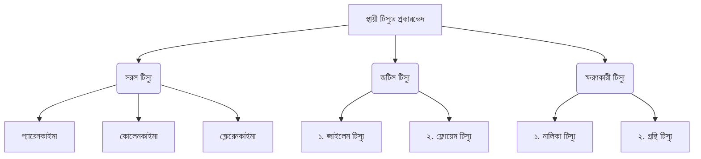

# 07-নগ্নবীজী ও আবৃতবীজী উদ্ভিদ

<!-- ========================================== -->
<!-- PDF Page 1 / 14 -->
<!-- ========================================== -->

ভার্সিটি 'ক' মাস্টার প্রশ্নব্যাংক                                                                  উদ্ভিদবিজ্ঞান: অধ্যায়-০৭

❖ Cycas:
➢ ট্রান্সফিউশন টিস্যু থাকে।
➢ পামফার্ন নামে পরিচিত।
➢ শুক্রাণু ল্যাটিমের মতো, বহু ফ্লাজেলাবিশিষ্ট।
➢ উদ্ভিদকুলের মধ্যে সর্ববৃহৎ।
➢ কচি পাতার ভার্নেশন সারসিনেট।
➢ আর্কিগোনিয়াম সৃষ্টি Cycas এর আদি বৈশিষ্ট্য।
➢ কোরালয়েড মূল বা রুট টিউবারকল থাকে।
➢ স্পোরোফাইট।
➢ বায়ুপরাগী।
➢ পাতা দুই প্রকার: যথা-ছোটো আকৃতির বাদামি বর্ণের রোমশ শল্কপত্র এবং বৃহদাকৃতির সবুজ পল্পপত্র।

----------------------------------------------------------------------------------------------------------------------------------

বিগত ভর্তি পরীক্ষার MCQ প্রশ্ন-সলভ

01. Cycas এর কোরালয়েড মূলের শৈবাল স্তরটি কোথায় অবস্থান করে? [DU’25-26]
(a) এপিডার্মিস (b) ফ্লোয়েম টিস্যু
(c) মধ্য কর্টেক্স (d) পেরিসাইকেল
(c)

02. Cycas-এর কোরালয়েড মূলে পাওয়া যায়- [Jnu’25-26]
(a) Azolla + Nostoc
(b) Anabaena + Azolla
(c) Anabaena + Nostoc
(d) Nostoc + Mycorrhizae
(c)

03. Ephedra-র ক্ষেত্রে কোনটি প্রযোজ্য? [JU’25-26]
(a) বিশ্বের সবচেয়ে প্রাচীন বৃক্ষ
(b) বিশ্বের সবচেয়ে উঁচু কনিফার
(c) দ্বিনিষেক দেখা যায়
(d) জীবন্ত জীবাশ্ম
(c)
ব্যাখ্যা: নগ্নবীজী উদ্ভিদে দ্বিনিষেক ঘটে না, ফলে এন্ডোস্পার্ম হ্যাপ্লয়েড এবং নিষেকের পূর্বে সৃষ্টি হয়। তবে Ephedra এক্ষেত্রে ব্যতিক্রম।

04. Cycas এর অ্যাপোফাইসিস কী? [JU’25-26]
(a) পুংরেণুপত্রের বর্ধিত অংশ
(b) স্পোরাঞ্জিয়া
(c) স্ত্রীরেণুপত্র
(d) স্ত্রীরেণু
(a)

05. কোন সায়ানো ব্যাকটেরিয়ার কারণে সাইকাস উদ্ভিদে প্রবাল মূল সৃষ্টি হয়? [RU’25-26]
(a) Oscillatoria (b) Anabaena
(c) Spirulina (d) Mycrocystis
(b)
ব্যাখ্যা: Nostoc, Anabaena নামক সায়ানোব্যাকটেরিয়াসহ নির্দিষ্ট ব্যাকটেরিয়া দ্বারা আক্রান্ত হয়ে কোরালয়েড মূলের সৃষ্টি হয়।

06. নগ্নবীজী উদ্ভিদে নিচের কোনটি অনুপস্থিত? [CU’25-26]
(a) স্পোরোফিল (b) গর্ভাশয়
(c) ডিম্বক (d) শস্য
(b)

07. Cycas উদ্ভিদের শস্য কোন ধরনের? [CoU’25-26]
(a) হ্যাপ্লয়েড (b) ডিপ্লয়েড
(c) ট্রিপ্লয়েড (d) পলিপ্লয়েড
(a)

08. বিশ্বের সর্বোচ্চ উদ্ভিদ হলো- [DU’24-25]
(a) Shorea faguetiana
(b) Sequoia sempervirens
(c) Eucalyptus regnans
(d) Switonia floribaunda
(b)
ব্যাখ্যা: পৃথিবীর সবচেয়ে উঁচু বৃক্ষ Sequoia sempervirens একটি কনিফার জাতীয় উদ্ভিদ।

09. নিচের কোনটিতে কোরালয়েড মূল পাওয়া যায়? [Jnu’24-25; RU’21-22]
(a) Pinus (b) Cycas
(c) Hibiscus (d) Ficus
(b)

10. কোনটি পৃথিবীর সর্বোচ্চ নগ্নবীজী উদ্ভিদ? [JU’24-25]
(a) Sequoia gigantea
(b) Abies bracteata
(c) Sequiadendron giganteum
(d) Sequoia sempervirens
(d)

11. কোন উদ্ভিদে দ্বি-নিষেক দেখা যায়? [RU, Agri, BUP’24-25]
(a) Ginkgo (b) Gnetum
(c) Ephedra (d) Cycas
(c)
ব্যাখ্যা: নগ্নবীজী উদ্ভিদের মধ্যে কেবল Ephedra তে দ্বিনিষেক দেখা যায়।

12. নগ্নবীজী উদ্ভিদে কোনটি অনুপস্থিত? [RU, Agri ’24-25]
(a) পাতা (b) ফুল
(c) ফল (d) বীজ
(c)

13. নিচের কোন বৃক্ষটি নগ্নবীজী? [RU’24-25; JU’21-22]
(a) Zea mays (b) Thuja sp
(c) Solanum melongena (d) Euphorbia sp
(b)
ব্যাখ্যা: বাগানে লাগানো অবস্থায় Gymnosperm হলো Cycas revoluta, Thuja, Aurucaria, Pinus ইত্যাদি।

14. সাইকাস-এর স্ত্রী প্রজনন অঙ্গের নাম কী? [RU’24-25]
(a) মাইক্রোস্পোরোফিল (b) মেগাস্পোরোফিল
(c) স্পোরোফিল (d) সায়াপ্রোফিল
(b)

৯৯                                                                                                         পরিবর্তনের প্রত্যয়ে নিরন্তর পথচলা...

<!-- ========================================== -->
<!-- PDF Page 2 / 14 -->
<!-- ========================================== -->

ভার্সিটি ‘ক’ মাস্টার প্রশ্নব্যাংক

১৫. নগ্নবীজী গাছে পরাগায়ন হয় না কোন মাধ্যমে?
[HSTU’24-25]
(a) বায়ু ও পানি (b) পানি ও প্রাণী
(c) বায়ু ও পতঙ্গ (d) বায়ু

১৬. কোন নগ্নবীজী উদ্ভিদ আবৃতবীজী উদ্ভিদের নিকটতম?
[BUP’24-25]
(a) Gnetum (b) Cycas
(c) Pinus (d) Podocarpus

১৭. কোন নগ্নবীজী উদ্ভিদের জাইলেম-এ প্রকৃত ভেসেল কোষ থাকে?
[JU’23-24]
(a) Cycas (b) Pinus
(c) Gnetum (d) Ephedra

১৮. কোন উদ্ভিদের বীজ খাদ্য হিসেবে ব্যবহৃত হয়? [JU’23-24]
(a) Cycas circinalis (b) Cycas revoluta
(c) Cycas pectinata (d) Cycas media
ব্যাখ্যা: বীজ খাদ্য হিসেবে ব্যবহৃত হয়- Cycas revoluta.
বার্লি প্রস্তুত, পাকস্থলীর পীড়া ও চর্মরোগের ওষুধ- Cycas circinalis.

১৯. কোন বিভাগের নগ্নবীজী উদ্ভিদ আবৃতবীজী উদ্ভিদের সাথে অধিক ঘনিষ্ঠ?
[CU’23-24]
(a) Cycadophyta (b) Coniferophyta
(c) Ginkgophyta (d) Gnetophyta
ব্যাখ্যা: Gnetophyta বিভাগের উদ্ভিদের কাণ্ডের টিস্যুতে ভেসেল আছে। এদের পাতা আবৃতবীজী উদ্ভিদের মতো, এবং আবৃতবীজী উদ্ভিদের মতো এদের শুক্রাণু ফ্লাজেলাবিহীন।

২০. নিচের কোনটি জীবন্ত জীবাশ্ম? [JU’22-23]
(a) Ginkgo (b) Pteris
(c) Thuja (d) Gnetum

২১. কোন উদ্ভিদের পুংরেণু দেখতে ফুলের মতো? [JU’22-23]
(a) Ephedra (b) Ginkgo
(c) Welwitschia (d) Sequoia

২২. কোন উদ্ভিদের ফুলে গর্ভাশয় নাই? [JU’22-23]
(a) কলা (b) গম
(c) কাঁঠাল (d) সাইকাস

২৩. পৃথিবীর সবচেয়ে উঁচু বৃক্ষ কোন পরিবারের? [JU’22-23]
(a) Moraceae (b) Poaceae
(c) Coniferaceae (d) Dipterocarpaceae

২৪. নগ্নবীজী উদ্ভিদের পরিণত ফ্লোয়েম টিস্যুতে- [RU’22-23]
(a) সঙ্গীকোষ থাকে না
(b) সঙ্গীকোষ থাকে
(c) গর্ভযুক্ত ভেসেল কোষ থাকে
(d) কোনটিই নয়

২৫. Cycas-এর শুক্রাণু হলো- [RU’22-23]
(a) এক ফ্লাজেলাবিশিষ্ট (b) দ্বি-ফ্লাজেলাবিশিষ্ট
(c) বহু ফ্লাজেলাবিশিষ্ট (d) ফ্লাজেলাবিহীন
ব্যাখ্যা: Cycas-এর শুক্রাণু লাটিমের মতো, বহু ফ্লাজেলাবিশিষ্ট এবং উদ্ভিদকুলের মধ্যে সর্ববৃহৎ।

২৬. বাংলাদেশে প্রাকৃতিকভাবে জন্মানো নগ্নবীজী বৃক্ষ কোনটি? [GST’21-22]
(a) তালিপাম (b) সাইকাস
(c) বাঁশপাতা (d) নিটাম

২৭. Cycas-এর পুংরেণু সৃষ্টি হয় কোন কোষ থেকে? [RU’21-22]
(a) স্পোর মাতৃকোষ (b) স্ত্রীরেণু মাতৃকোষ
(c) পুংরেণু পত্র (d) স্পোরাঞ্জিয়াম

২৮. জীবন্ত জীবাশ্ম কোনটি? [GST’21-22; KU’18-19; DU’13-14; CU’08-09, 10-11]
(a) Pinus (b) Cycas
(c) Zamia (d) Podocarpus

২৯. নিচের কোনটিতে কোরালয়েড মূল পাওয়া যায়? [DU’16-17]
(a) Pinus (b) Cycas
(c) Hibiscus (d) Ficus

৩০. কোনটি নগ্নবীজী উদ্ভিদ? [GST’20-21]
(a) বাঁশ (b) ধান
(c) গম (d) সাইকাস

৩১. কোন উদ্ভিদকে পামফার্ন বলা হয়? [Agri’18-19]
(a) Thuja (b) Pteris
(c) Gnetum (d) Cycas
ব্যাখ্যা: Cycas $\rightarrow$ পামফার্ন; Pteris $\rightarrow$ সানফার্ন।

৩২. পৃথিবীতে বর্তমানে জিম্নোস্পার্ম এর কয়টি প্রজাতি আছে? [JU’17-18]
(a) ৪৫০-৫১১ (b) ৪৫০-৫৩১
(c) ৬৫০-৭২১ (d) ৮৫০-৯১১

৩৩. কোন উদ্ভিদের শুক্রাণু সর্ববৃহৎ? [DU’15-16]
(a) Gnetum (b) Ginkgo
(c) Pinus (d) Cycas

---
(E) বিগত ভর্তি পরীক্ষার Written প্রশ্ন-সলভ

০১. ‘জীবন্ত জীবাশ্ম’ বলতে কী বুঝায়?
উত্তর: বর্তমানের কোনো জীবিত উদ্ভিদের বৈশিষ্ট্য যদি অতীতে কোনো জীবাশ্ম উদ্ভিদের বৈশিষ্ট্যের সাথে মিলসম্পন্ন হয় তবে তাকে জীবন্ত জীবাশ্ম বলা হয়। Cycas একটি জীবন্ত জীবাশ্ম।

০২. সারসিনেট ভার্নেশন বলতে কী বুঝায়?
উত্তর: মুকুল অবস্থায় পাতার কুণ্ডলী পাকানো অবস্থাকে সারসিনেট ভার্নেশন বলে।

---
উদ্ভাস একাডেমিক এন্ড এডমিশন কেয়ার | ১০০

<!-- ========================================== -->
<!-- PDF Page 3 / 14 -->
<!-- ========================================== -->

১-০২ অ্যানজিওস্পার্ম উদ্ভিদ

১. **কন্দজ উদ্ভিদ**
➢ পৃথিবীর বৃহত্তম অ্যানজিওস্পার্ম উদ্ভিদ *Wolffia microscopia*
➢ বাংলাদেশের ক্ষুদ্রতম অ্যানজিওস্পার্ম উদ্ভিদ *Wolffia arrhiza*

**অ্যানজিওস্পার্ম ও অ্যানজিওস্পার্মের পার্থক্য:**

| পার্থক্যের বিষয় | অ্যানজিওস্পার্ম উদ্ভিদ | অ্যানজিওস্পার্ম উদ্ভিদ |
| :--- | :--- | :--- |
| (১) গর্ভাশয় ও গর্ভদণ্ড | গর্ভাশয় ও গর্ভদণ্ড আছে | গর্ভাশয় ও গর্ভদণ্ড আছে |
| (২) ফল সৃষ্টি | গর্ভাশয় না থাকায় ফল উৎপন্ন হয় না | গর্ভাশয় থেকে ফল উৎপন্ন হয় |
| (৩) আর্কিপোরিয়া | আর্কিপোরিয়া সৃষ্টি হয় | আর্কিপোরিয়া সৃষ্টি হয় না |
| (৪) দ্বিনিষেক | সাধারণত দ্বিনিষেক ঘটে না | দ্বিনিষেক ঘটে |
| (৫) এন্ডোস্পার্ম (শস্য) | এন্ডোস্পার্ম হ্যাপ্লয়েড। নিষেক পূর্ব উৎপন্ন হয় | এন্ডোস্পার্ম ট্রিপ্লয়েড। নিষেক পরে উৎপন্ন হয় |
| (৬) পরাগযোগের মাধ্যম | বায়ু | বায়ু, পানি ও প্রাণী (কীটপতঙ্গ) |

**কান্ড:**

| প্রকার | উদাহরণ | প্রকার | উদাহরণ |
| :--- | :--- | :--- | :--- |
| ফাঁপা কান্ড | ঘাস গোত্রের (Poaceae) উদ্ভিদ। Cyperaceae তিনকোনা বিশিষ্ট Lamiaceae চারকোনা বিশিষ্ট | বাল্ব (ভূ-নিম্নস্থ প্রতি সংশ্লেষিত রূপান্তরিত কান্ড) | পেঁয়াজ, রসুন ইত্যাদি |
| টিউবার (কান্ডের স্ফীতপ্রান্ত শাঁসালো মজ্জা কান্ড অংশ) | আলু (মিষ্টি আলু মূলের স্ফীত অংশ, কান্ড নয়) | রাইজোম (ভূ-নিম্নস্থ রূপান্তরিত কান্ড) | আদা, হলুদ ইত্যাদি |

**পত্র:**

| প্রকার | উদাহরণ |
| :--- | :--- |
| সরল পত্র | জবা, আম, জাম, কাঁঠাল প্রভৃতি। |
| যৌগিক পত্র | গোলাপ, নিম, লজ্জাবতী, সজিনা, কামিনী প্রভৃতি। |

**পুষ্পবিন্যাস/পুষ্পমঞ্জরী:**

| প্রকার | উদাহরণ |
| :--- | :--- |
| রেসিমোস বা অনির্গত | রেসিম | সরিষা |
| | স্পাইক | রজনীগন্ধা |
| | স্পাইকলেট | ধান, গম, যেকোনো ঘাস |
| | স্প্যাডিক্স | নারিকেল, কচু, কলা |
| | ক্যাপিচুলাম বা শিরমঞ্জরী | গাদা, সূর্যমুখী |
| সাইমোজ বা নিৰ্গত | জবা |

**এস্টিভেশন বা পুষ্পপত্রবিন্যাস:**

| প্রকার | উদাহরণ | প্রকার | উদাহরণ |
| :--- | :--- | :--- | :--- |
| ভালভেট বা প্রান্তস্পর্শী | গর্ভাশয়ের বৃত্তি, জবার উপবৃত্তি | ইমব্রিকেট | কৃষ্ণচূড়া, আলকাতরাসুধা |
| টুইস্টেড বা আবর্ত | জবার বৃত্তি, বাবলা, আকন্দ | কুইনকানসিয়াল | পেয়ারা, সরিষা |
| কুইনকাস বা পাকানো | জবার দলমণ্ডল, করবীর | ভেক্সিলারি | মটরশুঁটি, শিম |

উদ্ভিদ কোষ ও গঠন এবং ১০১ পরিবর্তনের প্রয়োজনে লিখুন...

<!-- ========================================== -->
<!-- PDF Page 4 / 14 -->
<!-- ========================================== -->

উদ্ভিদবিজ্ঞান: অধ্যায়-০৯

**ভার্সিটি ‘ক’ মাস্টার প্রশ্নব্যাংক**

* **প্লাসেন্টেশন বা অমরাবিন্যাস:**

| প্রকারভেদ | উদাহরণ |
| :--- | :--- |
| (i) মার্জিনাল বা একপ্রান্তীয় বা প্রান্তীয় | মটরশুঁটি, শিম। |
| (ii) ফ্রি সেন্ট্রাল বা মুক্তমধ্য | তুত, নুনিয়াশাক। |
| (iii) বেসাল বা মূলীয় | সূর্যমুখী, ত্রিধারা, ধান। |
| (iv) অ্যাক্সাইল বা অক্ষীয় | জবা, ঢেঁড়স। |
| (v) অ্যাপিক্যাল বা শীর্ষক | লালপাতা, ধনিয়া। |
| (vi) সুপারফিসিয়াল বা গাত্রীয় | শালুক, শাপলা, পদ্ম। |
| (vii) প্যারাইটাল বা বহুপ্রান্তীয় | শশা, লাউ। |

* **ফল:**

| ধরন | উদাহরণ | ধরন | উদাহরণ |
| :--- | :--- | :--- | :--- |
| প্রকৃত ফল | আম, জাম, লিচু। | সরোসিস | কাঁঠাল, আনারস। |
| অপ্রকৃত ফল | কাঁঠাল, আপেল। | লিগিউম | শিম, মটর। |
| সরল ফল | আম, ধান। | ক্যাপসুল | ধুতুরা, ঢেঁড়স, পাট। |
| গুচ্ছিত ফল | আতা, স্ট্রবেরি। | সিলিকুয়া | সরিষা, মূলা। |
| যৌগিক ফল | কাঁঠাল, আনারস। | সাইজোকাপ | ধনে, গাজর। |
| ক্যারিওপসিস | ধান, গম। | ড্রুপ | আম, কুল, আমড়া। |
| বেরি | কলা, টমেটো। | হেসপেরিডিয়াম | কমলা, বাতাবীলেবু। |
| পেপো | কুমড়া, শসা। | | |

---

**বিগত ভর্তি পরীক্ষার MCQ প্রশ্ন-সলভ**

01. কোন ধরনের পুষ্পবিন্যাসে প্রান্ত পুষ্পিকা এবং মধ্য পুষ্পিকা থাকে? [DU’25-26]
(a) স্পাইক (b) স্পাইলেট
(c) ক্যাপিতুলাম (d) সাইমোজ (c)
ব্যাখ্যা: ক্যাপিতুলাম বিন্যাসে পুষ্পাধারের ওপর দু’ধরনের পুষ্পিকা যথা- কেন্দ্রে নলাকৃতির মধ্যপুষ্পিকা ও বাইরে জিহ্বাকৃতির প্রান্তপুষ্পিকা থাকে।

02. ফ্লোরাল ডায়াগ্রাম সর্বপ্রথম কোন বিজ্ঞানী প্রবর্তন করেন? [JnU’25-26]
(a) J H Barnhart (b) M F X Bichat
(c) V Honert (d) A W Eichler (d)

03. কাঁপা কাণ্ড পাওয়া যায় কোন গোত্রের উদ্ভিদে? [JU’25-26]
(a) Lamiaceae (b) Malvaceae
(c) Urticaceae (d) Orchidaceae (a)

04. আবৃতবীজী উদ্ভিদের বৈশিষ্ট্য নয় কোনটি? [RU’25-26]
(a) দ্বি-নিষেকের ঘটে (b) বীজের শস্য ট্রিপ্লয়েড
(c) বীজপত্র একটি বা দুইটি (d) গর্ভাশয় থাকে না (d)

05. সূর্যমুখীর অমরাবিন্যাস কোন ধরনের? [RU’25-26]
(a) অ্যাক্সাইল (b) প্যারাইটাল
(c) সুপারফিসিয়াল (d) বেসাল (d)

06. স্প্যাডিংস পুষ্পবিন্যাস কোন উদ্ভিদের বৈশিষ্ট্য?
(a) নারিকেল (b) ধান [RU’25-26]
(c) রজনীগন্ধা (d) সরিষা (a)

07. টুইস্টেড পুষ্পপত্র বিন্যাস কোন উদ্ভিদের বৈশিষ্ট্য? [RU’25-26; 19-20]
(a) জবা (b) পেয়ারা
(c) করবী (d) অপরাজিতা (a)
ব্যাখ্যা: টুইস্টেড এক্ষেত্রে বৃত্তাংশগুলোর (বা পাপড়ির) একটি প্রান্ত অপরটির প্রান্তকে পরস্পর ঢেকে রাখে। যেমন: জবা ফুলের দলমণ্ডল, করবী ফুল।

08. ফলত্বক ও বীজত্বক পরস্পর সংলগ্ন থাকে কোন জাতীয় ফলে? [KU’25-26]
(a) পেপো (b) ড্রুপ
(c) ক্যাপসুল (d) ক্যারিওপসিস (d)
ব্যাখ্যা:
পেপো: বহিঃত্বক চামড়ার মতো, বীজ অমরার সাথে যুক্ত।
ড্রুপ: বহিঃত্বক পাতলা, মধ্যত্বক রসালো ও পুরু, অন্তঃত্বক কাষ্ঠল।
ক্যাপসুল: ফল উপর থেকে নিচে বহু কপাটে বিদীর্ণ হয়।
ক্যারিওপসিস: ফলত্বক ও বীজত্বক পরস্পর সংলগ্ন।

09. আলু একটি রূপান্তরিত- [HSTU’25-26]
(a) মূল (b) কাণ্ড
(c) পাতা (d) গর্ভাশয় (b)

---
**১০২** **উদ্ভাস একাডেমিক অ্যান্ড এডমিশন কেয়ার** **পরিবর্তনের প্রত্যয়ে নিভৃত পথচলা**

<!-- ========================================== -->
<!-- PDF Page 5 / 14 -->
<!-- ========================================== -->

উদ্ভিদবিজ্ঞান: অধ্যায়-০৭

১০. নিচের কোনটি মিথ্যা ফলের উদাহরণ? [Agri’25-26]
(a) আম (b) টমেটো
(c) কলা (d) আপেল
ব্যাখ্যা: True Fruit: আম, জাম, লিচু।
False Fruit: আপেল, কাঁঠাল।
(d)

১১. ক্যাপিচুলাম (হেড) ধরনের পুষ্পমঞ্জরি কোন পরিবারের বৈশিষ্ট্য? [Agri’25-26]
(a) পোয়াসি (b) ব্রাসিকাসি
(c) ফ্যাবাসি (d) অ্যাস্টেরাসি
(d)

১২. দ্বি-নিষেখ কোন উদ্ভিদ গোষ্ঠীর বৈশিষ্ট্য? [Agri’25-26]
(a) জিম্নোস্পার্ম (b) শৈবাল
(c) অ্যাঞ্জিওস্পার্ম (d) ব্রায়োফাইট
(c)

১৩. নিচের কোনটি হেসপেরিডিয়াম (Hesperidium) জাতীয় ফল? [Jnu’24-25; JU’22-23]
(a) কাজু বাদাম (b) কমলা
(c) নারকেল (d) শসা
(b)

১৪. ঢেঁড়সের অমরাবিন্যাস কোনটি? [JU’24-25]
(a) গাত্রীয় (b) বহুপ্রান্তীয়
(c) মুক্তমধ্য (d) অক্ষীয়
(d)

১৫. আবৃতবীজী উদ্ভিদের এন্ডোস্পার্ম কোন ধরনের? [RU’24-25]
(a) হ্যাপ্লয়েড (b) ডিপ্লয়েড
(c) ট্রিপ্লয়েড (d) টেট্রাপ্লয়েড
ব্যাখ্যা: আবৃতবীজী উদ্ভিদের এন্ডোস্পার্ম ট্রিপ্লয়েড ধরনের।
অপরদিকে নগ্নবীজী উদ্ভিদের এন্ডোস্পার্ম হ্যাপ্লয়েড।
(c)

১৬. মটরশুঁটিতে কোন ধরনের অমরাবিন্যাস থাকে? [RU’24-25; JU’21-22]
(a) একপ্রান্তীয় (b) বহুপ্রান্তীয়
(c) মুক্তমধ্য (d) গাত্রীয়
(a)

১৭. গন্ধরাজের বৃত্তিতে বেগন ধরনের এস্টিভেশন দেখা যায়? [RU’24-25]
(a) ওপেন (b) ইমব্রিকেট
(c) টুইস্টেড (d) ভেলভেট
(a)

১৮. কোন উদ্ভিদে এক প্রকোষ্ঠবিশিষ্ট প্রান্তীয় গর্ভাশয় পাওয়া যায়? [RU’24-25]
(a) কুমড়া (b) লাউ (c) মটর (d) বেগুন
(c)

১৯. দ্বিবীজপত্রী উদ্ভিদের পাতার শিরাবিন্যাস কী ধরনের? [RU’24-25]
(a) সমান্তরাল (b) বৃত্তাকার
(c) রৈখিক (d) জালিকার
(d)

২০. বহুপ্রান্তীয় অমরাবিন্যাস কোন উদ্ভিদে পাওয়া যায়? [RU’24-25]
(a) লাউ-শসা (b) শাপলা-পদ্ম
(c) জবা-ধুতুরা (d) ধান-ধনিয়া
(a)

২১. কোন উদ্ভিদের ফুল অধিগর্ভ? [RU’24-25]
(a) পেয়ারা (b) কুমড়া (c) ঢেঁড়স (d) ডালিম
ব্যাখ্যা: ঢেঁড়স, জবা ইত্যাদি Malvaceae গোত্রের উদ্ভিদের ফুল অধিগর্ভ।
(c)

২২. কোনটি এপিগাইনাস ফুলের উদাহরণ? [RU’24-25]
(a) শসা (b) আলু (c) পেঁয়াজ (d) টমেটো
ব্যাখ্যা: কুমড়া, শসা, ইত্যাদি Cucurbitaceae গোত্রের উদ্ভিদের ফুল এপিগাইনাস ধরনের।
(a)

২৩. কোনটি উদ্ভিদের পাতা যৌগিক নয়? [RU’24-25]
(a) গোলাপ (b) সজনে (c) জাম (d) নিম
(c)

২৪. স্পাইকলেট পুষ্পমঞ্জরি কোন উদ্ভিদে দেখা যায়? [RU’24-25]
(a) সূর্যমুখী (b) বেগুন (c) ভুট্টা (d) কচু
(c)

২৫. স্থায়ী বৃত্তি দেখা যায় উদ্ভিদের কোন গোত্রে? [RU’24-25]
(a) Asteraceae (b) Poaceae
(c) Polygonaceae (d) Solanaceae
(d)

২৬. কৃষ্ণচূড়া (Delonix regia) ফুলে কোন ধরনের এস্টিভেশন (পুষ্পপত্র বিন্যাস) দেখা যায়? [KU’24-25; CU’22-23]
(a) Twisted (b) Imbricate
(c) Vexillary (d) Quincuncial
(b)

২৭. ধানের পুষ্পমঞ্জরি কোন ধরনের? [CU’23-24; Jnu’15-16]
(a) রেসিম (b) ক্যাপিচুলাম
(c) সলিটারি (d) স্পাইকলেট
(d)

২৮. নিয়ত বর্ধনশীল মঞ্জরীযুক্ত পুষ্পমঞ্জরি দেখা যায় কোন উদ্ভিদে? [DU’22-23]
(a) রজনীগন্ধা (b) সরিষা
(c) ধান (d) জবা
ব্যাখ্যা: রজনীগন্ধা (স্পাইক), ধান (স্পাইকলেট), সরিষা (রেসিম) ইত্যাদি অনিয়ত পুষ্পমঞ্জরীযুক্ত ফুল।
(d)

২৯. আনারস কোন জাতীয় ফল? [JU’22-23]
(a) সরোসিস (b) বেরি
(c) গুচ্ছিত (d) সিলিকুয়া
(a)

৩০. কোনটি Angiosperm এর অন্তর্ভুক্ত? [JU’21-22]
(a) Podocarpus neriolius
(b) Saccharum officinarum
(c) Gnetum montenum
(d) Cycas revoluta
(b)

৩১. কোনটি যৌগিক ফল? [JU’21-22]
(a) আম (b) কাঁঠাল (c) জাম (d) লিচু
(b)

৩২. জবাতে কোন ধরনের অমরাবিন্যাস থাকে? [JU’21-22; CU’21-22]
(a) শীর্ষক (b) অক্ষীয় (c) মূলীয় (d) গাত্রীয়
(b)

১০৩

পরিবর্তনের প্রত্যয়ে নিভৃত পথচলা...

[CS CamScanner]

<!-- ========================================== -->
<!-- PDF Page 6 / 14 -->
<!-- ========================================== -->

উদ্ভিদবিজ্ঞান: অধ্যায়-৭

ভার্সিটি 'ক' মাস্টার প্রশ্নব্যাংক

৩৩. কোনটি গুচ্ছিত ফল? [JU'21-22]
(a) আতা (b) লিচু (c) আপেল (d) আম
৩৪. সবচেয়ে ক্ষুদ্রতম আবৃতবীজী উদ্ভিদ কোনটি? [CU'21-22]
(a) Wolffia microscopia
(b) Wolffia arrhiza
(c) Mistletoe sp.
(d) Rafflesia sp.
৩৫. দ্বিনিষেক প্রক্রিয়া কোন উদ্ভিদের বৈশিষ্ট্য? [GST'21-22]
(a) ব্রায়োফাইট (b) টেরিডোফাইট
(c) নগ্নবীজী (d) গুপ্তবীজী
৩৬. কোন উদ্ভিদের পুষ্প ট্রাইমেরাস প্রকৃতির?
[Agri'21-22; KU'18-19]
(a) জবা (b) ধান
(c) টমেটো (d) টিউলিপ
৩৭. বহুপ্রান্তীয় অমরাবিন্যাস কোন উদ্ভিদে পাওয়া যায়? [RU'20-21]
(a) শিম (b) সরিষা (c) জবা (d) বেগুন
৩৮. ধান কোন প্রকৃতির ফল? [CU'20-21]
(a) ক্যাপসুল (b) বেরি
(c) সাইজোকার্প (d) ক্যারিওপসিস

৩৯. কোনটিতে গাত্রীয় অমরাবিন্যাস পাওয়া যায়? [DU'18-19]
(a) Oryza sativa (b) Nelumbo nucifera
(c) Helianthus annuus (d) Portulaca oleracea
৪০. নিচের কোনটিতে ইমব্রিকেট পুষ্পপত্র বিন্যাস থাকে? [DU'18-19]
(a) Cassia sophera (b) Brassica napus
(c) Lablab purpureus (d) Pisum sativum
৪১. পুষ্পক উদ্ভিদের বীজের শাঁস হল— [CU'17-18]
(a) হ্যাপ্লয়েড (b) ডিপ্লয়েড
(c) ট্রিপ্লয়েড (d) টেট্রাপ্লয়েড
৪২. Cucumis sativus এর প্লাসেন্টেশন কোন প্রকৃতির? [DU'16-17]
(a) বেসাল (b) শীর্ষক
(c) এক প্রান্তীয় (d) প্যারাইটাল
৪৩. আবৃতবীজী উদ্ভিদের মধ্যে বাংলাদেশে প্রাপ্ত কোনটি
ক্ষুদ্রতম উদ্ভিদ? [KU'16-17]
(a) ইউক্যালিপটাস (b) গর্জন
(c) উলফিয়া (d) বৈলাম
৪৪. লেমা ও প্যালিয়া কিসের অংশ বিশেষ? [DU'15-16]
(a) স্পাইকলেট (b) পরাগধানী
(c) পাতা (d) ডিম্বক

T-03: আবৃতবীজী উদ্ভিদের গোত্র পরিচিতি

কনসেপ্ট রিডিউ
➢ ধানের পুষ্প সংকেত: মপ. টমপ. $\text{+}^{\nearrow}$ $\text{পু}_৩$ $\text{গ}_১$
➢ জবার পুষ্প সংকেত: $\oplus$ $\text{উ}_{৩-৮}$ $\text{দ}_৫$ $\text{পু}_{(\infty)}$ $\text{গর্}_{(৫)}$

❖ Poaceae ও Malvaceae গোত্রের মধ্যে পার্থক্য:

| পার্থক্যের বিষয় | Poaceae | Malvaceae |
| :--- | :--- | :--- |
| (i) স্বরুপ | বর্ষজীবী বা বহুবর্ষজীবী বীরুৎ, কতক বৃক্ষবৎ। | বীরুৎ, গুল্ম বা বৃক্ষ; উদ্ভিদ প্রায় পিচ্ছিল পদার্থযুক্ত। |
| (ii) মূল | গুচ্ছমূল। | প্রধান মূল। |
| (iii) কাণ্ড | নলাকার, অধিকাংশ মধ্যপর্ব ফঁপা। | কাষ্ঠল, শাখাবিত ও বেলনাকার। |
| (iv) পাতা | লিগিউল বিশিষ্ট ও সমান্তরাল শিরাবিন্যাসবিশিষ্ট। | মুক্তপার্শ্বীয় উপপত্রযুক্ত ও জালিকাকার শিরাবিন্যাসবিশিষ্ট। |
| (v) পুষ্প | পুষ্পিকা নামে পরিচিত, অসম্পূর্ণ, ট্রাইমেরাস। | বৃহৎ, সম্পূর্ণ, পঞ্চমেরাস (পেন্টামেরাস)। |
| (vi) পুংস্তবক | পুংকেশর সাধারণত ৩টি (কখনো ৬টি) পরাগধানী রেখাকার ও সর্বমুখ। | পুংকেশর বহু, পরাগধানী একপ্রকোষ্ঠী ও বৃক্কাকার। |
| (vii) স্ত্রীস্তবক | গর্ভপত্র ১টি, গর্ভাশয় একপ্রকোষ্ঠবিশিষ্ট। | গর্ভপত্র ৫-১০টি, গর্ভাশয় সাধারণত ৫ প্রকোষ্ঠবিশিষ্ট। |
| (viii) অমরাবিন্যাস | মূলীয়। | অক্ষীয়। |
| (ix) ফল | ক্যারিওপসিস। | ক্যাপসুল বা বেরি বা সাইজোকার্প। |
| (x) উদাহরণ | ধান, বাঁশ, আখ, গম, ভুট্টা, দূর্বাঘাস, যব, লেমন ঘাস, নলখাগড়া, খড়ুঘাস। | জবা, ঢেঁড়স, কার্পাস তুলা, কেনাফ, মেস্তা বা চুকাইর, ঝুমকো মরিচ ফুল, ইন্ডিয়ান টিউলিপ। |

১০৪

<!-- ========================================== -->
<!-- PDF Page 7 / 14 -->
<!-- ========================================== -->

সিটি 'ক' মাস্টার প্রশ্নব্যাংক                                                                          উদ্ভিদবিজ্ঞান: অধ্যায়-০৭

------------------------------------------------------------------------------------------------------------------------------------------------------------------

**বিগত ভর্তি পরীক্ষার MCQ প্রশ্ন-সলভ**

১. $P_5 A_{\infty} \underline{G}_{(5)}$ এই সংকেতটি কোন উদ্ভিদের পুষ্প সংকেত? [JU'25-26]
(a) ধান (b) জবা (c) তুলা (d) ভুট্টা (b)

২. কোনটি Poaceae গোত্রের বৈশিষ্ট্য নয়? [RU'25-26]
(a) পুষ্পবিন্যাস স্পাইকলেট (b) গর্ভমুণ্ড পালকের ন্যায়
(c) অমরাবিন্যাস প্রান্তীয় (d) ফল ক্যারিওপসিস (c)

৩. ধানের অমরাবিন্যাস- [HSTU'25-26]
(a) প্রান্তীয় (b) মূলীয়
(c) বহুপ্রান্তীয় (d) মুক্তকেন্দ্রীয় (b)

৪. কোনটি Malvaceae গোত্রের শনাক্তকরণ বৈশিষ্ট্য নয়? [CoU'25-26]
(a) বৃত্যাংশ ৫টি (b) একক পুষ্প
(c) কাষ্ঠল কাণ্ড (d) গর্ভপত্র ৫টি (a)

৫. সর্বমুখ পরাগধানী যে পরিবারে দেখা যায়- [DU'24-25]
(a) সাইপেরাসি (b) মালভেসি
(c) পোয়াসি (d) ফেবেসি (c)
ব্যাখ্যা: মালভেসি $\rightarrow$ পরাগধানী বৃক্কাকার।
পোয়াসি $\rightarrow$ পরাগধানী সর্বমুখ।

৬. নিচের কোনটি Poaceae গোত্রের উদ্ভিদ নয়? [JnU'24-25]
(a) *Triticum aestivum*
(b) *Oryza sativa*
(c) *Cynodon dactylon*
(d) *Gossypium herbaceum* (d)

৭. বাংলাদেশে এ যাবৎ Poaceae গোত্রের কতটি গণ শনাক্ত হয়েছে? [JU'24-25]
(a) ১৩ (b) ২৩ (c) ৭৩ (d) ১১৩ (d)

৮. Poaceae গোত্রের ফলের নাম কী? [RU'24-25, 22-23, JU'23-24; Agri'21-22, DU'19-20]
(a) ম্যালও (b) ক্যারিওসীনাস
(c) পডোকার্পস (d) ক্যারিওপসিস (d)

৯. পেন্টামেরাস পুষ্প দেখা যায় কোন উদ্ভিদে? [RU'24-25]
(a) টমেটো (b) ধান
(c) কাউন (d) খেজুর (a)

১০. কোন উদ্ভিদের ফুলের নাম পুষ্পিকা? [RU'24-25]
(a) ঘাস (b) পাট
(c) কাঁঠাল (d) মটরশুঁটি (a)

১১. ক্যারিওপসিস কোন গোত্রের বৈশিষ্ট্য? [RU'24-25]
(a) Malvaceae (b) Solanaceae
(c) Poaceae (d) Liliaceae (c)

১২. কোন গোত্রে বৃক্কাকার পরাগধানী পাওয়া যায়? [CoU'24-25]
(a) Malvaceae (b) Liliaceae
(c) Cruciferae (d) Leguminosae (a)

১৩. পালকের ন্যায় গর্ভমুণ্ড থাকে কোন উদ্ভিদে? [Agri'24-25]
(a) *Allium sativum* (b) *Triticum aestivum*
(c) *Hibiscus cannabinus* (d) *Hibiscus mutabilis* (b)
ব্যাখ্যা: পালকের ন্যায় গর্ভমুণ্ড থাকে একবীজপত্রী উদ্ভিদে। *Triticum aestivum* একটি একবীজপত্রী উদ্ভিদ।

১৪. Poaceae গোত্রের উদ্ভিদ কোনটি? [GST'23-24]
(a) বাঁশ (b) জবা
(c) বন ওকড়া (d) স্থলপদ্ম (a)
ব্যাখ্যা: Poaceae গোত্রের কিছু গুরুত্বপূর্ণ উদ্ভিদ: বাঁশ, ধান, আখ, গম ইত্যাদি এবং জবা, বন ওকড়া ও স্থলপদ্ম Malvaceae গোত্রের।

১৫. কোন গোত্রের উদ্ভিদের পরাগরেণু বৃহৎ এবং কন্টকিত? [CoU'22-23]
(a) Poaceae (b) Liliaceae
(c) Malvaceae (d) Solanaceae (c)

১৬. দুর্বাঘাস একটি- [CoU'22-23]
(a) বর্ষজীবী উদ্ভিদ (b) দ্বিবর্ষজীবী উদ্ভিদ
(c) বহুবর্ষজীবী উদ্ভিদ (d) কোনটিই নয় (c)

১৭. Lodicule যে পরিবারের বৈশিষ্ট্য- [CoU'22-23]
(a) Malvaceae (b) Poaceae
(c) Cycadaceae (d) Cruciferae (b)

১৮. তোষা পাট একটি- [CoU'22-23]
(a) বৃক্ষ (b) গুল্ম
(c) কাষ্ঠল বীরুৎ (d) কোনটিই নয় (d)

১৯. Floral formula লিখতে উপমঞ্জরীপত্রের জন্য ব্যবহৃত হয় কোনটি? [JU'21-22]
(a) Url. (b) Brl. (c) Erl. (d) Frl. (b)

২০. Floral formula লিখতে মঞ্জরীপত্রের জন্য ব্যবহৃত হয় কোনটি? [JU'21-22]
(a) Br. (b) Kr. (c) Ar. (d) Mr. (a)

২১. আমিষ সরবরাহকারী উদ্ভিদতাত্ত্বিক পরিবারের নাম কী? [Agri'19-20]
(a) গ্রামিনি (b) সোলানেসি
(c) মালভেসি (d) ফ্যাবাসি (d)

------------------------------------------------------------------------------------------------------------------------------------------------------------------
উদ্ভাস একাডেমিক এন্ড এডমিশন কেয়ার                                           ১০৫                                           পরিবর্তনের প্রত্যয়ে নিরন্তর পথচলা...

<!-- ========================================== -->
<!-- PDF Page 8 / 14 -->
<!-- ========================================== -->

ভার্সিটি 'ক' মাস্টার প্রশ্নব্যাংক

২২. ডালজাতীয় ফসলের উদ্ভিদতাত্ত্বিক পরিবারের নাম কী?
(a) ক্রুসিফেরি
(b) গ্রামিনি [BAU'18-19]
(c) লিগিউমিনোসি
(d) সোলানেসি
(c)

২৩. সর্বমুখ পরাগধানী, পালকের ন্যায় গর্ভমুণ্ড, ক্যারিওপসিস ফল কোন গোত্রের শনাক্তকারী বৈশিষ্ট্য? [DU'17-18]
(a) Malvaceae
(b) Poaceae
(c) Liliaceae
(d) Tiliaceae
(b)

২৪. আখের বৈজ্ঞানিক নাম- [Jnu'17-18]
(a) Zea mays
(b) Triticum aestivum
(c) Pisum sativum
(d) Saccharum officinarum
(d)

২৫. কোনটি Poaceae গোত্রের উদ্ভিদ নয়? [CU'17-18]
(a) বাঁশ
(b) ধান
(c) আখ
(d) তাল
(d)

২৬. Malvaceae গোত্রের পুংস্তবকের গঠন কী? [DU'13-14]
(a) টেট্রাডিনেমাস
(b) দ্বিগুচ্ছক
(c) একগুচ্ছক
(d) বহুগুচ্ছক
(c)

---
(চিহ্ন) বিগত ভর্তি পরীক্ষার Written প্রশ্ন-সলভ
---

০১. উদাহরণসহ Poaceae গোত্রের চারটি শনাক্তকারী বৈশিষ্ট্য লিখ? [DU'25-26, 22-23]
উত্তর: উদাহরণসহ Poaceae গোত্রের চারটি শনাক্তকারী বৈশিষ্ট্য নিম্নরূপ:
(i) কাণ্ড সাধারণত নলাকার, মধ্যপর্ব ফাঁপা
(ii) পরাগধানী সর্বমুখ
(iii) ফল ক্যারিওপসিস
(iv) গর্ভাশয় এক প্রকোষ্ঠবিশিষ্ট
উদাহরণ: ধান (Oryza sativa L.), বাঁশ (Bambusa bambos) ইত্যাদি।

N.B: অন্যান্য বৈশিষ্ট্যসমূহ:
➢ পাতা লিগিউলবিশিষ্ট
➢ পত্রমূল কাণ্ডবেষ্টক
➢ পুষ্পবিন্যাস (মঞ্জরী) স্পাইকলেট
➢ গর্ভমুণ্ড পালকের ন্যায়
➢ অমরাবিন্যাস মূলীয়

---

০২. মালভেসি গোত্রের পাঁচটি শনাক্তকারী বৈশিষ্ট্য লিখ। [DU]
উত্তর: মালভেসি গোত্রের পাঁচটি শনাক্তকারী বৈশিষ্ট্য:
(i) উদ্ভিদের কচি অংশ রোমশ ও মিউসিলেজ পূর্ণ (পিচ্ছিল পদার্থযুক্ত)।
(ii) উপপত্র মুক্তপার্শ্বীয়।
(iii) পুষ্প একক এবং সাধারণত উপবৃতিযুক্ত।
(iv) পুংকেশর বহু, একগুচ্ছক, পুংকেশরীয় নালিকা গর্ভদণ্ডকে চারদিকে বেষ্টিত।
(v) পরাগধানী এক প্রকোষ্ঠী (এককোষ্ঠী নয়) ও বৃক্কাকার।

০৩. Malvaceae গোত্রের উল্লেখযোগ্য তিনটি উদ্ভিদের ব্যবহার ও তাদের অর্থনৈতিক গুরুত্ব লিখ। [Jnu]
উত্তর: Malvaceae গোত্রের উল্লেখযোগ্য তিনটি উদ্ভিদের ব্যবহার ও তাদের অর্থনৈতিক গুরুত্ব নিচে বর্ণনা করা হলো:
(a) জবা (Hibiscus rosa-sinensis Linn.) এর অর্থনৈতিক গুরুত্ব:
(i) ফুলের জন্য একে বাগানে লাগানো হয়।
(ii) জবা ফুলের রস মাথায় মাখলে মাথা ঠান্ডা থাকে, চুল কালো ও লম্বা হয়।
(iii) এর রস চুল পড়া বন্ধ করে, নতুন চুল জন্মায় ও চুল উজ্জ্বল করে।
(iv) জবাকুসুম তেলের এটি একটি উপাদান।
(b) ঢেঁড়স (Abelmoschus esculentus Linn.Moench) এর অর্থনৈতিক গুরুত্ব:
(i) ঢেঁড়স এর প্রধান ব্যবহার সবজি হিসেবে।
(ii) এটি স্যুপ তৈরিতেও ব্যবহৃত হয়।
(iii) এর ভেষজ গুরুত্বও আছে। কচি ঢেঁড়সে লৌহ বা আয়রন আছে। নিয়মিত খেলে শারীরিক দুর্বলতা সারে।
(iv) এটি বহুমূত্র রোগেরও উপকার করে থাকে।
(v) ঢেঁড়স গাছ হতে ভালো আঁশ পাওয়া যায়।
(c) কার্পাস তুলা (Gossypium herbaceum Linn.) এর অর্থনৈতিক গুরুত্ব:
(i) এর বীজতক থেকে তুলা পাওয়া যায়।
(ii) কার্পাস তুলা হতে সুতা হয়। সুতা হতে সুতি কাপড় তৈরি হয়।
(iii) লেপ, তোষক তৈরিতে কার্পাস তুলার ব্যবহার হয়।

০৪. জবা ফুলের পুষ্প সংকেত লিখ। [RU'14]
উত্তর: পুষ্প সংকেত: $$\oplus \text{ উপবৃতি}_{(৫)} \text{ বৃত্তি}_{(৫)} \text{ দল}_{(৫)} \text{ পুং}_{(\infty)} \text{ স্ত্রী}_{(৫)}$$

---

“চোখকে নয়, মনোযোগকে আকৃষ্ট করে এমন কিছুর পিছনে দৌড়াও!”
- রয় টি. বেনেট

---
উদভাস একাডেমিক এন্ড এডমিশন কেয়ার | ১০৬ | পরিবর্তনের প্রত্যয়ে নিরন্তর পথচলা

<!-- ========================================== -->
<!-- PDF Page 9 / 14 -->
<!-- ========================================== -->

ডাইজেস্ট 'ক' মাস্টার ড্রয়ব্যাক                                                                           উদ্ভিদবিজ্ঞান: অধ্যায়-০৭

                                  প্র্যাকটিস প্রবলেম
                প্রথমে নিজে চেষ্টা করো; অতঃপর উত্তরের সাথে মিলিয়ে নাও।

| MCQ প্র্যাকটিস প্রবলেম | |
| :--- | :--- |
| 01. Poaceae গোত্রের পুষ্পপত্র বিন্যাস কী ধরনের? [হাসান স্যার] | 16. জবা ফুলের গর্ভপত্রের সংখ্যা কয়টি? [হাসান স্যার] |
| (a) স্পাইক (b) রেসিম (c) স্প্যাডিংস (d) স্পাইকলেট | (a) এক (b) তিন (c) পাঁচ (d) সাত |
| 02. নগ্নবীজী কীসের মাধ্যমে পরাগায়ন ঘটে? [হাসান স্যার] | 17. কার্পাস তুলার বৈজ্ঞানিক নাম কী? [হাসান স্যার] |
| (a) প্রাণী (b) পতঙ্গ (c) বাতাস (d) পানি | (a) *Abelmoschus esculentus* (b) *Gossypium herbaceum* |
| 03. Cycas উদ্ভিদের মূলদেহ কোন ধরনের? [হাসান স্যার] | (c) *Hibiscus cannabinus* (d) *Thespesia populnea* |
| (a) Haploid (b) Diploid (c) Triploid (d) Tetraploid | 18. Malvaceae গোত্রের দলের পুষ্পপত্রবিন্যাস কোন ধরনের? [হাসান স্যার] |
| 04. স্পোরাঞ্জিয়া একত্রিত হয়ে কী গঠন করে? [হাসান স্যার] | (a) ওপেন (b) ভালভেট (c) ইমব্রিকেট (d) টুইস্টেড |
| (a) স্পোর (b) স্ট্রোবিলাস (c) সোরাস (d) মেগাস্পোর | 19. বহুমূত্র রোগে কোনটি উপকারী? [হাসান স্যার] |
| 05. কোন উদ্ভিদের যৌন জননে মেগাস্পোর ও মাইক্রোস্পোর তৈরি হয়? [হাসান স্যার] | (a) জবা (b) ধুতুরা (c) তেঁতুল (d) হলপনা |
| (a) শৈবাল (b) ছত্রাক (c) সাইকাস (d) টেরিস | 20. Cycas এর শুক্রাণুর আকৃতি কীরূপ? [হাসান স্যার] |
| 06. বৃত্তিকে কোনটি দ্বারা চিহ্নিত করা হয়? [হাসান স্যার] | (a) বেলনাকার (b) মোচাকৃতির (c) লাটিমাকৃতির (d) পেয়ালাকৃতির |
| (a) K (b) Ep (c) Ck (d) Ek | 21. Cycas এর আদি বৈশিষ্ট্য হলো- [হাসান স্যার] |
| 07. টেপাল কার অংশ? [হাসান স্যার] | (a) ফ্ল্যাজেলাযুক্ত শুক্রাণু (b) মাইক্রোস্পোরোফিল (c) সোরাস (d) আর্কিগোনিয়াম |
| (a) দলমণ্ডল (b) পুষ্পপুট (c) বৃত্তি (d) উপবৃত্তি | 22. আবৃতবীজী উদ্ভিদ নয় কোনটি? [হাসান স্যার] |
| 08. বেরি জাতীয় ফল কোনটি? [হাসান স্যার] | (a) *Triticum* (b) *Oryza* (c) *Hibiscus* (d) *Gnetum* |
| (a) টমেটো (b) শিম (c) মটর (d) পাট | 23. নিম্নের কোনটি নগ্নবীজী উদ্ভিদের বৈশিষ্ট্য? [হাসান স্যার] |
| 09. শীর্ষদেশীয় (Apical) অমরাবিন্যাসের উদাহরণ কোনটি? [হাসান স্যার] | (a) সমরেণুপ্রসু (b) স্পোরোফাইট (c) গ্যামিটোফাইট (d) গর্ভাশয় আছে |
| (a) লাল পাতা (b) শাপলা (c) জবা (d) সরিষা | 24. কোনটি থেকে শ্বাসকষ্টের ঔষধ ইফেক্ট্রিন পাওয়া যায়? [হাসান স্যার] |
| 10. বাংলাদেশে কত প্রজাতির বাঁশ পাওয়া যায়? [হাসান স্যার] | (a) *Cycas* (b) *Pinus* (c) *Gnetum* (d) *Ephedra* |
| (a) ২৬ (b) ২৭ (c) ২৮ (d) ২৯ | 25. Cycas এর প্রতিটি পাতা- [হাসান স্যার] |
| 11. পুংপুষ্পের সাংকেতিক চিহ্ন কোনটি? [হাসান স্যার] | (a) অপক্ষ যৌগিক (b) পক্ষল যৌগিক (c) দ্বিপক্ষল যৌগিক (d) কোনটি নয় |
| (a) % (b) ♀ (c) ♂ (d) ⊕ | 26. Fibrous root দেখা যায় কোনটিতে? [হাসান স্যার] |
| 12. কোনটি Poaceae গোত্রের উদ্ভিদ? [হাসান স্যার] | (a) ধান (b) দূর্বা (c) অর্কিড (d) অশ্বত্থ |
| (a) *Hibiscus rosa-sinensis* (b) *Zea mays* | 27. কোনটি বীরুৎ জাতীয় উদ্ভিদ নয়? [হাসান স্যার] |
| (c) *Gossypium herbaceum* (d) *Abelmoschus esculentus* | (a) ধান (b) গম (c) দূর্বাঘাস (d) আম |
| 13. বার্লির বৈজ্ঞানিক নাম কী? [হাসান স্যার] | 28. কোনটি উপগুল্ম জাতীয় উদ্ভিদ? [হাসান স্যার] |
| (a) *Triticum aestivum* (b) *Oryza sativa* | (a) দূর্বাঘাস (b) জাম (c) গোলাপ (d) কলকাসুন্দা |
| (c) *Zea mays* (d) *Hordeum vulgare* | |
| 14. রক্তপাত বন্ধ ও ক্ষত নিরাময়ে ব্যবহৃত হয় কোনটি? [হাসান স্যার] | **MCQ উত্তরমালা** |
| (a) উলুঘড় (b) লেবুঘাস (c) দূর্বাঘাস (d) বার্লি | |
| 15. জবা ও ধানের অমরাবিন্যাস যথাক্রমে- [হাসান স্যার] | **01. d | 02. c | 03. b | 04. c | 05. c | 06. a | 07. b** |
| (a) অক্ষীয় ও মূলীয় (b) একপ্রান্তীয় ও বহুপ্রান্তীয় | **08. a | 09. a | 10. c | 11. c | 12. b | 13. d | 14. c** |
| (c) অক্ষীয় ও বহুপ্রান্তীয় (d) মূলীয় ও বহুপ্রান্তীয় | **15. a | 16. c | 17. b | 18. d | 19. c | 20. c | 21. d** |
| | **22. d | 23. b | 24. d | 25. b | 26. a | 27. d | 28. d** |

১০৭                                                                      উদ্ভাস একাডেমিক এন্ড এডমিশন কেয়ার                                                    পরিবর্তনের প্রত্যয়ে দীপ্ত পথচলা...

<!-- ========================================== -->
<!-- PDF Page 10 / 14 -->
<!-- ========================================== -->

উদ্বিদবিজ্ঞান: অধ্যায়-৭

**ভার্সিটি ‘ক’ মাস্টার প্রশ্নব্যাংক**

২৯. নিম্নের কোনটি গুচ্ছ মূল?
(a) মুলা (b) গাজর (c) বীট (d) ধান

৩০. ভূ-নিম্নস্থ রূপান্তরিত কাণ্ড নয় কোনটি?
(a) টিউবার (b) রাইজোম (c) বাল্ব (d) স্টিপিউল

৩১. টিউবার কাণ্ডের উদাহরণ নিচের কোনটি?
(a) পেঁয়াজ (b) রসুন (c) আদা (d) আলু

৩২. কোনটি বাল্ব কাণ্ড?
(a) পেঁয়াজ (b) আলু (c) আদা (d) হলুদ

৩৩. কোনটি রানার কাণ্ডের উদাহরণ?
(a) থানকুনি (b) রসুন (c) আদা (d) আলু

৩৪. কোনটি মূলের স্ফীত অংশ?
(a) মিষ্টি আলু (b) রসুন (c) আদা (d) আলু

৩৫. রেসিম পুষ্পমঞ্জরী কোথায় পাওয়া যায়?
(a) সরিষা (b) বাবলা (c) সূর্যমুখী (d) নারিকেল

৩৬. লেমা কোন ধরনের রেসিমোস?
(a) রেসিম (b) স্পাইক (c) স্পাইকেলেট (d) ক্যাপিচুলেট

৩৭. কোনটিতে মুক্ত এস্টিভেশন দেখা যায়?
(a) আতা (b) আকন্দ (c) গন্ধরাজ (d) বাবলা

৩৮. পেয়ারা ফুলে কোন এস্টিভেশন দেখা যায়?
(a) কুইনকানসিয়াল (b) ভেক্সিলারি (c) ওপেন (d) ভালভেট

৩৯. মটরশুঁটি ফুলে কোন এস্টিভেশন দেখা যায়?
(a) ইমব্রিকেট (b) ওপেন (c) ভালভেট (d) ভেক্সিলারি

৪০. কোনটি Zygomorphic ফুল?
(a) কলাবতী (b) রজনীগন্ধা (c) অপরাজিতা (d) ধুতুরা

৪১. এপিগাইনাস বা গর্ভশীর্ষ পুষ্প কোনটি?
(a) শিম (b) পেয়ারা (c) মটর (d) জবা

৪২. পেরিগাইনাস বা গর্ভকটি পুষ্প কোনটি?
(a) ধুতুরা (b) গোলাপ (c) সরিষা (d) আপেল

৪৩. কোনটি বেসাল বা মূলীয় প্লাসেন্টেশনের উদাহরণ?
(a) ত্রিধারা (b) ধান (c) সূর্যমুখী (d) সবগুলো

৪৪. কোনটি এক্সাইল বা অক্ষীয় প্লাসেন্টেশনের উদাহরণ?
(a) জবা (b) শসা (c) ত্রিধারা (d) নুনিয়া শাক

৪৫. কোনটি প্রকৃত ফল?
(a) আতা (b) আপেল (c) আম (d) আঙুর

৪৬. আনারস কী জাতীয় ফল?
(a) সরল ফল (b) গুচ্ছিত ফল (c) যৌগিক ফল (d) কোনটিই নয়

৪৭. Cycas উদ্ভিদের কোন অঙ্গটি সাপের ফণার ন্যায়?
(a) মেগাস্পোরোফিল (b) মাইক্রোস্পোরোফিল (c) স্ট্রোবিলাস (d) কোরালয়েড মূল

৪৮. কোনটি সিলিকুয়া ফলের উদাহরণ?
(a) কলা (b) টমেটো (c) সরিষা (d) ধনে

৪৯. নগ্নবীজী উদ্ভিদের—
(a) গর্ভাশয় নেই কিন্তু গর্ভমুণ্ড আছে
(b) শাঁস ডিপ্লয়েড
(c) সাধারণত আর্কিগোনিয়া সৃষ্টি হয়
(d) ফ্লোয়েম টিস্যুতে সঙ্গী কোষ থাকে

৫০. Malvaceae গোত্রের উদ্ভিদের ফল কোন ধরনের হয়?
(a) ক্যাপসিউল (b) বেরি (c) সাইজোকাপ (d) সবগুলো

৫১. রক্ত আমাশয় ও অর্শ রোগের ভালো ওষুধ নিচের কোনটি?
(a) জবা ফুল (b) ঢেঁড়স (c) বাসক (d) পানকুড়ি

৫২. Malvaceae গোত্রের সবচেয়ে বড় গণ হলো—
(a) Gossypium (b) Abelmoschus (c) Abutilon (d) Hibiscus

৫৩. কোনটি বাংলাদেশে বাঁশপাতা নামে পরিচিত?
(a) Cycas pectinata (b) Gnetum montanum (c) Gnetum oblongum (d) Podocarpus nerifolia

৫৪. অচ্ছদপক্ষল যৌগিক পত্র কোন উদ্ভিদে দেখা যায়?
(a) বাঁদর লাঠি (b) গোলাপ (c) কৃষ্ণচূড়া (d) সজিনা

৫৫. ত্রিপক্ষল যৌগিক পত্র কোন উদ্ভিদে দেখা যায়?
(a) বাঁদর লাঠি (b) গোলাপ (c) কৃষ্ণচূড়া (d) সজিনা

৫৬. সূর্যমুখীতে কোন ধরনের পুষ্পবিন্যাস দেখা যায়?
(a) ক্যাপিচুলাম (b) সাইমোস (c) রেসিম (d) স্প্যাডিক্স

৫৭. লেমন ঘাসের বৈজ্ঞানিক নাম কোনটি?
(a) Hordeum vulgare (b) Saccharum officinarum (c) Cymbopogon citratus (d) Zea mays

৫৮. লিগুলবিশিষ্ট পাতা, পালকের ন্যায় গর্ভমুণ্ড, এক প্রকোষ্ঠী গর্ভাশয়- কোন গোত্রের শনাক্তকারী বৈশিষ্ট্য?
(a) Malvaceae (b) Poaceae (c) Liliaceae (d) Tiliaceae

৫৯. স্পাইকেলেটের গোড়ায় কয়টি শূন্য গ্লুম থাকে?
(a) ১টি (b) ২টি (c) ৩টি (d) একটিও না

৬০. কোনটি দ্বিবীজপত্রী উদ্ভিদের বৈশিষ্ট্য নয়?
(a) পুষ্প টেট্রামেরাস বা পেন্টামেরাস
(b) মূল প্রধান মূল
(c) পাতার শিরাবিন্যাস জালিকাকার
(d) পরাগধানী সর্বমুখ

| MCQ উত্তরমালা |
|:---|:---|:---|:---|
| 29. d | 30. d | 31. d | 32. a | 33. a | 34. a |
| 35. c | 37. c | 38. a | 39. d | 40. c | 41. b |
| 43. d | 44. a | 45. c | 46. c | 47. a | 48. c |
| 50. d | 51. a | 52. d | 53. d | 54. a | 55. d |
| 57. c | 58. b | 59. b | 60. d | | |

১০৮
উদ্ভাস একাডেমিক এন্ড এডমিশন কেয়ার | পরিবর্তনের প্রত্যয়ে পথচলা

<!-- ========================================== -->
<!-- PDF Page 11 / 14 -->
<!-- ========================================== -->

ভার্সিটি 'ক' মাস্টার প্রশ্নব্যাংক                                                                  উদ্ভিদবিজ্ঞান: অধ্যায়

                                        **প্যাকটিস প্রবলেমের সমাধান**

------------------------------------------------------------------------------------------------------------------------------------------------------

           **MCQ প্যাকটিস প্রবলেমের সমাধান**

০৪. ব্যাখ্যা: (c); সাইকাসের পুংরেণুপত্রের পৃষ্ঠদেশে বহু স্পোরাঞ্জিয়া অবস্থান করে; ২-৫ টি স্পোরাঞ্জিয়া একত্রে সোরাস বলা হয়।
০৫. ব্যাখ্যা: (c); হ্যাপ্লয়েড পুংরেণুকে মাইক্রোস্পোর ও হ্যাপ্লয়েড স্ত্রীরেণুকে মেগাস্পোর বলে। মেগাস্পোর হতে আর্কিগোনিয়াম সৃষ্টি হয়।
০৭. ব্যাখ্যা: (b); পুষ্পপুট এর প্রতিটি সদস্যকে বলা হয় টেপাল। বৃত্তি এবং দলকে যখন আকৃতি ও বর্ণে পৃথক করা যায় না অর্থাৎ দেখতে একই রকম দেখায় তখন এদেরকে একত্রে পুষ্পপুট বলে।
০৮. ব্যাখ্যা: (a); মনে রাখার কৌশল:
      কেটবেরী
        ↓
      কলা টমেটো
১১. ব্যাখ্যা: (c); পুষ্প সংকেতে ব্যবহৃত চিহ্নসমূহ-
      একপ্রতিসম পুষ্প - $\dagger$;       বহুপতিসম পুষ্প - $\oplus$
      পুংপুষ্প - $\sigma$;              স্ত্রীপুষ্প - $♀$
      উভলিঙ্গ পুষ্প - $⚥$
১৫. ব্যাখ্যা: (a); জবা যেহেতু Malvaceae গোত্রের অন্তর্ভুক্ত, তাই এর অমরাবিন্যাস অক্ষীয় আর ধান যেহেতু Poaceae গোত্রের অন্তর্ভুক্ত, তাই এর অমরাবিন্যাস মূলীয়।
১৮. ব্যাখ্যা: (d); Malvaceae (জবা) দলের পুষ্পপ্রতীকন্যাস - Malvaceae → (জবা) বৃত্তির পুষ্পপ্রতীকন্যাস → ভাল্ভেট, জবার উপবৃত্তির পুষ্পপ্রতীকন্যাস → ওপেন।
২১. ব্যাখ্যা: (d); Cycas মেগাস্পোরোফিল হতে আর্কিগোনিয়াম সৃষ্টি হয় না। আর্কিগোনিয়ামের ভেতর ডিম্বাণু উৎপন্ন হয় না। আর্কিগোনিয়াম সাইকাসের একটি আদিবৈশিষ্ট্য।
৪৮. ব্যাখ্যা: (c); সিলিকুয়া ফলের উদাহরণ: সরিষা, মুলা।
৫৩. ব্যাখ্যা: (d); *Podocarpus neriifolius* একটি নগ্নবীজী উদ্ভিদ যা বাংলাদেশে বাঁশপাতা নামে পরিচিত এবং এটি কক্সবাজার ও সিলেট বনাঞ্চলে পাওয়া যায়।
৫৪. ব্যাখ্যা: (a); অচূড় পক্ষল যৌগিক পত্রের উদাহরণ: বাঁশ। এই ক্ষেত্রে র‍্যাকিসের চূড়ায় কোনো পাতা থাকে না অর্থাৎ জোড় সংখ্যায় থাকে।
৫৫. ব্যাখ্যা: (d); অচূড় পক্ষল যৌগিক পত্র – বাঁদর লাঠি
      সচূড় পক্ষল যৌগিক পত্র – গোলাপ গাছের পাতা
      দ্বিপক্ষল যৌগিক পত্র – কৃষ্ণচূড়া
      ত্রিপক্ষল যৌগিক পত্র – সজিনার পাতা
৬৪. ব্যাখ্যা: (b); ভেক্সিলারি এস্টিভেশনের উদাহরণ: মটর, শিম, অপরাজিতা।
৬৯. ব্যাখ্যা: (a); জবা ফুলের বৈশিষ্ট্য: উপপত্রযুক্ত, মুক্তপার্শ্বীয়, গর্ভপাদ পুষ্পী, দলমণ্ডল টুইস্টেড।
৭০. ব্যাখ্যা: (b); *Hibiscus cannabinus*, Malvaceae গোত্রের উদ্ভিদ; বাকি উদ্ভিদসমূহ Poaceae গোত্রের।

------------------------------------------------------------------------------------------------------------------------------------------------------

           **Written প্যাকটিস প্রবলেমের সমাধান**

০১. উত্তর: নগ্নবীজী উদ্ভিদের ৫টি বৈশিষ্ট্য নিম্নরূপ:
      (i) দেহ স্পোরোফাইটিক, অর্থাৎ মূল, কাণ্ড, ও পাতায় বিভক্ত।
      (ii) জাইলেমে ভেসেল (ব্যতিক্রম *Gnetum*) এবং ফ্লোয়েমে সঙ্গীকোষ অনুপস্থিত।
      (iii) সকলেই অসমরেণুপ্রসূ (Heterosporous) অর্থাৎ পুরুষ ও স্ত্রী স্পোর তৈরি করে।
      (iv) সাধারণত আর্কিগোনিয়া তৈরি হয়, যা একটি উন্নত বৈশিষ্ট্য।
      (v) হ্যাপ্লয়েড শস্য, নিষেকের পূর্বে সৃষ্টি হয়।
০২. উত্তর: *Cycas* এর ৫টি বৈশিষ্ট্য নিম্নরূপ:
      (i) উদ্ভিদ খাড়া পাম জাতীয়, বীজ উৎপন্ন হয় কিন্তু ফল উৎপন্ন হয় না।
      (ii) পাতা বৃহৎ, পক্ষল যৌগিক, কাণ্ডের মাথার দিকে সর্পিলাকারে সজ্জিত।
      (iii) কচি পাতার ভার্নেশন সারসিনেট (কুগুলিত)।
      (iv) গৌণ অস্থানিক কোরালয়েড মূল আছে।
      (v) পুংরেণুপত্র স্ট্রোবিলাস তৈরি করে কিন্তু স্ত্রীরেণুপত্র স্ট্রোবিলাস তৈরি করে না।
০৩. উত্তর: *Cycas* উদ্ভিদের সাথে ফার্নের ৪টি সাদৃশ্য নিম্নরূপ:
      (i) *Cycas* ও ফার্ন উভয়ই স্পোরোফাইট। দেহ মূল, কাণ্ড ও পাতায় বিভক্ত।
      (ii) উভয়ের পাতা পক্ষল যৌগিক।
      (iii) উভয়ের কচি পাতা কুগুলিত অবস্থায় থাকে।
      (iv) উভয় উদ্ভিদের শুক্রাণু বহু ফ্ল্যাজেলাযুক্ত।

------------------------------------------------------------------------------------------------------------------------------------------------------
উদ্ভাস একাডেমিক এন্ড এডমিশন কেয়ার                                   ১১০                                   পরিবর্তনের প্রত্যয়ে নিরন্তর পথচলা

<!-- ========================================== -->
<!-- PDF Page 12 / 14 -->
<!-- ========================================== -->

ভার্সিটি ‘ক’ মাস্টার প্রশ্নব্যাংক | উদ্ভিদবিজ্ঞান: অধ্যায়-০৭

০৪. উত্তর: Cycas এর পুংস্পোরোফিল ও স্ত্রীস্পোরোফিল এর মধ্যে ৫টি পার্থক্য নিম্নরূপ:

| পুংস্পোরোফিল (Microsporophyll) | স্ত্রীস্পোরোফিল (Megasporophyll) |
| :--- | :--- |
| (i) এরা ঘনসন্নিবিষ্ট হয়ে মোচাকৃতির পুংস্ট্রৌবিলাস গঠন করে। | (i) এরা ফাঁকাভাবে গুচ্ছাকারে থাকায় কোনো স্ট্রৌবিলাস গঠন করে না। |
| (ii) এদের পৃষ্ঠে সোরাস থাকে। | (ii) কোনো সোরাস থাকে না। |
| (iii) এর সরু ও বর্ধিত মাথাকে অ্যাপোফাইসিস বলে। | (iii) যৌগপত্র সদৃশ মাথার পাশে ক্ষুদ্রাকার পত্রকে পিনিউল বলে। |
| (iv) এরা পুংরেণু উৎপন্ন করে। | (iv) এরা স্ত্রীরেণু উৎপন্ন করে। |
| (v) আর্কিগোনিয়াম সৃষ্টি হয় না। | (v) স্ত্রীরেণু হতে আর্কিগোনিয়াম সৃষ্টি হয়। |

০৫. উত্তর: গর্ভাশয়ের অবস্থানের ভিত্তিতে পুষ্প ৩ প্রকার। উদাহরণসহ নিম্নরূপ:
(i) গর্ভপাদ পুষ্প: যে পুষ্পে বৃত্তি, দল ও পুংস্তবক গর্ভাশয়ের নিচে অবস্থান করে তাকে গর্ভপাদ পুষ্প বলে। যেমন: জবা, ধুতুরা, সরিষা, ধান।
(ii) গর্ভকটি পুষ্প: যে পুষ্পে বৃত্তি, দল ও পুংস্তবক গর্ভাশয়ের চারদিকে চক্রাকারে অবস্থান করে তাকে গর্ভকটি পুষ্প বলে। যেমন: শিম, গোলাপ।
(iii) গর্ভশীর্ষ পুষ্প: যে পুষ্পে বৃত্তি, দল ও পুংস্তবক গর্ভাশয়ের উপরে অবস্থান করে তাকে গর্ভশীর্ষ পুষ্প বলে। যেমন: কুমড়া, পেয়ারা।

০৬. উত্তর: এস্টিভেশনের উপর ভিত্তি করে ফুলের শ্রেণিবিভাগ ও একটি করে উদাহরণ নিম্নরূপ:
(i) ওপেন বা মুক্ত: গন্ধরাজের (Gardenia jasminoides) বৃত্তি।
(ii) ভালভেট বা প্রান্তস্পর্শী: বাবলা (Acacia arabica) ফুল।
(iii) টুইস্টেড বা পাকানো: (Hibiscus rosa-sinensis) ফুল।
(iv) ইমব্রিকেট: কৃষ্ণচূড়া: (Delonis regia) ফুল।
(v) কুইনকানসিয়াল: পেয়ারা (Psidium guajava) ফুল।
(vi) ভেক্সিলারি: শিম (Lablab purpureus) ফুল।

০৭. উত্তর: নগ্নবীজী ও আবৃতবীজী উদ্ভিদের মধ্যে ৫টি পার্থক্য নিম্নরূপ:

| পার্থক্যের বিষয় | নগ্নবীজী (ব্যক্তবীজী) উদ্ভিদ | আবৃতবীজী (গুপ্তবীজী) উদ্ভিদ |
| :--- | :--- | :--- |
| (i) গর্ভাশয় ও গর্ভদণ্ড | এদের গর্ভাশয় ও গর্ভদণ্ড নেই। | এদের গর্ভাশয় ও গর্ভদণ্ড আছে। |
| (ii) ফল সৃষ্টি | গর্ভাশয় না থাকায় ফল উৎপন্ন হয় না। | গর্ভাশয় ফলে পরিণত হয়। |
| (iii) বীজের অবস্থান | ফল হয় না বলে বীজ নগ্ন অবস্থায় থাকে। | ফল হয় তাই বীজ ফলের ভেতরে থাকে। |
| (iv) আর্কিগোনিয়া | আর্কিগোনিয়া সৃষ্টি হয়। | আর্কিগোনিয়া সৃষ্টি হয় না। |
| (v) পরাগায়ন | পরাগরেণু সরাসরি ডিম্বক রন্ধ্রে পতিত হয়। | পরাগরেণু গর্ভমুণ্ডে পতিত হয়। |

০৮. উত্তর: ধান পুষ্পের পুষ্প সংকেত:
মপ. উমপ. ⚰️ ♂️ পু৩... গ১

০৯. উত্তর: Poaceae গোত্রের উদ্ভিদের ৪টি অর্থনৈতিক গুরুত্ব নিম্নরূপ:
(i) এই গোত্রভুক্ত উদ্ভিদগুলো (ধান, গম, ভুট্টা) পৃথিবীর অধিকাংশ মানুষের খাদ্য সরবরাহ করে।
(ii) বাঁশ, ঘাস, আখের ছোবড়া দিয়ে কাগজ উৎপাদন করা হয়।
(iii) গৃহনির্মাণের কাজে বাঁশ ব্যবহৃত হয়।
(iv) সৌন্দর্য বর্ধনের কাজে এই গোত্রভুক্ত বিভিন্ন ঘাস ব্যবহৃত হয়।

১০. উত্তর: একবীজপত্রী এবং দ্বিবীজপত্রী উদ্ভিদের মধ্যে ৫টি পার্থক্য নিম্নরূপ:

| তুলনীয় বিষয় | একবীজপত্রী উদ্ভিদ | দ্বিবীজপত্রী উদ্ভিদ |
| :--- | :--- | :--- |
| (i) বীজপত্রের সংখ্যা | একটি, বীজত্বক এবং ফলত্বক সংযুক্ত। | দুটি, বীজত্বক এবং ফলত্বক পৃথক। |
| (ii) পাতার শিরাবিন্যাস | সমান্তরাল। | জালিকাকার। |
| (iii) ফুল | ট্রাইমেরাস, অর্থাৎ স্তবকের সংখ্যা তিন বা তিনের গুণিতক। | টেট্রামেরাস বা পেন্টামেরাস, অর্থাৎ স্তবকের সংখ্যা চার বা পাঁচের গুণিতক। |
| (iv) ক্যাম্বিয়ামের উপস্থিতি | সাধারণত অনুপস্থিত, ফলে গৌণ বৃদ্ধি ঘটে না। | সাধারণত উপস্থিত, ফলে গৌণ বৃদ্ধি ঘটতে দেখা যায়। |
| (v) মূল | সব ধরনের মূল অস্থানিক গুচ্ছ প্রকৃতির। | কিছু ব্যতিক্রম ছাড়া সব ধরনের মূল স্থানিক প্রধান। |

উদ্ভাস একাডেমিক এন্ড এডমিশন কেয়ার | ১১১ | পরিবর্তনের প্রত্যয়ে নিরন্তর পথচলা...

<!-- ========================================== -->
<!-- PDF Page 13 / 14 -->
<!-- ========================================== -->

ভার্সিটি 'ক' মাস্টার প্রশ্নব্যাংক

উদ্ভিদবিজ্ঞান

অধ্যায় ০৮

টিস্যু ও টিস্যুতন্ত্র

টপিক অ্যানালাইসিস

➢ ভার্সিটি ভর্তি পরীক্ষার জন্য এই অধ্যায়ের গুরুত্বপূর্ণ টপিকসমূহ:

| গুরুত্ব | টপিক | যতবার এসেছে | যেসব ভর্তি পরীক্ষায় প্রশ্ন এসেছে |
| :--- | :--- | :--- | :--- |
| | | MCQ | Written | MCQ |
| ০০০ | T-01: টিস্যু ও ভাজক টিস্যু | 22 | 03 | JnU'25-26, 09-10; JU'24-25, 21-22, 19-20; RU'25-26, 24-25, 23-24, 21-22, 09-10; CU'25-26, 23-24; KU'18-19; CoU'24-25; GST'21-22; Agri'25-26; BUP'24-25 |
| ০০০ | T-02: টিস্যুতন্ত্র | 66 | 01 | DU' 23-24, 22-23, 21-22, 20-21, 16-17; JnU'17-18; JU'25-26, 24-25, 23-24, 22-23, 21-22, 17-18; RU'25-26, 24-25, 23-24, 22-23, 21-22, 17-18, 09-10, 07-08; CU'25-26, 22-23, 21-22, 20-21; HSTU'25-26, 24-25; CoU'25-26, 24-25; GST'24-25, 22-23; Agri'25-26, 24-25, 22-23, 21-22, 20-21; BUP'23-24 |
| ০০ | T-03: উদ্ভিদের মূল ও কাণ্ডের অন্তর্গঠন | 05 | 01 | JU'24-25, 21-22; KU'16-17; Agri'22-23; SUST'24-25 |

T-01: টিস্যু ও ভাজক টিস্যু

কনসেপ্ট রিভইউ

➢ ভাজক টিস্যু ও স্থায়ী টিস্যুর বৈশিষ্ট্য:

| ভাজক টিস্যুর বৈশিষ্ট্য | স্থায়ী টিস্যুর বৈশিষ্ট্য |
| :--- | :--- |
| ➢ কোষগুলো জীবিত, ছোট ও সমব্যাসীয়। | ➢ কোষগুলো বিভাজনে অক্ষম। |
| ➢ কোষ সর্বদা বিভাজনক্ষম (মাইটোসিস)। | ➢ স্থূল বা পুরু কোষপ্রাচীর থাকে। |
| ➢ সেলুলোজ নির্মিত পাতলা কোষপ্রাচীর বিশিষ্ট। | ➢ নিউক্লিয়াস স্বাভাবিকের চেয়ে ছোট। |
| ➢ নিউক্লিয়াস অপেক্ষাকৃত বড় আকারের। | ➢ মৃত কোষ প্রোটোপ্লাজমবিহীন (প্যারেনকাইমা ও কোলেনকাইমা |
| ➢ দানাদার ঘন সাইটোপ্লাজম পূর্ণ। | টিস্যু প্রোটোপ্লাজমপূর্ণ তবে স্ক্লেরেনকাইমা টিস্যু প্রোটোপ্লাজমবিহীন)। |
| ➢ কোষগহ্বর সাধারণত থাকে না। | ➢ কোষগহ্বর অপেক্ষাকৃত বড়। |
| ➢ ঘনসন্নিবিষ্ট → আন্তঃকোষীয় ফাঁক থাকে না। | ➢ আন্তঃকোষীয় ফাঁক থাকতে পারে, নাও থাকতে পারে। |
| ➢ কোষগুলোর বিপাকীয় হার বেশি। | |
| ➢ প্লাস্টিডগুলো প্রোপ্লাস্টিড অবস্থায় থাকে। | |

উদ্ভাস একাডেমিক এন্ড এডমিশন কেয়ার ১১২ পরিবর্তনের প্রত্যয়ে নির্ভীক

<!-- ========================================== -->
<!-- PDF Page 14 / 14 -->
<!-- ========================================== -->

উদ্ভিদবিজ্ঞান ম্যাথ-২৮

**ভাজক টিস্যু শ্রেণিবিন্যাস**

* শ্রেণিবিন্যাস:

| প্রকার | লক্ষণ |
| :--- | :--- |
| **(ক) উৎপত্তি অনুসারে** | |
| (i) প্রারম্ভিক ভাজক টিস্যু | > এ অঞ্চল থেকেই বৃদ্ধির সূচনা হয়। |
| (ii) প্রাইমারি ভাজক টিস্যু | > মূল বা কাণ্ডের অগ্রভাগের শীর্ষে এয়া অবস্থান করে। |
| (iii) সেকেন্ডারি ভাজক টিস্যু | > এ টিস্যু প্রম্নত বিভাজনক্ষম থাকে। |
| | > উদাহরণ: কর্ক ক্যাম্বিয়াম, ইন্টারফ্যাসিকুলার ক্যাম্বিয়াম। উদ্ভিদের ব্যাস বা পার্শ্ববৃদ্ধি করে। |
| **(খ) অবস্থান অনুসারে** | |
| (i) শীর্ষস্থ ভাজক টিস্যু | > এদের বিভাজনের ফলে উদ্ভিদ দৈর্ঘ্যে বৃদ্ধি পায়। |
| | > এদের অবস্থান মূল, কাণ্ড বা এদের শাখা-প্রশাখার শীর্ষে। |
| (ii) নিবেশিত ইন্টারক্যালারি ভাজক টিস্যু | > দুটি স্থায়ী টিস্যুর মাঝে অবস্থান করে। |
| | > ঘাস জাতীয় উদ্ভিদ, পাইন, ফাইফ ইত্যাদি উদ্ভিদের পর্বমূল, পর্ব মধ্যের গোড়ায়, পর্ব সন্ধিতে ও ফুলের বোঁটায় থাকে। |
| (iii) পার্শ্বীয় ভাজক টিস্যু / ল্যাটারাল ভাজক টিস্যু | > উদ্ভিদের ব্যাস বৃদ্ধি করে। |
| | > উদাহরণ: ইন্টার ফ্যাসিকুলার ক্যাম্বিয়াম, কর্ক ক্যাম্বিয়াম প্রভৃতি। |
| **(গ) কোষ বিভাজন অনুসারে** | |
| (i) ম্যাস ভাজক টিস্যু | > উদাহরণ: বর্দ্ধনশীল ভ্রূণ, রেণুবীজ, এন্ডোস্পার্ম তথা শস্য টিস্যু, মজ্জা, কর্টেক্সের প্রভৃতি। |
| (ii) প্লেট ভাজক টিস্যু | > উদাহরণ: পাতা, বহিঃস্থ বহিঃত্বক। |
| (iii) রিব ভাজক টিস্যু | > উদাহরণ: বহিঃস্থ মূল, কাণ্ডের মজ্জা রশ্মি, বহিঃস্থ জাইলেম ও ফ্লোয়েম, তরুণ মূল প্রভৃতি। |
| **(ঘ) কাজ অনুসারে** | |
| (i) প্রোটোডার্ম | > মূল, কাণ্ড ও শাখা-প্রশাখায় ত্বক (এপিডার্মা, এপিডার্মিস) তৈরি করে। |
| (ii) প্রোক্যাম্বিয়াম | > পরিবহন টিস্যু (জাইলেম ও ফ্লোয়েম) সৃষ্টি করে। |
| (iii) গ্রাউন্ড মেরিস্টেম | > কর্টেক্স, মজ্জা ও মজ্জা রশ্মি তৈরি করে। |

**স্থায়ী টিস্যু**

**স্থায়ী টিস্যুর প্রকারভেদ**

* **সরল টিস্যু:**
    ১. প্যারেনকাইমা: সেলুলোজ নির্মিত পাতলা প্রাচীর বিশিষ্ট, জীবিত কোষ, কোষগুলোর গঠন অনেকটা ভাজক মত, কিন্তু বিভাজন ক্ষমতা নেই।
    ২. কোলেনকাইমা: সেলুলোজ ও পেকটিন নির্মিত অসমভাবে পুরু প্রাচীর বিশিষ্ট, জীবিত কোষ।
    ৩. স্ক্লেরেনকাইমা: লিগনিন যুক্ত পুরু প্রাচীর বিশিষ্ট, ক্রমান্বয়ে মৃত কোষে পরিণত হয়।

* **জটিল টিস্যু:**
    ১. জাইলেম টিস্যু: (i) ট্রাকিড, (ii) ভেসেল, (iii) জাইলেম ফাইবার (মৃত উপাদান), (iv) জাইলেম প্যারেনকাইমা (জীবিত উপাদান)। পানি ও খাদ্যের পরিবহন (উর্ধমুখী সংবহন)।
    ২. ফ্লোয়েম টিস্যু: (i) সীভনল, (ii) সঙ্গীকোষ, (iii) ফ্লোয়েম প্যারেনকাইমা (জীবিত উপাদান), (iv) ফ্লোয়েম ফাইবার (মৃত উপাদান)। খাদ্য পরিবহন ও খাদ্য সঞ্চয় (নিম্নমুখী বা উর্ধমুখী সংবহন)।

* **ক্ষরণকারী টিস্যু:**
    উদ্ভিদের বর্জ্য পদার্থ, এনজাইম, আঠা ইত্যাদি নানা প্রকার ক্ষরণ পদার্থ নিঃসৃত হয়।

৬ উদ্ভাস একাডেমিক এন্ড এডমিশন কেয়ার ১১৫ পরিবর্তনের প্রত্যয়ে নিভৃত পথচলা...
