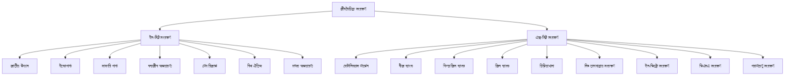

# 12-জীবের পরিবেশ, বিস্তার ও সংরক্ষণ

<!-- ========================================== -->
<!-- PDF Page 1 / 10 -->
<!-- ========================================== -->

উদ্বিদ্ভজ্ঞান: অধ্যায়...

— ভার্সিটি 'ক' মাস্টার প্রশ্নব্যাংক

**বাংলাদেশের বিলুপ্তপ্রায় জীব**

| শ্রেণি | বিলুপ্তপ্রায় উদ্ভিদ/প্রাণী (বৈজ্ঞানিক নামসহ) | গুরুত্বপূর্ণ তথ্য |
| :--- | :--- | :--- |
| ফার্নবর্গীয় উদ্ভিদ | (i) *Psilotum triquetrum* | — |
| নগ্নবীজী উদ্ভিদ | (i) *Cycas pectinata* (ii) *Podocarpus nerifolia* (iii) *Gnetum funiculare* | — |
| আবৃতবীজী উদ্ভিদ | (i) তালিপাম (*Corypha taliera*) | > এটি বৃহত্তর বাংলার এন্ডেমিক। > তালিপাম জীবনে একবারই ফুল ও ফল উৎপাদন করে এবং পরে মৃত্যু ঘটে। |
| | (ii) মল্লিকা ঝাঁঝি (*Aldrovanda vesiculosa*) | > মল্লিকা ঝাঁঝি জলজ এবং পতঙ্গভুক উদ্ভিদ। |
| | (iii) ক্ষুদে বড়লা (*Knema bengalensis*) | > ক্ষুদে বড়লা বাংলাদেশের এন্ডেমিক। > এর কাণ্ডে ক্ষত হলে রক্ত বর্ণের কষ বের হতে থাকে। |
| | (iv) কোরুদ (*Licuala peltata*) | > এর পাতা দিয়ে নানা রকম ছাতা ও ঘরের ছাউনি তৈরি করা হয়। |
| | (v) রোট্যালা (*Rotala simpliciuscula*) | > এটি বাংলাদেশের এন্ডেমিক। > এটি উভচর উদ্ভিদ, জলসিক্ত স্থানে জন্মে। |
| প্রাণী | (i) রাজশকুন (*Sarcogyps calvus*) | > বাংলাদেশে এটি মহাবিপন্ন বলে চিহ্নিত। > অপর নাম Red headed vulture or King Vulture, কেননা মাথা নগ্ন ও পালক কালো। |
| | (ii) ঘড়িয়াল (*Gavialis gangeticas*) | > বাংলাদেশে এটি মহাবিপন্ন বলে চিহ্নিত। |
| | (iii) মিঠাপানির কুমির (*Crocodylus palustris*) | > বাগেরহাটের খান জাহান আলীর মাজারের সাথের পুকুরে কয়েকটি কুমির এখনও আছে। |
| | (iv) নীলগাই (*Boselaphus tragocamelus*) | > ১৯৪০ সালে তেতুলিয়া অঞ্চলে নীলগাই পাওয়া যেত। |
| | (v) শুশুক (*Orcaella brevirostris*, *Platanista gangetica*, *Neophocaena phocaenoides*) | > এটি একটি স্তন্যপায়ী জলজ প্রাণী। > অঞ্চলভেদে এরা শুশুক মাছ, শিশু মাছ, হউম মাছ, হচ্ছুম মাছ সহ নানা নামে পরিচিত। |
| | (vi) রাজ ধনেশ (*Buceros bicornis*) | — |

**জীববৈচিত্র্য সংরক্ষণ পদ্ধতিসমূহ**

উদ্ভাস একাডেমিক এন্ড এডমিশন কেয়ার | ১৭৬ | পরিবর্তনের প্রত্যয়ে নিরন্তর পথচলা...

<!-- ========================================== -->
<!-- PDF Page 2 / 10 -->
<!-- ========================================== -->

উদ্ভিদবিজ্ঞান: অধ্যায়-১২

**বিগত ভর্তি পরীক্ষার MCQ প্রশ্ন-সলভ**

০১. IUCN-এর প্রধান কার্যালয় কোথায় অবস্থিত? [RU'25-26]
(a) গ্ল্যান্ড, সুইজারল্যান্ড (b) জুরিখ, সুইজারল্যান্ড
(c) জেনেভা, সুইজারল্যান্ড (d) গোথেনবার্গ, সুইডেন
(a)

০২. বিশ্বের সর্ববৃহৎ বায়োম সৃষ্টিকারী বনাঞ্চলে কোন ধরনের উদ্ভিদের প্রাধান্য দেখা যায়? [RU'25-26]
(a) সাইকাস (b) ম্যানগ্রোভ
(c) কনিফার (d) ইউক্যালিপটাস
(c)

০৩. বাংলাদেশে কোন পাখিটি বিলুপ্তপ্রায়? [SUST'25-26]
(a) Ardea purpurea
(b) Buceros bicornis
(c) Francolinus francolinus
(d) Coturnix coturnix
(b)

০৪. বাংলাদেশে বিলুপ্ত প্রায় তাল জাতীয় বৃক্ষ কোনটি? [SUST'25-26]
(a) Licuala peltata
(b) Podocarpus nerifolia
(c) Aquillaria agallocha
(d) Knema bengalensis
(a)

০৫. হ্রদের কিনারার উষ্ণ অঞ্চলকে বলে— [SUST'25-26]
(a) Litoral zone (b) Limnetic zone
(c) Profundal zone (d) Pelagic zone
(a)
ব্যাখ্যা: হ্রদের কিনারার উষ্ণ অঞ্চল— বেলা অঞ্চল (Litoral zone)। হ্রদের উপরের মুক্ত অঞ্চল-অগভীর অঞ্চল (Linnetic zone), সাগরের পৃষ্ঠীয় যুক্ত অঞ্চল- (Pelagic zone), হ্রদের গভীরে ক্ষীণ আলোকিত অঞ্চল- গভীর অঞ্চল (Profundal zone)।

০৬. কোন উদ্ভিদটি বাংলাদেশে বিলুপ্ত প্রায়? [BUP'23-24; DU'19-20]
(a) Pteris vittata (b) Podocarpus nerifolia
(c) Cycas revoluta (d) Nerium indicum
(b)

০৭. বাংলাদেশের বিলুপ্তপ্রায় উদ্ভিদ কোনটি? [GST'21-22]
(a) সেগুন (b) চাপালিশ
(c) তালিপাম (d) জারুল
(c)
ব্যাখ্যা: তালিপাম হলো বৃহত্তর বাংলার এন্ডেমিক।

০৮. বাংলাদেশে বিলুপ্তপ্রায় প্রাণী কোনটি? [RU'20-21]
(a) পাতি কাক (b) ঘড়িয়াল
(c) মেনি মাছ (d) ট্যারা মাছ
(b)

০৯. কি স্থাপনের মাধ্যমে জীববৈচিত্র্য রক্ষা করা যায়? [Agri'20-21]
(a) Blood bank (b) Gene bank
(c) Sperm bank (d) Hormone bank
(b)

১০. রামসার কনভেনশন অনুযায়ী বাংলাদেশের তালিকাভুক্ত জলাভূমি কোনটি? [JU'19-20]
(a) আলতা দিঘি (b) টাঙ্গুয়ার হাওড়
(c) কাপ্তাই হ্রদ (d) হালদা নদী
(b)

১১. কোন উদ্ভিদ প্রজাতি বাংলাদেশের এন্ডেমিক? [JU'19-20]
(a) Corypha taliera (b) Licuala peltata
(c) Rosa involucrata (d) Rotala simpliciuscula
(d)
ব্যাখ্যা: বাংলাদেশের এন্ডেমিক প্রজাতি—
Knema bengalensis (ক্ষুদে বড়ুলা);
Rotala simpliciuscula (রোট্যালা)।

১২. বাবলা কোন বায়োমের প্রধান উদ্ভিদ? [JU'19-20]
(a) মরুভূমি (b) তৃণভূমি
(c) তুন্দ্রা (d) সাভানা
(a)
ব্যাখ্যা: মরুভূমির বায়োমের উদ্ভিদ -> ক্যাকটাস, বাবলা, খেজুর।

১৩. বাংলাদেশের কোন ন্যাশনাল পার্কটি সর্বপ্রথম প্রতিষ্ঠিত হয়? [JU'19-20]
(a) হিমছড়ি (b) পাবলাখালী
(c) নিঝুমদ্বীপ (d) রামসাগর
(a)

১৪. পাইন কোন বায়োমের প্রধান উদ্ভিদ? [JU'19-20]
(a) ট্রপিক্যাল রেইন ফরেস্ট (b) ডেসিন্ডুয়াস ফরেস্ট
(c) কনিফার ফরেস্ট (d) সাভানা
(c)
ব্যাখ্যা: কনিফার ফরেস্ট -> পাইন, রেডউড;
ময়েস্ট ডেসিন্ডুয়াস ফরেস্ট -> শাল, কড়ই।

১৫. রাতারগুল জলাবনের উদ্ভিদ কোনটি? [JU'19-20]
(a) Artocarpus chaplasha (b) Pongamia pinnata
(c) Acanthus ilicifolius (d) Ceriops decandra
(b)
ব্যাখ্যা: রাতারগুল জলাবনের উদ্ভিদ—
নল খাগড়া (Phragmitis karka);
কাশ (Saccharum spontaneum);
ইকড়া ঘাস (Erianthus ravennae);
করচ গাছ (Pongamia pinnata)

১৬. Ex-situ conservation এর উদাহরণ কোনটি? [RU'19-20]
(a) ইকোপার্ক (b) সাফারি পার্ক
(c) অভয়ারণ্য (d) চিড়িয়াখানা
(d)

১৭. কোন উদ্ভিদে হাইড্রোজেন সায়ানাইড আছে? [Agri. Guccho'19-20]
(a) কাসাভা (b) আখরোট
(c) জোয়ার (d) সবকটিতে
(a)

১৮. বাংলাদেশের বিলুপ্তপ্রায় উদ্ভিদ- [RU'18-19; DU'15-16]
(a) Corypha taliera Roxb
(b) Vinca rosea Linn
(c) Datura metal linn
(d) Camellia sinensis Kuntze
(a)

১৯. গোলপাতার বৈজ্ঞানিক নাম হলো- [CU'18-19]
(a) Heritiera fomes
(b) Nipa fruticans
(c) Excoecaria agallocha
(d) Phoenix paludosa
(b)

২০. বাংলাদেশের একমাত্র গেম রিজার্ভ কোথায় অবস্থিত? [CU'18-19]
(a) রামসাগর (b) ডুলাহাজরা
(c) মাধবকুন্ড (d) টেকনাফ
(d)

উদ্ভাস একাডেমিক এন্ড এডমিশন কেয়ার
১৭৭
পরিবর্তনের প্রত্যয়ে নিরন্তর পথচলা...

<!-- ========================================== -->
<!-- PDF Page 3 / 10 -->
<!-- ========================================== -->

ভার্সিটি 'ক' মাস্টার জীববিজ্ঞান

২১. IUCN রেডলিস্ট ক্যাটাগরির সংখ্যা হলো [CU'18-19]
(a) ৪টি (b) ৬টি (c) ৭টি (d) ৮টি (b)
২২. IUCN red list অনুসারে কোনটি Threatened category? [KU'18-19]
(a) বিলুপ্ত প্রজাতি (b) বন্য পরিবেশে বিলুপ্ত
(c) বিপন্ন প্রজাতি (d) বিরল প্রজাতি (c)
ব্যাখ্যা: অতিবিপন্ন, বিপন্ন ও বিপদগ্রস্ত শ্রেণি তিনটিকে একত্রে হুমকিগ্রস্ত (Threatened) প্রজাতি বলে।
২৩. কোনটি ইন-সিটু সংরক্ষণ এর উদাহরণ? [DU'17-18]
(a) উদ্ভিদ উদ্যান (b) বন্যজীব অভয়ারণ্য
(c) বীজ ব্যাংক (d) চিড়িয়াখানা (b)
২৪. ওয়ালেস ও ওয়েবার লাইন এর মধ্যবর্তী অঞ্চলের নাম হলো-
(a) ওয়ালেসিয়া (b) ওয়েবারিয়া [DU'17-18]
(c) ইপেস্চিন (d) ওয়ালেস-ওয়েবারিয়া (a)
২৫. Ex-situ কনজারভেশনের উদাহরণ হলো- [CU'17-18]
(a) গেম রিজার্ভ (b) বোটানিক্যাল গার্ডেন
(c) সাফারি পার্ক (d) ইকো পার্ক (b)
২৬. বাংলাদেশের জাতীয় বৃক্ষের নাম কী? [CU'17-18]
(a) Artocarpus heterophyllus
(b) Mangifera indica
(c) Delonix regia
(d) Azadirachta indica (b)
বাংলাদেশের জাতীয় বৃক্ষ -> Mangifera indica (আম)
২৭. রিক্যালসিট্রেন্ট বীজবাহী উদ্ভিদ সংরক্ষণের উপযোগী পদ্ধতি কোনটি? [KU'17-18]
(a) ইন-সিটু (b) এক্স-সিটু
(c) ইন-ভিট্রো (d) ফিল্ড-ইন ব্যাংক (b)
২৮. বাংলাদেশ কোন প্রাণিভৌগোলিক অঞ্চলে অবস্থিত?
[KU'16-17; DU'14-15]
(a) Palaearctic Region (b) Nearctic Region
(c) Oriental Region (d) Neotropical Region (c)

২৯. কোন প্রাণীটি শুধুমাত্র ওরিয়েন্টাল অঞ্চলে পাওয়া যায়? [DU'15-16]
(a) ঘড়িয়াল (b) গন্ডার
(c) টুয়াটারা (d) হংস চঞ্চু প্লাটিপাস (a)
৩০. নিচের কোনটি কালমেঘের বৈজ্ঞানিক নাম? [DU'13-14]
(a) Andrographis paniculata
(b) Bacopa monnieri
(c) Centella asiatica
(d) Ocimum sanctum (a)
৩১. প্লাটিপাস কোথায় পাওয়া যায়? [DU'13-14]
(a) Australia (b) Oriental Region
(c) Africa (d) Bangladesh (a)
৩২. কে কন্টিনেন্টাল ড্রিফট সম্পর্কে আধুনিক ধারণা দেন? [DU'13-14]
(a) ওয়েগেনার (b) ডারউইন
(c) প্লেটার (d) বেকন (a)
৩৩. সাভানা কোন ইকোসিস্টেমের অংশ? [JnU'13-14]
(a) Terrestrial ecosystem (b) Estuarine ecosystem
(c) Lacustrine ecosystem (d) Riverine ecosystem (a)

---
(উ) বিগত ভর্তি পরীক্ষার Written প্রশ্ন-সলভ
---

০১. পূর্ণরূপ লিখঃ IUCN, WCU, DD, mRNA [RU'18-19]
উত্তর: IUCN – International Union for Conservation of Nature and Natural Resources.
WCU – World Conservation Union.
DD – Data Deficient.
mRNA – messenger Ribo-Nucleic Acid.
০২. IUCN প্রদত্ত Threatened Category কয়টি ও কি কি? [RU'18-19]
উত্তর: তিনটি। যথা:
(i) Critically Endangered বা অতিবিপন্ন
(ii) Endangered Species বা বিপন্ন প্রজাতি
(iii) Vulnerable Species বা বিপদগ্রস্ত

---
প্র্যাকটিস প্রবলেম
প্রথমে নিজে চেষ্টা করো; অতঃপর উত্তরের সাথে মিলিয়ে নাও।
---

MCQ প্র্যাকটিস প্রবলেম
০১. বারিমণ্ডল ও অশ্মমণ্ডলের আন্তঃক্রিয়াকে কী বলে? [হাসান স্যার]
(a) পপুলেশন (b) কমিউনিটি
(c) ইকোস্ফিয়ার (d) বায়োস্ফিয়ার (d)
০২. নিচের কোনটি ফাইটোপ্ল্যাঙ্কটন? [হাসান স্যার]
(a) Spirulina (b) Eudorina
(c) Pandorina (d) সবগুলো (d)
০৩. একটি পুকুর বা বিলের প্রাথমিক খাদক কোনটি? [হাসান স্যার]
(a) ফাইটোপ্ল্যাঙ্কটন (b) জুপ্ল্যাঙ্কটন
(c) মাছরাঙা (d) মলা মাছ (b)
০৪. কোনটি বিয়োজক বা স্যাপ্রোফাইট বা ট্রপফর্মার? [হাসান স্যার]
(a) ব্যাকটেরিয়া ও ছত্রাক (b) ব্যাকটেরিয়া ও ভাইরাস
(c) জুপ্ল্যাঙ্কটন (d) সবগুলো (a)
০৫. Food Chain-এর প্রতিটি ধাপকে কী বলে? [হাসান স্যার]
(a) ট্রফিক লেভেল (b) বাস্তুতন্ত্র
(c) খাদ্যজাল (d) পিরামিড (a)

MCQ উত্তরমালা
০১. d | ০২. d | ০৩. b | ০৪. a | ০৫. a

উদ্ভাস একাডেমিক এন্ড এডমিশন কেয়ার | ১৭৬ | পরিবর্তনের প্রত্যয়ে নিরন্তর পথচলা
CS CamScanner

<!-- ========================================== -->
<!-- PDF Page 4 / 10 -->
<!-- ========================================== -->

ভার্সিটি 'ক' মাস্টার প্রশ্নব্যাংক

উদ্ভিদবিজ্ঞান: অধ্যায়-১২

০৬. রূপান্তরের দক্ষতা প্রয়োজন হয় কোন ইকোলজিক্যাল পিরামিডে?
(a) সংখ্যার (b) বায়োমাস
(c) শক্তির (d) আকারের [হাসান স্যার]

০৭. শক্তি প্রবাহ ব্যাখ্যায় ১০ শতাংশ নিয়মের প্রবর্তক কে?
(a) Smith (b) Lindenmann
(c) Samuel (d) Waldayer [হাসান স্যার]

০৮. একটি বাঘ যদি হরিণের ১০ কেজি মাংস খায় তবে ঐ মাংসের কতটুকু বাঘের দেহ গঠনে কাজে লাগে?
(a) ১ কেজি (b) ১০ কেজি
(c) ৫ কেজি (d) ২ কেজি [হাসান স্যার]

০৯. যেসব উদ্ভিদ পানিতে জন্মে তাদেরকে কী বলে?
(a) জেরোফাইট (b) হাইড্রোফাইট
(c) এপিফাইট (d) হ্যালোফাইট [হাসান স্যার]

১০. নিচের কোনটি মুক্ত ভাসমান জলজ উদ্ভিদ?
(a) সাদা শাপলা (Nymphaea pubescens)
(b) নীল শাপলা (Nymphaea nouchali)
(c) পদ্ম (Nelumbo nucifera)
(d) সবগুলো [হাসান স্যার]

১১. কোনটি মুক্ত ভাসমান জলজ উদ্ভিদ নয়?
(a) কলমিলতা (Ipomoea aquatica)
(b) কচুরিপানা (Eichhornia crassipes)
(c) ক্ষুদ্রিপানা (Lemna minor)
(d) গুঁড়িপানা (Wolffia microscopica) [হাসান স্যার]

১২. কোন উদ্ভিদের মূল থাকে না?
(a) কলমিলতা (b) গুঁড়িপানা
(c) ক্ষুদ্রিপানা (d) কেশরদাম [হাসান স্যার]

১৩. নিচের কোনটি মরুঝ উদ্ভিদ?
(a) ফণিমন্সা (Opuntia dillenii)
(b) খেজুর (Phoenix dactylifera)
(c) ঘৃতকুমারী (Aloe vera)
(d) সবগুলো [হাসান স্যার]

১৪. মরুঝ উদ্ভিদের পাতার কোথায় পত্ররন্ধ্র থাকে?
(a) ঊর্ধ্বত্বকে (b) নিম্নত্বকে
(c) মধ্যত্বকে (d) বোটায় [হাসান স্যার]

১৫. লোনা মাটির উদ্ভিদের বিশেষ বৈশিষ্ট্য কোনটি?
(a) শ্বাসমূল বা নিউমেটোফোর (b) স্তম্ভমূল বা ঠেস মূল
(c) জরায়ুজ অংকুরোদগম (d) সবগুলো [হাসান স্যার]

১৬. নিউমেটোফোর থাকে কোন উদ্ভিদে?
(a) শতাব্দী (b) খেজুর (c) সুন্দরী (d) শাপলা [হাসান স্যার]

১৭. কোন ধরনের উদ্ভিদের মূল সুগঠিত নয়?
(a) হাইড্রোফাইট (b) মেসোফাইট
(c) জেরোফাইট (d) হ্যালোফাইট [হাসান স্যার]

১৮. সবচেয়ে বড় ট্রপিক্যাল রেইন ফরেস্ট কোনটি?
(a) ইন্দোনেশিয়ান দ্বীপপুঞ্জ (b) কঙ্গো অববাহিকা
(c) আলপাইন তুন্দ্রা (d) আমাজান অববাহিকা [হাসান স্যার]

১৯. পৃথিবীর সবচেয়ে বড় ও প্রথম বায়োম কোনটি?
(a) লোনাপানির বায়োম (b) মিঠা পানির বায়োম
(c) ম্যানগ্রোভ বায়োম (d) তুন্দ্রা বায়োম [হাসান স্যার]

২০. সবচেয়ে বড় মরুভূমি কোনটি?
(a) কালাহারি (b) সাভানা (c) সাহারা (d) থর [হাসান স্যার]

২১. রামসার কনভেনশন অনুযায়ী বাংলাদেশের তালিকাভুক্ত জলাভূমি হলো-
(a) সুন্দরবন ও টাঙ্গুয়ার হাওড়
(b) সুন্দরবন ও হাকালুকি হাওড়
(c) হাকালুকি হাওড় ও টাঙ্গুয়ার হাওড়
(d) হাকালুকি হাওড়, টাঙ্গুয়ার হাওড় ও রাতারগুল [হাসান স্যার]

২২. পৃথিবী কয়টি প্রাণিভৌগোলিক অঞ্চলে বিভক্ত?
(a) ৪টি (b) ৬টি (c) ৪টি (d) ১১টি [হাসান স্যার]

২৩. নিচের কোনটি Exotic?
(a) পেঁপে (b) আনারস
(c) তেলাপিয়া ও সিলভার কার্প (d) সবগুলো [হাসান স্যার]

২৪. চট্টগ্রাম, পার্বত্য চট্টগ্রাম ও সিলেটে অবস্থিত-
(a) চিরসবুজ ও অর্ধ-চিরসবুজ বন
(b) পত্রঝরা বনঞ্চল
(c) ম্যানগ্রোভ বনাঞ্চল
(d) ট্রপিক্যাল রেইন ফরেস্ট [হাসান স্যার]

২৫. ময়নামতির বন কী নামে পরিচিত?
(a) রাটয়া বন (b) গজনী বন
(c) শালবন বিহার (d) সেগুন বন [হাসান স্যার]

২৬. বাংলাদেশের একমাত্র বন্য গোলাপ কোথায় পাওয়া যায়?
(a) বরেন্দ্র বনাঞ্চলে (b) সিলেটের রাতারগুলে
(c) সুন্দরবনে (d) কক্সবাজারের হিমছড়িতে [হাসান স্যার]

২৭. সুন্দরবনের কতভাগ বাংলাদেশে অবস্থিত?
(a) ৫০ % (b) ৫৫ % (c) ৬০ % (d) ৬২ % [হাসান স্যার]

২৮. বাংলাদেশের সবচেয়ে ছোট ন্যাশনাল পার্ক কোনটি?
(a) রামসাগর (b) নিঝুমদ্বীপ
(c) লাউয়াছড়া (d) হিমছড়ি [হাসান স্যার]

২৯. ইউনেস্কো কতসালে সুন্দরবনকে ওয়ার্ল্ড হেরিটেজ সাইট হিসেবে অন্তর্ভুক্ত করে?
(a) ১৯৯৬ (b) ১৯৯৭ (c) ১৯৯৮ (d) ১৯৯৯ [হাসান স্যার]

| MCQ উত্তরমালা |
|:---:|:---:|:---:|:---:|:---:|:---:|
| 06. c | 07. b | 08. a | 09. b | 10. d | 11. a |
| 12. b | 13. d | 14. b | 15. d | 16. c | 17. a |
| 18. d | 19. a | 20. c | 21. a | 22. b | 23. d |
| 24. a | 25. c | 26. b | 27. d | 28. a | 29. b |

১৭৯
উদ্ভাস একাডেমিক এন্ড এডমিশন কেয়ার
পরিবর্তনের প্রত্যয়ে নিভৃত পথচলা...

<!-- ========================================== -->
<!-- PDF Page 5 / 10 -->
<!-- ========================================== -->

ভর্সিটি 'ক' মাস্টার প্রশ্নব্যাংক

৩০. কোনটি বাংলাদেশের বিলুপ্তপ্রায় উদ্ভিদ?
(a) তালিপাম (Corypha taliera)
(b) ক্ষুদে বড়লা (Knema bengalensis)
(c) মল্লিকা ঝাঁঝি (Aldrovanda vesiculosa)
(d) সবগুলো

৩১. বাংলাদেশের সবচেয়ে বড় ন্যাশনাল পার্ক কোনটি?
(a) রামসাগর (b) নিঝুমদ্বীপ (c) লাউয়াছড়া (d) হিমছড়ি

৩২. আয়তনের দিক থেকে বিশ্বের সর্ববৃহৎ হাওড় কোনটি?
(a) হাকালুকি হাওড় (b) টাঙ্গুয়ার হাওড়
(c) নিউ ক্যাসেল হাওড় (d) নিকলি হাওড়

৩৩. কোনটি ‘ছয় কুড়ি বিল নয় কুড়ি কন্দ’ নামে পরিচিত?
(a) চলনবিল (b) টাঙ্গুয়ার হাওড়
(c) হাকালুকি হাওড় (d) নিকলি হাওড়

৩৪. অতিনিম্ন তাপমাত্রায় (-১৯৬°C) তরল নাইট্রোজেনে কোন পদ্ধতিতে রিসালসট্যান্ট প্রজাতি সংরক্ষণ করা হয়?
(a) Orthodex (b) Cryogenic
(c) Lysogenic (d) সবগুলো

৩৫. বীজকে কত ডিগ্রি তাপমাত্রায় ফ্রিজিং করলে বহুদিন সংরক্ষণ করা যায়?
(a) -২০°C (b) -১৫°C (c) -১০°C (d) -৫°C

৩৬. ‘মাছের মাতৃভাণ্ডার’ হিসেবে পরিচিত কোনটি? [আলিম স্যার]
(a) টাঙ্গুয়ার হাওড় (b) হালদা নদী
(c) হাকালুকি হাওড় (d) নাফ নদী

৩৭. কোনটি বাস্তুতন্ত্রের বিয়োজক নয়? [আলিম স্যার]
(a) ব্যাকটেরিয়া (b) মৃতজীবী ছত্রাক
(c) পতঙ্গ (d) শৈবাল

৩৮. যেসব প্রাণী মৃত জীবদেহের অবশিষ্টাংশ খেয়ে বেঁচে থাকে তাদের কী বলে? [আলিম স্যার]
(a) ডিকম্পোজার (b) ট্রান্সফর্মার
(c) ডেট্রিভোরাস (d) স্যাপ্রোফাগ

৩৯. পার্বত্য অঞ্চলের মাটি লাল হওয়ার কেন?
(a) আয়রন অক্সাইড (b) হিউমাস অধিক
(c) লৌহজাতীয় পদার্থ বেশি (d) জলীয়বাষ্প বেশি থাকে

৪০. রাজকুন বিলুপ্তির প্রধান কারণ কোনটি?
(a) খাদ্যের অভাব (b) নির্বিচারে হত্যা
(c) পরিবেশ বিপর্যয় (d) কীটনাশক ব্যবহার

| MCQ উত্তরমালা |
| :--- | :--- | :--- | :--- | :--- |
| 30. d | 31. b | 32. a | 33. b | 34. b |
| 36. c | 37. d | 38. c | 39. c | 40. d |

---
**Written প্র্যাকটিস প্রবলেম**

০১. হ্যালোফাইট কী? হ্যালোফাইটের ৪টি অভিযোজনীয় বৈশিষ্ট্য লিখ।
০২. হাইড্রোফাইট, জেরোফাইট ও হ্যালোফাইট উদ্ভিদের মধ্যে পার্থক্য উল্লেখ কর।
০৩. Endemic ও Exotic কী? বাংলাদেশের ২টি Endemic উদ্ভিদ/প্রাণীর নাম লিখ।
০৪. জলজ উদ্ভিদের ৫টি বৈশিষ্ট্য লিখ।
০৫. জেরোফাইট কী? জেরোফাইট উদ্ভিদের ৫টি বৈশিষ্ট্য লিখ।
০৬. প্রাণিভৌগোলিক অঞ্চলের প্রকারভেদসমূহ লিখ।
০৭. নিচের প্রাণীগুলোর বৈজ্ঞানিক নাম লিখ।
শুশুক, শ্বেত কাকাতুয়া, সিলেটি কচ্ছপ, গারো পাহাড়ি বাঘ, সবুজ রুই
০৮. নিচের উদ্ভিদগুলোর বৈজ্ঞানিক নাম লিখ।
তালিপাম, ক্ষুদে বড়লা, করচ, জংলি গোলাপ, মল্লিকা ঝাঁঝি

---
**প্র্যাকটিস প্রবলেমের সমাধান**

**MCQ প্র্যাকটিস প্রবলেমের সমাধান**

০১. ব্যাখ্যা: (c); ভৌত পরিবেশের উপাদান ৩টি:
(i) বায়ুমণ্ডল (atmosphere),
(ii) বারিমণ্ডল (hydrosphere)
(iii) অশ্মমণ্ডল (lithosphere)
বায়োস্ফিয়ার ও বায়ুমণ্ডল বায়োস্ফিয়ারের সাথে বায়ুমণ্ডল, বারিমণ্ডল ও অশ্মমণ্ডলের আন্তঃক্রিয়াকে বলা হয় ইকোস্ফিয়ার।

০২. ব্যাখ্যা: (d); ভাসমান ক্ষুদ্র উদ্ভিদকে ফাইটোপ্ল্যাঙ্কটন বলে। এরা উৎপাদক হিসেবে কাজ করে।

০৭. ব্যাখ্যা: (b); খাদকরা যত উৎপাদককে ভক্ষণ করে তার দশমাংশ মাত্র ব্যবহারকারীর (খাদকের) দেহ গঠনের কাজে লাগে, শক্তি প্রবাহ ব্যাখ্যায় এটি ১০ শতাংশ নিয়ম নামে পরিচিত। Lindenmann (1942) এ মতবাদের প্রবর্তক।

১২. ব্যাখ্যা: (b); ওড়িপানা ক্ষুদ্রতম আবৃতবীজী উদ্ভিদ। এটি মুক্ত ভাসমান জলজ উদ্ভিদ হিসেবে পানির উপরিভাগে ভেসে থাকে।

৩৪. ব্যাখ্যা: (b); যেসব বীজকে শুকালে অঙ্কুরোদগম ক্ষমতা নষ্ট হয় না, তাকে রিক্যালসিট্র্যান্ট বীজ বলে। এদের তিনভাবে সংরক্ষণ করা যায়: (i) In-vitro উপায়, (ii) তরল আর্গন মাধ্যমে, (iii) অতি নিম্ন তাপমাত্রায় তরল নাইট্রোজেনে cryogenic পদ্ধতিতে।

---
**উন্মেষ** একাডেমিক এন্ড এডমিশন কেয়ার | ১৮০ | পরিবর্তনের প্রত্যয়ে নির্ভর পথচলা
[CS CamScanner]

<!-- ========================================== -->
<!-- PDF Page 6 / 10 -->
<!-- ========================================== -->

ভার্সিটি 'ক' মাস্টার প্রশ্নব্যাংক | উদ্ভিদবিজ্ঞান: অধ্যায়-১২

(Written প্র্যাকটিস প্রবলেমের সমাধান)

০১. উত্তর: যেসব উদ্ভিদ লবণাক্ত পরিবেশে (মাটিতে ও পানিতে) সহজেই জন্মাতে ও বিস্তার লাভ করতে পারে সেসব উদ্ভিদই লোনা মাটির উদ্ভিদ বা হ্যালোফাইট। এসব উদ্ভিদের ৪টি অভিযোজনীয় বৈশিষ্ট্য নিম্নরূপ:
(i) লোনা মাটির উদ্ভিদের কাণ্ড ও পাতা রসালো থাকে।
(ii) মাটিতে $O_2$ কম থাকায় অনেক উদ্ভিদে শ্বাসমূল বা নিউমেটোফোর সৃষ্টি হয়।
(iii) মূলের অভ্যন্তরে (কর্টেক্স-এ) বড় বড় বায়ুকুঠুরী থাকে। এই বায়ুকুঠুরী অক্সিজেন ধরে রাখতে পারে।
(iv) অনেক উদ্ভিদে জরায়ুজ অঙ্কুরোদগম (Viviparous germination) হয়, যেমন- *Rhizophora* গণের প্রজাতি।

০২. উত্তর: হাইড্রোফাইট, জেরোফাইট ও হ্যালোফাইট উদ্ভিদের মধ্যে ৩টি পার্থক্য নিম্নরূপ:

| বৈশিষ্ট্য | হাইড্রোফাইট | জেরোফাইট | হ্যালোফাইট |
| :--- | :--- | :--- | :--- |
| (i) মূল | মূল সুগঠিত নয়। | মূল সুগঠিত এবং মাটির উপরিটল অথবা নিচে বহুদূর পর্যন্ত বিস্তৃত। | মূল সুগঠিত। |
| (ii) পাতার আকার | পাতা বড় ও নরম হয়। | পাতা ক্ষুদ্রাকৃতির। | পাতা ক্ষুদ্র ও স্ফীত হতে পারে। |
| (iii) কিউটিকল | নিমজ্জিত পাতায় কিউটিকল থাকে না। বায়বীয় অংশ ও ভাসমান পাতায় পাতলা কিউটিকলের স্তর থাকে। | কাণ্ড ও পাতার ত্বকে কিউটিকলের মোটা স্তর থাকে। | কাণ্ড ও পাতার উপরিভাগে পুরু কিউটিন স্তর থাকে। |

০৩. উত্তর: কোনো নির্দিষ্ট ভৌগোলিক অঞ্চলে সীমাবদ্ধ উদ্ভিদ বা প্রাণীকে উক্ত অঞ্চলের এন্ডেমিক উদ্ভিদ/প্রাণী বলে।
এক ভৌগোলিক অঞ্চল (দেশ) থেকে অন্য ভৌগোলিক অঞ্চল (দেশ)-এ প্রবর্তনকারী উদ্ভিদ বা প্রাণীকে আগত অঞ্চলের Exotic উদ্ভিদ/প্রাণী বলে।
বাংলাদেশের ৪টি Exotic উদ্ভিদ/প্রাণীর নাম: পেঁপে, আনারস, তেলাপিয়া ও সিলভার কার্প।

০৪. উত্তর: জলজ উদ্ভিদের ৫টি বৈশিষ্ট্য নিম্নরূপ:
(i) নিমজ্জিত জলজ উদ্ভিদের কাণ্ড নরম, দুর্বল, সরু ও লম্বা মধ্যপর্ব বিশিষ্ট হয়। মাটিতে নোঙরাবদ্ধ ভাসমান উদ্ভিদের কাণ্ড সাধারণত রাইজোম জাতীয় হয়।
(ii) জলজ উদ্ভিদের মূল সুগঠিত হয় না, অনেক ক্ষেত্রে মূল থাকে না বললেই চলে।
(iii) কাণ্ড ও পাতার বহিঃত্বক কিউটিনযুক্ত থাকে না; পত্ররন্ধ্র থাকে না, বা কম থাকে। পত্ররন্ধ্রে প্রহরী (রক্ষীকোষ) কোষ নাও থাকতে পারে।
(iv) এদের মূল ও কাণ্ডে বড় বড় বায়ুকুঠুরী থাকে। বায়ুকুঠুরী বিশিষ্ট গঠনকে অ্যারেনকাইমা বলে।
(v) যান্ত্রিক টিস্যু কম থাকে। এজন্য অঙ্গ-প্রত্যঙ্গ দৃঢ় হয় না।

০৫. উত্তর: মরু পরিবেশে অর্থাৎ বৃষ্টিপাতহীন শুষ্ক ও বালুকাময় অঞ্চলে যেসব উদ্ভিদ জন্মায়, তাদেরকে জেরোফাইট বলে।
জেরোফাইট উদ্ভিদের ৪টি বৈশিষ্ট্য নিম্নরূপ:
(i) মূল বিস্তৃত অথবা মাটির গভীরে প্রসারিত থাকে।
(ii) কাণ্ড ও পাতা চ্যাপ্টা ও রসালো।
(iii) পাতা অনেক ক্ষেত্রে কণ্টক-এ রূপান্তরিত হয়, কোনো কোনো পাতা সংক্ষিপ্ত হয়ে যায়।
(iv) কোষের আকার অপেক্ষাকৃত ছোটো হয়, কোষপ্রাচীর পুরু ও কিউটিকল যুক্ত থাকে।

০৬. উত্তর: প্রাণিভৌগোলিক অঞ্চলের প্রকারভেদসমূহ নিম্নরূপ:
(i) প্যালিয়ার্কটিক অঞ্চল
(ii) ওরিয়েন্টাল অঞ্চল
(iii) অস্ট্রেলিয়ান অঞ্চল
(iv) নিওট্রপিক্যাল অঞ্চল
(v) ইথিওপিয়ান অঞ্চল
(vi) নিআর্কটিক অঞ্চল

০৭. উত্তর: প্রশ্নে উল্লিখিত প্রাণীগুলোর বৈজ্ঞানিক নাম নিম্নরূপ:
(i) শুশুক- *Orcaella brevirostris*
(ii) শ্বেত কাকাতুয়া- *Cacatua alba*
(iii) সিলেটি কচ্ছপ- *Kachuga sylhetensis*
(iv) গারো পাহাড়ি ব্যাঙ- *Rana garoensis*
(v) সবুজ রুই- *Lubeo fisheri*

০৮. উত্তর: প্রশ্নে উল্লিখিত উদ্ভিদগুলোর বৈজ্ঞানিক নাম নিম্নরূপ:
(i) তালি পাম- *Corypha taliera*
(ii) ক্ষুদে বদলা- *Knema bengalensis*
(iii) কোকদ- *Licuala peltata*
(iv) জংলি গোলাপ- *Rosa involucrata*
(v) মল্লিকা ঝাঁঝি- *Aldrovanda vesiculosa*

উদ্ভাস একাডেমিক এন্ড এডমিশন কেয়ার | ১৮১ | পরিবর্তনের প্রত্যয়ে নিরন্তর পথচলা...
উদ্ভিদবিজ্ঞান: অধ্যায়-১২

<!-- ========================================== -->
<!-- PDF Page 7 / 10 -->
<!-- ========================================== -->

প্রাণিবিল্ডান

<!-- ========================================== -->
<!-- PDF Page 8 / 10 -->
<!-- ========================================== -->

প্রাণিবজ্ঞান

<!-- ========================================== -->
<!-- PDF Page 9 / 10 -->
<!-- ========================================== -->

ভর্তি 'ক' মাস্টার প্রশ্নব্যাংক                                                                                  প্রাণিবজ্ঞান: অধ্যায়-০১

অধ্যায়
০১
প্রাণীর বিভিন্নতা ও শ্রেণিবিন্যাস

টপিক অ্যানালাইসিস
ভার্সিটি ভর্তি পরীক্ষার জন্য এই অধ্যায়ের গুরুত্বপূর্ণ টপিকসমূহ:

| গুরুত্ব | টপিক | যতবার এসেছে | যেসব ভর্তি পরীক্ষায় প্রশ্ন এসেছে |
| :--- | :--- | :--- | :--- |
| | | MCQ | Written | MCQ | Written |
| ০০ | T-01: প্রাণিবৈচিত্র্য ও শ্রেণিবিন্যাসের ভিত্তি | 37 | 02 | DU'25-26, DU'21-22, 18-19, 17-18; JU'25-26, 24-25, 23-24, 22-23, 21-22; RU'25-26, RU'24-25, 22-23, 21-22, 19-20; CU'24-25, 23-24, 22-23, 18-19; HSTU'24-25; CoU'24-25; BUP'24-24 | DU'23-24; JnU'24-25 |
| ০০ | T-02: শ্রেণিবিন্যাসের নীতি | 12 | 01 | RU'25-26, 24-25, 22-23; CU'22-23, 20-21; SUST'25-26; HSTU'25-26; BAU'18-19; BUP'23-24 | RU'19-20 |
| ০০০ | T-03: প্রাণিজগতের প্রধান পর্বসমূহ | 66 | 06 | DU'24-25, 23-24, 22-23, 20-21, 19-20, 18-19, 17-18, 16-17, 15-16, 13-14; JnU'25-26, 24-25; JU'25-26, 24-25, 23-24, 22-23, 21-22, 19-20; RU'24-25, 23-24, 22-23, 21-22, 19-20; CU'25-26, CU'23-24, 22-23, 20-21, 17-18; KU' 18-19; HSTU'25-26; CoU'25-26; GST'24-25, 23-24, 22-23, 21-22; Agri'22-23, 19-20; BAU'18-19 | DU'24-25, 22-23, 21-22, 20-21, 19-20; JnU'18-19 |
| ০০০ | T-04: Chordata পর্বের শ্রেণিবিন্যাস | 44 | 05 | DU'24-25, 22-23, 19-20, 18-19, 17-18, 16-17, 08-09; JnU'24-25, 16-17; JU'23-24, 21-22, 19-20; RU'25-26, 24-25, 23-24, 21-22, 20-21, 10-11; CU'23-24, 22-23, 21-22, 17-18, 08-09; HSTU'25-26; CoU'25-26; Agri'22-23, 21-22, 19-20; BAU'14-15 | DU'25-26; DU'19-20; JnU'24-25, 19-20; RU'19-20, |

T-01: প্রাণিবৈচিত্র্য ও শ্রেণিবিন্যাসের ভিত্তি

কনসেপ্ট রিভিউ

| ভিত্তি | শ্রেণিবিন্যাস | উদাহরণ |
| :--- | :--- | :--- |
| (i) সংগঠন-ক্রয়মাত্রা | ক. কোষীয় মাত্রার গঠন | > Porifera পর্বের সকল প্রাণী। |
| | খ. কোষ-টিস্যু মাত্রার গঠন | > Cnidaria পর্বের সকল প্রাণী। |
| | গ. টিস্যু-অঙ্গ মাত্রার গঠন | > Platyhelminthes পর্বের সকল প্রাণী। |
| | ঘ. অঙ্গ-তন্ত্র মাত্রার গঠন | > সর্বপ্রথম আবির্ভূত হয়েছে নিমারটিয়ান (Nemartean) নামক এক সামুদ্রিক প্রাণিগোষ্ঠীতে। |
| (ii) ভ্রূণস্তর | ক. দ্বিম্তরী/দ্বিভ্রূণস্তরী/ডিপ্লোব্লাস্টিক | > Cnidaria পর্বের সকল প্রাণী। |
| | খ. ত্রিম্তরী/ত্রিভ্রূণস্তরী/ট্রিপ্লোব্লাস্টিক | > Platyhelminthes থেকে Chordata পর্বের সকল প্রাণী। |
| (iii) প্রতিসাম্য | ক. গোলীয় প্রতিসাম্য | > Volvox globator, Radiolaria, Heliozoa। |
| | খ. অरीय প্রতিসাম্য | > হাইড্রা, জেলিফিশ, সী অ্যানিমনি প্রভৃতি। |
| | গ. দ্বিঅरीय প্রতিসাম্য | > Ctenophora জাতীয় প্রাণী (যেমন-Ceoloplana)। |
| | ঘ. দ্বিপার্শ্বীয় প্রতিসাম্য | > প্রজাপতি (Pieris brassicae), ব্যাঙ (Minervarya asmati), মানুষ প্রভৃতি। |
| | ঙ. অপ্রতিসাম্য | > স্পঞ্জ (Cliona celata), আপেল শামুক (Pila globosa) প্রভৃতি। |

উদ্ভাস একাডেমিক এন্ড এডমিশন কেয়ার                                           ১৮৩                                           পরিবর্তনের প্রত্যয়ে নিরন্তর পথচলা...

CS CamScanner

<!-- ========================================== -->
<!-- PDF Page 10 / 10 -->
<!-- ========================================== -->

ভিসিটি ‘ক’ মাস্টার প্রিপারেশন

| ভিত্তি | শ্রেণিবিভাগ | উদাহরণ |
| :--- | :--- | :--- |
| (iv) সিলোম | ক. অ্যাসিলোমেট বা সিলোমবিহীন | > Porifera, Cnidaria, Ctenophora, Platyhelminthes, Nemertea পর্বের প্রাণী। |
| | খ. সিউডোসিলোমেট বা অপ্রকৃত-সিলোমেট | > Nematoda, Rotifera, Kinorhyncha প্রভৃতি পর্বের প্রাণী। |
| | গ. ইউসিলোমেট বা প্রকৃত সিলোমেট | > Hemichordata ও Mollusca থেকে Chordata পর্যন্ত পর্বের প্রাণী। |
| (v) পৌষ্টিকনালি | ক. প্যারাজোয়া (নির্দিষ্ট পৌষ্টিকনালি বা গহ্বর থাকে না) | > Porifera |
| | খ. এন্টারোজোয়া (নির্দিষ্ট পৌষ্টিকনালি বা গহ্বর থাকে) | > Cnidaria থেকে Chordata |
| (vi) খণ্ডায়ন | ক. সমখণ্ডকায়ন | > Annelida (যেমন: কেঁচো) পর্বের প্রাণী। |
| | খ. অসমখণ্ডকায়ন | > Arthropoda ও Chordata পর্বের প্রাণী। |
| (vii) অঞ্চলায়ন | | > Arthropoda পর্বের প্রাণীতে দেখা যায়। |

ক্লিভেজ ও ভ্রূণীয় বিকাশের ওপর ভিত্তি করে দ্বি-পার্শ্বীয় প্রতিসম প্রাণীদের দুই ভাগে ভাগ করা হয়:

| প্রোটোস্টোমিয়া | ক্লিভেজ সর্পিল ও নির্ধারিত; ব্লাস্টোপোর মুখছিদ্রে পরিণত হয়। | Annelida, Arthropoda, Mollusca |
| :--- | :--- | :--- |
| ডিউটারোস্টোমিয়া | ক্লিভেজ অরীয় ও অনির্ধারিত; ব্লাস্টোপোর পায়ুছিদ্রে পরিণত হয়। | Echinodermata, Chordata |

প্রকৃত সিলোমকে দুই ভাগে ভাগ করা হয়:

| সাইজোসিলেমেট | ভ্রূণের মেসোডার্মাল টিস্যু বিদীর্ণ (Split) হয়ে এ ধরনের সিলোম সৃষ্টি হয়। | Annelida, Mollusca, Arthropoda |
| :--- | :--- | :--- |
| এন্টারোসিলোমেট | ভ্রূণের আর্কেটেরনের প্রাচীর থেকে সৃষ্ট মেসোডার্মাল থলি (Pouch) থেকে এ ধরনের সিলোম সৃষ্টি হয়। | Echinodermata, Chordata |

---

### বিগত ভর্তি পরীক্ষার MCQ প্রশ্ন-সলভ

**01. কোন পর্বের প্রাণীতে প্রকৃত ট্রকোফোর পাওয়া যায়?** [DU '25-26; JU '24-25]
(a) পরিফেরা (b) আর্থ্রোপোডা (c) অ্যানিলিডা (d) মলাস্কা

**02. প্লাটিহেলমিনথিস পর্বের প্রাণীদের সিলোম কিরূপ?** [JU '25-26]
(a) সিলোমবিহীন (b) অপ্রকৃত সিলোম (c) প্রকৃত সিলোম (d) ইউসিলোম

**03. ডিম্বাণুর সাইটোপ্লাজমের যেদিকে কুসুমের পরিমাণ বেশি থাকে তাকে কি বলা হয়?** [RU '25-26]
(a) অ্যানিমেল পোল (b) ভেজিটাল পোল (c) ভিটালিন পোল (d) কেরিয়ন
ব্যাখ্যা: ভেজিটাল পোল: ক্লিভেজের সময় ডিমের যে প্রান্তে কুসুম থাকে।
অ্যানিমেল পোল: ক্লিভেজের সময় ডিমের যে প্রান্তে নিউক্লিয়াস থাকে।

**04. কোনটি দ্বি-পার্শ্বীয় প্রতিসম?** [JU '24-25]
(a) Pila (b) Minervarya (c) Hydra (d) Volvox

**05. কোনটি অপ্রতিসম?** [JU '24-25, 19-20]
(a) Pila (b) Hydra (c) Aurelia (d) Volvox

**06. কোন প্রাণী সিউডোসিলোমেট?** [JU '24-25; RU '22-23; DU '17-18]
(a) Mollusca (b) Nematoda (c) Arthropoda (d) Chordata

**07. দ্বিস্তরী প্রাণীর কোন ভ্রূণীয় অবস্থায় সিটি কোষের স্তর বিদ্যমান?** [RU '24-25]
(a) মরুলা (b) ব্লাস্টুলা (c) গ্যাস্ট্রুলা (d) আর্কেটেরন

**08. নিচের কোনটি সরল থেকে জটিল এর সঠিক ক্রম নির্দেশ করে?** [CU '24-25]
(a) অসংস্তম্ভ, অঙ্গ, কলা, কোষ
(b) কোষ, কলা, অঙ্গ, অসংস্তম্ভ
(c) কলা, কোষ, অঙ্গ, অসংস্তম্ভ
(d) কোষ, অঙ্গ, কলা, অসংস্তম্ভ

**09. কোন প্রাণী অসম দেহখণ্ডক বিশিষ্ট?** [HSTU '24-25]
(a) কেঁচো (b) জোক (c) রেশম কীট (d) প্রজাপতি

**10. নিচের কোনটি প্রকৃত সিলোমযুক্ত প্রাণী?** [CU '24-25]
(a) Nemertea (b) Nematoda (c) Rotifera (d) Arthropoda

**11. অরীয় প্রতিসাম্যতা দেখা যায় কোন প্রাণীতে?** [BUP '24-25; RU '21-22; JU '19-20]
(a) Homo sapiens (b) Volvox (c) Pila (d) Aurelia

**12. ‘Le Regne Animal’ গ্রন্থের রচয়িতা কে?** [JU '23-24]
(a) Cuvier (b) von Baer (c) Aristotle (d) Lamarck

---
উদ্ভস একাডেমিক এন্ড এডমিশন কেয়ার ১৬৪
