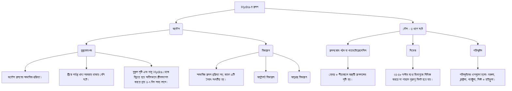

# 01-প্রাণীর বিভিন্নতা ও শ্রেণিবিন্যাস

<!-- ========================================== -->
<!-- PDF Page 1 / 17 -->
<!-- ========================================== -->

ভার্সিটি 'ক' মাস্টার প্রশ্নব্যাংক ■ ■ প্রাণীবিজ্ঞান: অধ্যায়-০১

T-02: শ্রেণিবিন্যাসের নীতি

◆ কনসেপ্ট রিভিউ
* শ্রেণিবিন্যাসের ধাপ/ট্যাক্সন:
| 1. Kingdom (সর্বজনীন স্তর) | 2. Phylum (সর্বোচ্চ স্তর) | 3. Class | 4. Order | 5. Family | 6. Genus | 7. Species (মূল বা ভিত্তি একক) |
[Note: লিনিয়াস 'গোত্র'কে শ্রেণিবিন্যাসের স্তর হিসেবে স্বীকৃতি দেননি]

* নামকরণের প্রকারভেদ (Nomenclature):
> দ্বিপদ নামকরণ: ক্যারোলাস লিনিয়াস সর্বপ্রথম প্রবর্তন করেন।
> ত্রিপদ নামকরণ: পাখি বিজ্ঞানী Schlegel সর্বপ্রথম প্রবর্তন করেন। যেমন: নীল নদ এলাকার চড়ুই পাখির বৈজ্ঞানিক নাম *Passer domesticus niloticus*.
* কোনো প্রাণীর বৈজ্ঞানিক নামের গণ ও প্রজাতির অংশ একই হলে তাকে টটোনিন বলে। যেমন: *Catla catla*.

◆ বিগত ভর্তি পরীক্ষার MCQ প্রশ্ন-সলভ

01. শ্রেণিবিন্যাসের একক-কে কি বলা হয়? [RU’25-26; BUP’23-24]
(a) ট্যাক্সিস
(b) ট্যাক্সন
(c) গণ
(d) প্রজাতি
(b)

02. প্রাণিজগতে মুখ্য ও গৌণ পর্বের সংখ্যা কোন্ অঙ্কের গুণিতক? [SUST’25-26]
(a) 9
(b) 6
(c) 5
(d) 3
(d)
ব্যাখ্যা: মুখ্য পর্ব সংখ্যা-9; গৌণ পর্ব সংখ্যা-24
গুণিতক $\frac{24}{9} \approx 3$

03. মানুষ কোন্ বর্গের অন্তর্গত? [HSTU’25-26]
(a) Homo
(b) Hominidae
(c) Primates
(d) Mammalia
(c)

04. শ্রেণিবিন্যাসের মৌলিক ধাপ কয়টি? [RU’24-25]
(a) 5
(b) 7
(c) 14
(d) 21
(b)

05. কোন্ প্রাণীর গণ ও প্রজাতি নাম একই হলে তাকে বলা হয়- [RU’24-25]
(a) টটোনিন
(b) সিনোনিম
(c) এ্যানটোনিন
(d) টটিপোটেন্ট
(a)

06. শ্রেণিবিন্যাসের মৌলিক এককের নাম কি? [RU, CU’22-23]
(a) ট্যাক্সন
(b) গণ
(c) দ্বিপদ
(d) প্রজাতি
(d)

07. জীবের ত্রিপদ নামকরণ করেন- [RU’22-23]
(a) Carolus linnaeus
(b) Schlegel
(c) Hickman
(d) Robert Grant
(b)

08. ICZN এর পূর্ণ নাম- [CU’20-21]
(a) International Cooperation on Zoological Nomenclature
(b) International Community on Zoological Nomenclature
(c) International Commission on Zoological Nomenclature
(d) International Committee on Zoological Nomenclature
(c)

09. "Diversity and Classification of Flowering Plants" বইটির লেখক কে? [CU’20-21]
(a) Carolus Linnaeus
(b) George Bentham
(c) Theophrastus
(d) Armen Takhtajan
(d)

10. প্রাণীর নামকরণে আন্তর্জাতিক সংস্থা কোনটি? [BAU’18-19]
(a) FAO
(b) ICZN
(c) ILO
(d) ICBN
(b)

◆ বিগত ভর্তি পরীক্ষার Written প্রশ্ন-সলভ

01. দ্বিপদ নামকরণ বলতে কি বুঝায়? [RU’19-20]
উত্তর: জীবের নামকরণের আন্তর্জাতিক নিয়মানুসারে গণ ও প্রজাতি নামের দুটি পদ ব্যবহার করে প্রাণীর যে নামকরণ করা হয় তাকে দ্বিপদ নামকরণ বলে।

উদ্ভাসের একাডেমিক এন্ড এডমিশন কেয়ার ■ ■ ১৮৬ পরিবর্তনের প্রত্যয়ে নিরন্তর পথচলা...

<!-- ========================================== -->
<!-- PDF Page 2 / 17 -->
<!-- ========================================== -->

ডাস্টি 'ক' মাস্টার গ্রন্থব্যাংক                                                                              প্রাণীবিজ্ঞান: অধ্যায়-০১

**T-03: প্রাণিজগতের প্রধান পর্বসমূহ**

**(১) কনসেপ্ট রিভিঊ**

**অমেরুদণ্ডী পর্বসমূহ:**

| পর্ব | Porifera | Cnidaria | Platyhelminthes | Nematoda | Mollusca | Annelida | Arthropoda | Echinodermata |
| :--- | :--- | :--- | :--- | :--- | :--- | :--- | :--- | :--- |
| **বিশেষ নাম** | ছিদ্রাল প্রাণী | সমুদ্রের ফুল/রেইন ফরেস্ট | চ্যাপ্টা কৃমি/ফিতা কৃমি | সুতা কৃমি/গোল কৃমি | কবজ প্রাণী | অঙ্গুরীমাল | সন্ধিপদী প্রাণী | কন্টকত্বক প্রাণী |
| **সংগঠন ক্রমমাত্রা** | দলীয় মাত্রা | টিস্যু মাত্রা | টিস্যু অঙ্গ মাত্রা | অঙ্গতন্ত্র মাত্রা | অঙ্গতন্ত্র মাত্রা | অঙ্গতন্ত্র মাত্রা | অঙ্গতন্ত্র মাত্রা | অঙ্গতন্ত্র মাত্রা |
| **ভ্রূণীয় স্তর** | নেই | দ্বিন্তরী | ত্রিন্তরী | ত্রিন্তরী | ত্রিন্তরী | ত্রিন্তরী | ত্রিন্তরী | ত্রিন্তরী |
| **রক্ত সংবহন** | অনুপস্থিত | অনুপস্থিত | অনুপস্থিত | অনুপস্থিত | অর্ধমুক্ত সংবহনতন্ত্র | বন্ধ সংবহন তন্ত্র | মুক্ত সংবহন তন্ত্র | অনুপস্থিত তবে হিমাল ও পেরিহিমালতন্ত্র সংবহনতন্ত্রের কাজ করে। |
| **রেচন** | - | - | শিখাকোষ ও রেচননালি | - | - | নেফ্রিডিয়া (segmental organ) | ম্যালপিজিয়ান নালিকা | - |
| **প্রতিসম** | - | অরীয় | দ্বিপার্শ্বীয় | দ্বিপার্শ্বীয় | দ্বিপার্শ্বীয় (গ্যাস্ট্রোপোডা ব্যতীত) | দ্বিপার্শ্বীয় | দ্বিপার্শ্বীয় | পূর্ণাঙ্গ প্রাণী পঞ্চঅরীয়, লার্ভাদশায় দ্বিপার্শ্বীয় |
| **সিলোম** | অ্যাসিলোমেট | অ্যাসিলোমেট | অ্যাসিলোমেট | সিউডোসিলোমেট | ইউসিলোমেট | ইউসিলোমেট | ইউসিলোমেট | ইউসিলোমেট |
| **লার্ভা** | অ্যাম্ফিব্লাস্টুলা, প্যারেনকাইমুলা | প্লানুলা | রেডিয়া, সারকারিয়া, স্পোরোসিস্ট, সিস্টসারকাস | র‍্যাবডিটিফর্ম বা মাইক্রোফাইলেরিয়া | ট্রোকোফোর বা ভেলিজার বা গ্লোচিডিয়াম | ট্রোকোফোর | লার্ভা, পিউপা বা নিম্ফ দশা | বাইপিনারিয়া, অরিকুলারিয়া, অফিওপ্লুিটিয়াস, একাইনোকিটাস |
| **অন্যান্য** | নালিতন্ত্র, স্পিকিউল/স্পঞ্জিন দেহের কাঠামো গঠন করে | নেমাটোসিস্ট বহনকারী নিডোসাইট, মেসোগ্লিয়া, পলিপ ও মেডুসা দশা | বাহ্যিক চোষক বা হুক বিদ্যমান, প্রোগ্লটিড থাকে | ইলাস্টিন নির্মিত দেহত্বক, নলের ভেতর নাল কাঠামো, যৌন দ্বিরূপতা দেখা যায় | রেতি জিহ্বা/র‍্যাডুলা, U আকৃতির পৌষ্টিকনালি | কাইটিনময় সিটা/পেশল প্যারাপোডিয়া চলন অঙ্গ | সন্ধিলয়ন দেখা যায়, ট্রাকিয়া শ্বসন অঙ্গ | নালিপদ চলন অঙ্গ, পানি সংবহনতন্ত্র, সকল সদস্য সামুদ্রিক |
| **Class সংখ্যা** | ৩ | ৪ | ৪ | ২ | ৫ | ৩ | ১৩ | ৬ |

---

**বিগত ভর্তি পরীক্ষার MCQ প্রশ্ন-সলভ**

01. Malacology-তে কোন বিষয়ে আলোচনা করা হয়? [JnU'25-26]
(a) পাখি বিষয়ে (b) শামুক-ঝিনুক বিষয়ে
(c) কৃমি বিষয়ে (d) মাছ বিষয়ে
**(b)**

02. শিখাকোষ কোন প্রাণীর বৈশিষ্ট্য? [JnU'25-26]
(a) Flatworm (b) Roundworm
(c) Earthworm (d) Grasshopper
**(a)**

03. Choanocyte নামক কোষ কোন প্রাণীতে দেখা যায়? [JnU'25-26]
(a) Obelia (b) Taenia
(c) Sycon (d) Hydra
**(c)**

04. কোন প্রাণীটি সিলোমবিহীন এবং ত্রিন্তরী? [JU'25-26]
(a) নিডারিয়া (b) অ্যানিলিডা
(c) একাইনোডার্মাটা (d) প্লাটিহেলমিন্থেস
**(d)**

05. কোন পর্বের প্রাণীতে ম্যান্টল নামক পাতলা আবরণে দেহ আবৃত থাকে? [JU'25-26; DU'20-21, 17-18; BAU'18-19]
(a) নিডারিয়া (b) নেমাটোডা
(c) একাইনোডার্মাটা (d) মোলাস্কা
**(d)**

06. অ্যানিলিডাতে নেফ্রিডিয়া কোন কাজের সাথে যুক্ত? [JU'25-26]
(a) রক্ত সংবহন (b) রেচন
(c) চলন (d) শ্বসন
**(b)**

১৮৭

**উদ্ভাস একাডেমিক এন্ড এডমিশন কেয়ার**                                             **পরিবর্তনের প্রত্যয়ে নির্ভর পথচলা...**

<!-- ========================================== -->
<!-- PDF Page 3 / 17 -->
<!-- ========================================== -->

সিটি 'ক' মাস্টার প্রশ্নব্যাংক                                                                  প্রাণিবিজ্ঞান: অধ্যায়-০১

২৮. পৃথিবীর আদি প্রাণী কোন পর্বের অন্তর্ভুক্ত? [RU’23-24]
(a) কর্ডাটা
(b) পরিফেরা
(c) সিলেন্টারেটা
(d) প্রোটোজোয়া

২৯. Gastrovascular Cavity কোন প্রাণীতে পাওয়া যায়?
(a) Scypha
(b) Hydra [RU’23-24]
(c) Taenia
(d) Aurelia
ব্যাখ্যা: সিলেন্টারনের অপর নাম:
(i) গ্যাস্ট্রোভ্যাসকুলার গহ্বর (Gastrovascular cavity),
(ii) পরিপাক সংবহন গহ্বর,
(iii) ব্লাইন্ড গাট বা ব্লাইন্ড স্যাক।

৩০. স্পিকিউল কোন পর্বের প্রাণীতে পাওয়া যায়? [CU’23-24]
(a) পরিফেরা
(b) নিডারিয়া
(c) মলাস্কা
(d) একাইনোডার্মাটা

৩১. "Holothuria tubulosa" কোন পর্বের প্রাণী? [GST’23-24]
(a) অ্যানিলিডা
(b) একাইনোডার্মাটা
(c) মলাস্কা
(d) নেমাটোডা
ব্যাখ্যা: Holothuria tubulosa (সমুদ্র শসা) একাইনোডার্মাটা পর্বের প্রাণী।

৩২. কোন কৃমি চোখকে আক্রান্ত করে? [DU’22-23]
(a) Loa loa
(b) Ascaris lumbricoides
(c) Necator americanus
(d) Wuchereria bancrofti
ব্যাখ্যা: Ascaris lumbricoides (গোলকৃমি) দ্বারা আরকোরিয়াসিস, Necator americanus (হুক কৃমি) দ্বারা রক্তাল্পতা এবং Wuchereria bancrofti দ্বারা গোদ রোগ হয়।

৩৩. ট্রোকোফোর লার্ভা দশা দেখা যায় কোন পর্বে? [JU’22-23]
(a) Porifera
(b) Annelida
(c) Cnidaria
(d) Echinodermata

৩৪. ম্যান্টলসহ কাইটিন নির্মিত র‍্যাচুলা থাকে কোন পর্বের প্রাণীতে? [JU, Agrl’22-23]
(a) Mollusca
(b) Echinodermata
(c) Nematoda
(d) Porifera

৩৫. কোন প্রাণীর দেহগহ্বর ও হিমোসিলে পরিণত হয়? [RU’22-23]
(a) কৃমি
(b) কেঁচো
(c) ব্যাঙ
(d) শামুক

৩৬. দ্বিস্তরী প্রাণীর দেহগহ্বরকে বলা হয়- [RU’22-23]
(a) সিলোম
(b) হিমোসিল
(c) সিলেন্টেরন
(d) মেসোগ্লিয়া

৩৭. কোন পর্বের প্রাণীদেরকে সামুদ্রিক ফুল বলা হয়? [CU’22-23; JU’21-22]
(a) আর্থ্রোপোডা
(b) নিডারিয়া
(c) নেমাটোডা
(d) প্লাটিহেলমিনথিস

৩৮. কোন পর্বের প্রাণীদের দেহে পানি সংবহনতন্ত্র থাকে? [GST’22-23; CU’17-18]
(a) Echinodermata
(b) Annelida
(c) Arthropoda
(d) Mollusca

৩৯. কোন পর্বের প্রাণীতে ইলাস্টিন নির্মিত কিউটিকল থাকে?
(a) Porifera
(b) Annelida [RU’21-22]
(c) Platyhelminthes
(d) Nematoda

৪০. ইলাস্টিন নির্মিত কিউটিকল দিয়ে আবৃত দেহ দেখা যায়- [RU’21-22]
(a) জেলিফিশে
(b) গোল কৃমিতে
(c) ফিতাকৃমিতে
(d) অক্টোপাসে

৪১. নিচের কোন পর্বের প্রাণীদের অনুত্রিমাল বলা হয়? [RU’21-22]
(a) Nematoda
(b) Annelida
(c) Arthropoda
(d) Mollusca

৪২. কোনটি পরিফেরা পর্বের প্রাণীর দেহে দেখা যায়?
(a) কোয়ানাসাইট
(b) ইলাস্টিন [RU’21-22]
(c) র‍্যাচুলা
(d) ট্র্যাপামটা

৪৩. কনগ্লোবেট গ্রন্থি কার আছে? [GST’21-22]
(a) ব্যাঙ
(b) হাইড্রা
(c) অক্টোপাস
(d) তেলাপোকা
ব্যাখ্যা: Conglobate বা Phallic গ্রন্থি তেলাপোকার ষষ্ঠ উদরীয় খণ্ডে পাওয়া যায়। এটি তেলাপোকার প্রজননতন্ত্রের অংশ।

৪৪. চ্যাপ্টা কৃমির বৈজ্ঞানিক নাম কী? [DU’20-21]
(a) Loa loa
(b) Fasciola hepatica
(c) Ascaris lumbricoides
(d) None of them
ব্যাখ্যা: চোখ কৃমি- Loa loa; গোল কৃমি- Ascaris lumbricoides.

৪৫. Jelly fish কোন পর্বভুক্ত প্রাণী? [CU’20-21; DU’13-14]
(a) Annelida
(b) Cnidaria
(c) Porifera
(d) Arthropoda

৪৬. শিখাকোষ যে পর্বের বৈশিষ্ট্য- [DU’19-20]
(a) আর্থ্রোপোডা
(b) অ্যানিলিডা
(c) মলাস্কা
(d) প্লাটিহেলমিনথিস

৪৭. অনন্য গহ্বরের পানি সংবহনতন্ত্র পাওয়া যায় কোনটিতে? [JU’19-20]
(a) Astropecten
(b) Pila
(c) Spongilla
(d) Aurelia

৪৮. নেফ্রিডিয়া নামক রেচন অঙ্গ কোন পর্বের প্রাণীতে থাকে? [JU’19-20]
(a) Annelida
(b) Nematoda
(c) Echinodermata
(d) Cnidaria

৪৯. নেফ্রিডিয়া কী? [RU’19-20]
(a) কেঁচোর চলন অঙ্গ
(b) কেঁচোর শসন অঙ্গ
(c) কেঁচোর রেচন অঙ্গ
(d) কেঁচোর প্রজনন অঙ্গ

৫০. হিমোসিল কোন প্রাণীতে পাওয়া যায়? [RU’19-20]
(a) আরশোলা
(b) চিংড়ি
(c) ঘাসফড়িং
(d) সবকয়টিতেই

৫১. একাইনোডার্মাটা শ্রেণির প্রাণীদের মূল বৈশিষ্ট্য হলো- [RU’19-20]
(a) এদের রেচনতন্ত্র আছে
(b) এদের ত্বক কন্টকিত
(c) রক্ত সংবহনতন্ত্র সক্রিয়
(d) পানি সংবহনতন্ত্র নিষ্ক্রিয়

পরিবর্তনের প্রত্যয়ে স্থির পথচলা...

<!-- ========================================== -->
<!-- PDF Page 4 / 17 -->
<!-- ========================================== -->

ভ্যার্সিটি ‘ক’ মাস্টার প্রশ্নব্যাংক                                                                                    প্রাণিবিজ্ঞান: অধ্যায়-০১

52. কোনটি আর্থ্রোপোডা পর্বের প্রাণী? [Agri'19-20]
(a) জেলিফিশ (b) স্টারফিশ
(c) সিলভার ফিশ (d) গোল্ড ফিশ (c)

53. স্কুইড যে পর্বভুক্ত প্রাণী- [DU'18-19]
(a) Porifera (b) Platyhelminthes
(c) Mollusca (d) Nematoda (c)

54. কাঁকড়ার বহিঃকঙ্কালে কোন রাসায়নিক দ্রব্যটি থাকে? [KU'18-19]
(a) লুমেন (b) জাইলান
(c) গ্লাইকোজেন (d) কাইটিন (d)

55. আর্থ্রোপোডার দেহ গহ্বরকে কী বলা হয়? [BAU'18-19]
(a) সিলোম (b) হিমোসিল
(c) গ্যাস্ট্রোভাসকুলার (d) অমনালি (b)

56. প্রবাল কোন পর্বভুক্ত? [DU'16-17]
(a) পরিফেরা (b) নিডারিয়া
(c) অ্যানিলিডা (d) কর্ডাটা (b)

57. কোন প্রাণিকুলের তিন জোড়া বক্ষদেশীয় পা ও একজোড়া শুঙ্গ আছে? [DU'15-16]
(a) কাঁকড়া (b) চিংড়ি (c) মাকড়সা (d) প্রজাপতি (d)

(ই) বিগত ভর্তি পরীক্ষার Written প্রশ্ন-সলভ

01. Porifera এবং Echinodermata পর্বের দুটির পার্থক্যকরণ বৈশিষ্ট্য এবং একটি করে উদাহরণ লিখ। [DU'24-25]
উত্তর: Porifera এবং Echinodermata পর্বের দুটি করে পার্থক্যকরণ বৈশিষ্ট্য এবং একটি করে উদাহরণ নিম্নরূপ:
Porifera পর্বের বৈশিষ্ট্য:
(i) দেহপ্রাচীর বাইরের দিকে পিনাকোডার্ম ও ভিতরের দিকে কোয়ানোডার্ম নামক দুটি কোষস্তরে বিন্যস্ত থাকে।
(ii) দেহপ্রাচীরে অস্টিয়া নামক অসংখ্য ছিদ্র থাকে।
উদাহরণ: Spongilla officinalis (বাথ স্পঞ্জ)।
Echinodermata পর্বের বৈশিষ্ট্য:
(i) দেহ কণ্টকময়, স্পাইন ও পেডিসিলারি নামক বহিঃকঙ্কালযুক্ত।
(ii) দেহের ভেতর পানি সংবহনতন্ত্র বিদ্যমান।
উদাহরণ: Asterias rubens (সমুদ্র তারা)।

02. নিচের প্রাণীগুলোর বৈজ্ঞানিক নাম লিখ। [DU'22-23]
(a) গৃহ মাছি (b) গোলকৃমি
(c) রুই মাছ (d) দোয়েল
(e) গোখরা সাপ
উত্তর: উপরোক্ত প্রাণীগুলোর বৈজ্ঞানিক নাম নিম্নরূপ:
(a) গৃহ মাছি- Musca domestica.
(b) গোলকৃমি- Ascaris lumbricoides.
(c) রুই মাছ- Labeo rohita.
(d) দোয়েল- Copsychus saularis.
(e) গোখরা সাপ- Naja naja.

03. Arthropoda পর্বের প্রাণীর পাঁচটি শনাক্তকারী বৈশিষ্ট্য। [DU'21-22]
উত্তর: Arthropoda পর্বের পাঁচটি শনাক্তকারী বৈশিষ্ট্যসমূহ:
(i) দেহ সন্ধিযুক্ত উপাঙ্গবিশিষ্ট, দ্বিপার্শ্বীয় প্রতিসম, খণ্ডকায়িত এবং ট্যাগমাটা বা অঞ্চলে বিভক্ত।
(ii) বহিঃকঙ্কাল কাইটিন নির্মিত।
(iii) রক্তসংবহনতন্ত্র মুক্ত প্রকৃতির, রক্তপূর্ণ দেহগহ্বরকে হিমোসিল বলে।
(iv) সাধারণত দেহতল অথবা ট্রাকিয়া, ফুলকা, বুকলাং বা বুকগিল-এর মাধ্যমে শ্বসন সম্পন্ন হয়।
(v) প্রধান রেচন অঙ্গ ম্যালপিজিয়ান নালিকা। এছাড়া দেহের অন্য অংশে রয়েছে কঙ্কাল, অ্যান্টেনাল, ম্যাক্সিলারি বা সবুজ গ্রন্থি।

04. Platyhelminthes এবং Nemathelminthes এর দুটি প্রধান পার্থক্য লিখ। [DU'20-21]
উত্তর: Platyhelminthes এবং Nemathelminthes এর দুটি প্রধান পার্থক্য:

| বিষয় | Platyhelminthes | Nemathelminthes |
| :--- | :--- | :--- |
| (i) সাধারণ নাম | চ্যাপ্টা কৃমি | সুতাকৃমি বা গোলকৃমি |
| (ii) সংগঠন মাত্রা | টিস্যু-অঙ্গ মাত্রা | অঙ্গতন্ত্র মাত্রা |
| (iii) সিলোম | অ্যাসিলোমেট | সিউডোসিলোমেট |
| (iv) যৌন দ্বিরূপতা | অনুপস্থিত | উপস্থিত |
| (v) লিঙ্গ | উভলিঙ্গ | একলিঙ্গ |

05. নিম্নোক্ত প্রাণীদের বৈজ্ঞানিক নাম লিখ। [DU'19-20]
(a) গোলকৃমি (Round worm), (b) আপেল শামুক (Apple snail), (c) জোঁক (Leech), (d) রুইমাছ (Rohu fish), (e) ঘড়িয়াল (Gharial), (f) দোয়েল (Magpie robin)
উত্তর: উপরোক্ত প্রাণীদের বৈজ্ঞানিক নাম নিম্নরূপ:
(a) গোলকৃমি (Round worm): Ascaris lumbricoides.
(b) আপেল শামুক (Apple snail): Pila globosa.
(c) জোঁক (Leech): Hirudinaria medicinalis.
(d) রুইমাছ (Rohu fish): Labeo rohita.
(e) ঘড়িয়াল (Gharial): Gavialis gangeticus.
(f) দোয়েল (Magpie robin): Copsychus saularis.

06. Mollusca ও Arthropoda পর্বের ৫টি করে বৈশিষ্ট্য লিখ। [JnU'18-19]
উত্তর: মলাস্কা পর্বের প্রাণীদের ৫টি বৈশিষ্ট্য নিম্নরূপ:
(i) সংগঠনমাত্রা: অঙ্গতন্ত্র মাত্রা।
(ii) সিলোম: ইউসিলোমেট।
(iii) রক্তসংবহনতন্ত্র: অর্ধমুক্ত।
(iv) শ্বসনঅঙ্গ: ফুলকা, ফুসফুস অথবা ম্যান্টল।
(v) মুখগহ্বরে কাইটিন নির্মিত রেতিজিহ্বা বা র‍্যাডুলা থাকে।
আর্থ্রোপোডা পর্বের প্রাণীদের ৫টি বৈশিষ্ট্য নিম্নরূপ:
(i) সংগঠনমাত্রা: অঙ্গতন্ত্র মাত্রা।
(ii) সিলোম: ইউসিলোমেট।
(iii) রক্তসংবহনতন্ত্র: উন্মুক্ত।
(iv) শ্বসনঅঙ্গ: দেহতল অথবা ট্রাকিয়া, ফুলকা, বুকগিল বা বুকলাং।
(v) দেহ সন্ধিযুক্ত উপাঙ্গ বিশিষ্ট, দ্বিপার্শ্বীয় প্রতিসম।

পরিবর্তনের প্রত্যয়ে উদ্ভাস                                                                                                        ১৯০

<!-- ========================================== -->
<!-- PDF Page 5 / 17 -->
<!-- ========================================== -->

মাস্টার প্রশ্নব্যাংক

প্রাণিবিজ্ঞান: অধ্যায়-০১

T-04: Chordata পর্বের শ্রেণিবিভাগ

| উপপর্ব/শ্রেণি | গুরুত্বপূর্ণ বৈশিষ্ট্য |
| :--- | :--- |
| Cyclostomata | কোনো লার্ভা দশা নাই। |
| Petromyzontida (ল্যাম্প্রে) | অ্যামোসিট লার্ভা দশা, সাতজোড়া ফুলকারন্ধ্র। |
| Chondrichthyes | অন্তঃকঙ্কাল তরুণাস্থিময়, প্লাকয়েড আঁইশ, ৫-৭ জোড়া ফুলকারন্ধ্র, পুচ্ছ পাখনা হেটেরোসার্কেল। |
| Actinopterygii | অন্তঃকঙ্কাল অস্থিময়, সাইক্লয়েড বা টিনয়েড আঁইশ, পুচ্ছ পাখনা হোমোসার্কেল। |
| Sarcopterygii | অন্তঃকঙ্কাল অস্থিময়, গ্যানয়েড আঁইশ, লেজ Diphycercal/ডাইফাইলসার্কেল। |
| Amphibia (উভচর) | অগ্রপদে চারটি ও পশ্চাৎপদে পাঁচটি করে নখরবিহীন আঙুল, হৃদপিণ্ড তিন প্রকোষ্ঠবিশিষ্ট। জীবনচক্রে ট্যাডপোল লার্ভা বিদ্যমান। |
| Reptilia (সরীসৃপ) | পায়ে ৫টি করে নখরযুক্ত আঙুল, হৃদপিণ্ড অসম্পূর্ণভাবে চার-প্রকোষ্ঠবিশিষ্ট। (ব্যতিক্রম: কুমির-সম্পূর্ণ চার প্রকোষ্ঠবিশিষ্ট)। |
| Aves (পাখি) | হৃদপিণ্ড ৪ প্রকোষ্ঠবিশিষ্ট, প্রথম সমউষ্ণশোণিত বা এন্ডোথার্মিক অবস্থা, অগ্রপদ দুটি ডানায় ও চোয়াল দন্তহীন চঞ্চুতে পরিণত। |
| Mammalia (স্তন্যপায়ী) | পরিণত লোহিত রক্তকণিকা নিউক্লিয়াসবিহীন, হৃদপিণ্ড সম্পূর্ণ চারপ্রকোষ্ঠী এবং এরাও সমউষ্ণশোণিত। |

**বিগত ভর্তি পরীক্ষার MCQ প্রশ্ন-সল্ভ**

**০৪.** কোন প্রাণীটি কর্ডেট কিন্তু মেরুদণ্ডী নয়? [RU'25-26]
(a) Branchiostoma
(b) Acipenser
(c) Cibeo
(d) Scoliodon 
(a)
ব্যাখ্যা: Urochordata ও Cephalochordata এর অন্তর্গত প্রাণীদের দেহ সরল প্রকৃতির ও মেরুদণ্ড গঠিত হয় বলে এদের Protochordata (আদি কর্ডাটা) বলা হয়। Branchiostoma cephalochordata এর অন্তর্ভুক্ত হওয়ায় এরা কর্ডেট কিন্তু মেরুদণ্ডী নয়।

**০৫.** কোনটি চ্যানিডি গোত্রের অন্তর্ভুক্ত? [RU'25-26]
(a) Channionidae
(b) Pilidae
(c) Clupeidae
(d) Channidae 
(d)

**০৬.** সর্প সংক্রান্ত জ্ঞানকে কি বলে? [HSTU'25-26]
(a) হার্পেটোলজি
(b) অরনিথোলজি
(c) ম্যামালজি
(d) ম্যালোকোলজি 
(a)

**০৭.** কোনটি মাছ? [HSTU'25-26]
(a) অক্টোপাস
(b) তারা মাছ
(c) জেলিফিশ
(d) কোনটি না 
(d)
ব্যাখ্যা: তারা মাছ → Echinodermata phylum এর।
জেলিফিশ → Arthropoda.
অক্টোপাস → Mammalia শ্রেণির।
মাছ → Chondrichthyes, Actinopterygii, Sarcopterygii.

**০৫.** কোন প্রাণীতে বহিনিষেধ ঘটে? [CoU'25-26]
(a) কাতল মাছ
(b) ঘাসফড়িং
(c) মানুষ
(d) ব্যাঙ 
(a)

**০৬.** কোন ধরনের প্রাণীর জীবন চক্রে প্রতীপ রূপান্তর দেখা যায়? [DU'24-25]
(a) ইউরোকর্ডট
(b) সেফালোকর্ডট
(c) স্তন্যপায়ী
(d) উভচর 
(a)
ব্যাখ্যা: ইউরোকর্ডাটা উপপর্বের প্রাণীর লার্ভার প্রতীপ রূপান্তর ঘটে, অর্থাৎ উন্নত বৈশিষ্ট্য হারিয়ে অনুন্নত বৈশিষ্ট্য অর্জন করে।

**০৭.** নিচের কোন ধরনের প্রাণীতে বায়ুপূর্ণ অস্থি থাকে? [JnU'24-25]
(a) মাছ
(b) ব্যাঙ
(c) পাখি
(d) সাপ 
(c)

**০৮.** কোন মাছের দেহত্বকে প্লাকয়েড আঁইশ থাকে? [RU'24-25]
(a) Anabus
(b) Latimaria
(c) Labeo
(d) Scoliodon 
(d)
ব্যাখ্যা: Scoliodon, Chondrichthyes শ্রেণির মাছ যাদের দেহ ক্ষুদ্র ও কন্টকময় প্লাকয়েড আঁইশে আবৃত।

**০৯.** কোন প্রাণীতে লার্ভা দশায় নটোকর্ড থাকে? [RU'24-25]
(a) Branchiostoma
(b) Ascidia
(c) Myxine
(d) Pristis 
(b)
ব্যাখ্যা: Urochordata উপপর্বের প্রাণীদের লার্ভা অবস্থায় নটোকর্ড থাকলেও পরিণত প্রাণীতে নটোকর্ড ও লেজ পুনঃশোষিত হয়।

১৯১
এসি একাডেমিক এন্ড এডমিশন কেয়ার — পরিবর্তনের প্রত্যয়ে নিবড় পথচলা...

[CS CamScanner]

<!-- ========================================== -->
<!-- PDF Page 6 / 17 -->
<!-- ========================================== -->

অধ্যায়: প্রাণিবিজ্ঞান

১০. কোন মাছের দেহত্বক গ্যানয়েড আঁইশ দ্বারা আবৃত থাকে?
(a) Protopterus (b) Sphyrna [RU'24-25]
(c) Labeo (d) Anabas
ব্যাখ্যা: Protopterus, Sarcopterygii শ্রেণির অন্তর্ভুক্ত মাছ যাদের আঁইশ গ্যানয়েড প্রকৃতির।

১১. কোন শ্রেণির মাছের পুচ্ছ-পাখনা হোমোরসাল? [JU'23-24]
(a) Chondrichthyes (b) Sarcopterygii
(c) Actinopterygii (d) Myxini

১২. ল্যাটিমেরির লেজ কোন ধরনের? [JU'23-24]
(a) Homocercal (b) Heterocercal
(c) Bicercal (d) Diphycercal

১৩. Petromyzontida শ্রেণির মাছেরা কী নামে পরিচিত?
(a) হ্যাগফিশ (b) ল্যাম্প্রে [RU'23-24]
(c) স্লাইম ইঁল (d) লব ফিশ

১৪. হৃৎপিণ্ড চার প্রকোষ্ঠ নয়- [CU'23-24]
(a) কুমির (b) ব্যাঙ (c) মানুষ (d) বাঘ
ব্যাখ্যা: উভচরের হৃৎপিণ্ড ৩ প্রকোষ্ঠবিশিষ্ট: ২ টি অলিন্দ ও ১ টি নিলয়।

১৫. জীববিজ্ঞানের কোন শাখায় সাপ নিয়ে আলোচনা করা হয়? [DU'22-23, 18-19]
(a) অনকোলজি (b) হার্পেটোলজি
(c) অরনিথোলজি (d) জিমোলজি
ব্যাখ্যা: Oncology-তে ক্যান্সার, Ornithology-তে পাখি এবং Geology-তে ভূ-তত্ত্ব নিয়ে আলোচনা করা হয়। হার্পেটোলজিতে উভচর এবং সরীসৃপ নিয়ে আলোচনা হয়।

১৬. চার প্রকোষ্ঠ বিশিষ্ট হৃৎপিণ্ড কোন প্রাণীতে থাকে? [CU'22-23; Agri'22-23, 21-22]
(a) টিকটিকি (b) কচ্ছপ (c) সাপ (d) কুমির
ব্যাখ্যা: সরীসৃপের মাঝে কুমির ব্যতিক্রম। কুমিরের হৃৎপিণ্ড সম্পূর্ণভাবে চার প্রকোষ্ঠ বিশিষ্ট হয়।

১৭. কোন শ্রেণির প্রাণীদের ৭ জোড়া ফুলকা রন্ধ্র থাকে? [JU'21-22]
(a) Myxini (b) Ascidiacea
(c) Petromyzontida (d) Larvacea
ব্যাখ্যা: পৃথক ফুলকারন্ধ্রসহ সাতজোড়া ফুলকা রয়েছে Petromyzontida শ্রেণিতে।

১৮. কোন শ্রেণির প্রাণীদের চোয়াল দন্তহীন চঞ্চুতে পরিণত হয়েছে? [JU'21-22]
(a) Actinopterygii (b) Aves
(c) Sarcopterygii (d) Mammalia

১৯. কন্ডিখথিসে কয়জোড়া ফুলকা রন্ধ্র থাকে? [RU'21-22; DU'17-18]
(a) 3-4 (b) 5-7 (c) 8-10 (d) 10-12

২০. কচ্ছপ কোন শ্রেণির প্রাণী?
(a) Amphibia (b) Reptilia
(c) Aves (d) Mammalia

২১. নলাপাখীর ডিম ও মেটাকার্ড আবিষ্কার করেন কে?
(a) এন্ড্রু গোল্ডগাস (b) কার্ল আর্নস্ট ফন
(c) সুইপ্যাটার (d) সালিম আলী

২২. নিচের কোনটি মাছ?
(a) সিলভার ফিশ (b) স্টার ফিশ
(c) গোল্ড ফিশ (d) জেলি ফিশ

২৩. 'রশ্মিময় পাখনাবিশিষ্ট মাছ' নামে পরিচিত কোন শ্রেণি? [Agri'20-21]
(a) Myxini (b) Chondrichthyes
(c) Actinopterygii (d) Sarcopterygii

২৪. বাংলাদেশের জাতীয় মাছ কোন শ্রেণির অন্তর্ভুক্ত? [RU'20-21]
(a) Amphibia (b) Osteichthyes
(c) Myxini (d) Chondrichthyes
ব্যাখ্যা: আমাদের জাতীয় মাছ ইলিশ Actinopterygii শ্রেণির অন্তর্ভুক্ত যার অন্য নাম Osteichthyes শ্রেণি।

২৫. কোন প্রাণীতে প্লাকয়েড আঁইশ রয়েছে? [DU'19-20]
(a) হাঙর (b) রুইমাছ
(c) কৈমাছ (d) কাতল মাছ

২৬. উভচর প্রাণীর হৃৎপিণ্ড কত প্রকোষ্ঠ বিশিষ্ট? [JU'19-20]
(a) ২ (b) ৩ (c) ৪ (d) ৫
ব্যাখ্যা: হৃৎপিণ্ডের প্রকোষ্ঠ:
মৎস্য $\rightarrow$ দ্বি-প্রকোষ্ঠী।
উভচর $\rightarrow$ তিন প্রকোষ্ঠী।
সরীসৃপ $\rightarrow$ অসম্পূর্ণভাবে বিভক্ত চার প্রকোষ্ঠী। (ব্যতিক্রম কুমিরে সম্পূর্ণভাবে চার প্রকোষ্ঠবিশিষ্ট)।
পাখি $\rightarrow$ সম্পূর্ণভাবে চার প্রকোষ্ঠী।
স্তন্যপায়ী $\rightarrow$ সম্পূর্ণভাবে চার প্রকোষ্ঠী।

২৭. তরুণাস্থিময় হাড়ের মাছে কোন ধরনের আঁইশ থাকে? [Agri'19-20]
(a) গ্যানয়েড (b) সাইক্লয়েড
(c) টিনয়েড (d) প্লাকয়েড

২৮. বোস্টামি কচ্ছপের বৈজ্ঞানিক নাম- [DU'18-19]
(a) Aspideretes hurum (b) Aspideretes nigricans
(c) Chelonia mydas (d) Pangshura tecta

২৯. ফিনিপিসে দাঁতের সংখ্যা- [DU'18-19]
(a) 20 (b) 24 (c) 26 (d) 30

৩০. সালামান্ডার কোন বর্গের প্রাণী? [DU'18-19]
(a) Anura (b) Crocodilia
(c) Gymnophiona (d) Caudata

১৯২

উদ্ভস একাডেমিক এন্ড এডমিশন কেয়ার

পরিবর্তনের প্রত্যয়ে নিবেদিত প্রাণ।

CS CamScanner

<!-- ========================================== -->
<!-- PDF Page 7 / 17 -->
<!-- ========================================== -->

‘ভার্সিটি’ ‘ক’ মাস্টার প্রশ্নব্যাংক                                                                                    প্রাণিবিজ্ঞান: অধ্যায়-০১

৩১. ডিম পাড়ে এমন স্তন্যপায়ী প্রাণী- [DU’18-19]
(a) ইঁদুর (b) বনরুই
(c) হংসচঞ্চু (d) কাঠবিড়াল (c)

৩২. কোন শ্রেণিভুক্ত প্রাণীদের এপিডার্মাল আঁইশ থাকে? [DU’17-18]
(a) কন্ড্রিকথিস (b) অস্টিকথিস
(c) রেপটাইলিয়া (d) মিক্সিনি (c)

৩৩. কুনোব্যাঙের বৈজ্ঞানিক নাম কী? [CU’17-18, 08-09]
(a) Rana tigrina (b) Bufo melanostictus
(c) Hylobates indica (d) Rana asiatica (b)

৩৪. কোনটি মাছ নয়? [DU’16-17]
(a) কার্প (b) বোম্বে ডাক
(c) সিলভার ফিশ (d) ক্যাটফিশ (c)
ব্যাখ্যা: সিলভার ফিশ আর্থ্রোপোডা পর্বের প্রাণী। তাই এটি মাছ নয়।

৩৫. কন্ড্রিকথিস শ্রেণিভুক্ত মাছে কোন ধরনের আঁইশ থাকে?
(a) সাইক্লয়েড (b) গ্যানয়েড [DU’16-17]
(c) টিনয়েড (d) প্লাকয়েড (d)

৩৬. কোনটি স্তন্যপায়ী প্রাণী নয়? [JnU’16-17]
(a) সিল (b) হাঙর (c) তিমি (d) ডলফিন (b)

৩৭. বাংলাদেশের জাতীয় পাখির বৈজ্ঞানিক নাম কী?
[BAU’14-15; RU’10-11; DU’08-09]
(a) Columba livia (b) Gallus domestica
(c) Passer domesticus (d) Copsychus saularis (d)

(৫) বিগত ভর্তি পরীক্ষার Written প্রশ্ন-সল্প

০১. কন্ড্রিকথিস ও অ্যাকটিনোপটেরিজি শ্রেণির মধ্যে পাঁচটি পার্থক্য লিখ? [DU’25-26]
উত্তর: কন্ড্রিকথিস ও অ্যাকটিনোপটেরিজি শ্রেণির মধ্যে পাঁচটি পার্থক্য নিম্নরূপ:

| পার্থক্যের বিষয় | Chondrichthyes | Actinopterygii |
| :--- | :--- | :--- |
| (i) আঁইশ | প্লাকয়েড | সাইক্লয়েড বা টিনয়েড |
| (ii) অন্ত:কঙ্কাল | সম্পূর্ণ তরুণাস্থিময় | সম্পূর্ণ অস্থিময় |
| (iii) লেজ | হেটেরোসার্কাল | হোমোসার্কাল |
| (iv) নিষেক | অন্ত:নিষেক ঘটে | বহি:নিষেক ঘটে |
| (v) উদাহরণ | স্কলিওডন ল্যাটিটকাডাস (Scoliodon laticaudus), স্টিং রে (Plesiobatis daviesi), হাতুড়ি হাঙর প্রভৃতি | টেনুয়ালোসা ইলিশা (Tenualosa ilisha), ল্যাবিও রোহিতা (রুই), টাকি, কাতল, রানি মাছ, বোয়াল মাছ, টুনা মাছ প্রভৃতি |

০২. Chondrichthyes ও Osteichthyes এর মধ্যে চারটি পার্থক্য লিখ। [JnU’24-25]
উত্তর: Chondrichthyes ও Osteichthyes এর মধ্যে চারটি পার্থক্য নিম্নরূপ:

| পার্থক্য নির্ণয়ক: | Chondrichthyes | Osteichthyes |
| :--- | :--- | :--- |
| (i) | অন্ত:কঙ্কাল মূলত তরুণাস্থিময়। | অন্ত:কঙ্কাল অস্থিময়। |
| (ii) | লেজ হেটেরোসার্কাল। | লেজ হোমোসার্কাল। |
| (iii) | আঁইশ প্লাকয়েড বা অনুপস্থিত। | আঁইশ সাইক্লয়েড, টিনয়েড বা গ্যানয়েড। |
| (iv) | পটকা বা বায়ুথলি অনুপস্থিত। | পটকা বা বায়ুথলি উপস্থিত, যা শ্বসন বা ভেসে থাকতে সাহায্য করে। |

০৩. গণ পর্যন্ত মানুষের শ্রেণিবিন্যাস কর (পর্ব, উপ-পর্ব, শ্রেণি, বর্গ, গোত্রসহ)। [DU’19-20]
উত্তর: গণ পর্যন্ত মানুষের শ্রেণিবিন্যাস নিম্নরূপ:
পর্ব- Chordata
উপ-পর্ব- Vertebrata
শ্রেণি- Mammalia
বর্গ- Primates
উপবর্গ- Homonoidea
গোত্র- Hominidae
গণ- Homo

০৪. ‘সকল মেরুদণ্ডী (Vertebrate) কর্ডেট (Chordate) কিন্তু সকল কর্ডেট মেরুদণ্ডী নয়’-ব্যাখ্যা কর। [JnU’19-20]
উত্তর: কর্ডেট প্রাণীর তিনটি অনন্য বৈশিষ্ট্য হচ্ছে স্থিতিস্থাপক নটোকর্ড, পৃষ্ঠীয় ফাঁপা স্নায়ুরজ্জু এবং গলবিলীয় ফুলকা রন্ধ্র। এসব বৈশিষ্ট্য সব ধরনের কর্ডেট প্রাণীর জীবনের যেকোনো দশায় কিংবা আজীবন পাওয়া যায়। Chordata পর্বের দুটি উপপর্ব যেমন Urochordata ও Cephalochordata এর সদস্যদের ক্ষেত্রে কর্ডাটার বৈশিষ্ট্যগুলো আজীবন পাওয়া যায়। কিন্তু Vertebrata উপপর্বের ক্ষেত্রে ভ্রূণাবস্থায় নটোকর্ড থাকলেও পূর্ণাঙ্গ অবস্থায় তা কশেরুকা নির্মিত মেরুদণ্ড দিয়ে প্রতিস্থাপিত হয়। সেজন্য এদের মেরুদণ্ডী প্রাণী বলে। কিন্তু এমন ঘটনা Urochordata ও Cephalochordata এর মধ্যে ঘটে না। তাই বলা যায়- সকল মেরুদণ্ডী প্রাণীই কর্ডেট কিন্তু সকল কর্ডেট মেরুদণ্ডী নয়।

০৫. ইলিশ মাছের শ্রেণিবিন্যাস (PCOFGS) লিখ। [RU’19-20]
উত্তর: ইলিশ মাছের শ্রেণিবিন্যাস (PCOFGS) নিম্নরূপ:
Phylum: Chordata
Sub phylum: Vertebrata
Class: Actinopterygii
Order: Clupeiformes
Family: Clupeidae
Genus: Tenualosa
Species: Tenualosa ilisha

১৯৩
উদ্ভাস একাডেমিক এন্ড এডমিশন কেয়ার                                       পরিবর্তনের প্রত্যয়ে নিরন্তর পথচলা...

<!-- ========================================== -->
<!-- PDF Page 8 / 17 -->
<!-- ========================================== -->

প্রাণিবিদ্যা: অধ্যায়-১

প্র্যাকটিস প্রবলেম
প্রথমে নিজে চেষ্টা করো, অতঃপর উত্তরের সাথে মিলিয়ে নাও।

MCQ প্র্যাকটিস প্রবলেম

০১. গোলীয় প্রতিসাম্য দেখা যায় কোথায়? [আজমল স্যার]
(a) Radiolaria (b) Heliozoa
(c) a & b (d) None

০২. অরীয় ক্লিভেজ দেখা যায় কোন পর্বে? [আজমল স্যার]
(a) Annelida (b) Arthropoda
(c) Mollusca (d) Chordata

০৩. নিচের কোনটি দ্বিরীয় প্রতিসাম্য প্রাণীর উদাহরণ? [আজমল স্যার]
(a) হাইড্রা (b) জেলিফিশ
(c) টিনোফোরা (d) সী অ্যানিমোন

০৪. শ্রেণিবিন্যাসবিদ্যার জনক কে? [আজমল স্যার]
(a) Carolus Linnaeus (b) George Bentham
(c) Theophrastus (d) de Candolle

০৫. প্রথম প্রকৃত খণ্ডায়ন দেখা যায় কোথায়? [আজমল স্যার]
(a) Arthropoda (b) Chordata
(c) Annelida (d) Nematoda

০৬. নিচের কোনটি প্লাটিহেলমিন্থেস পর্বভুক্ত প্রাণী? [আজমল স্যার]
(a) Scypha (b) Ascaris
(c) Fasciola (d) Metaphire

০৭. কোন পর্বের প্রাণীতে পেরিহিমালতন্ত্র থাকে? [আজমল স্যার]
(a) Annelida (b) Arthropoda
(c) Echinodermata (d) Chordata

০৮. নিচের কোনটি সঠিক? [আজমল স্যার]
(a) প্যারাপোডিয়া → Mollusca
(b) র‍্যাডুলা → Arthropoda
(c) স্পঞ্জোসিল → Porifera
(d) নটোকর্ড → Echinodermata

০৯. প্রজাপতি এর প্রতিসাম্যতা কোন ধরনের? [আজমল স্যার]
(a) অরীয় (b) দ্বিরীয়
(c) অপ্রতিসাম্য (d) দ্বিপার্শ্বীয়

১০. প্রাণিজগতের বৃহত্তম পর্ব কোনটি? [আজমল স্যার]
(a) Arthropoda (b) Annelida
(c) Porifera (d) Mollusca

১১. কোন পর্বের সকল প্রাণীই সামুদ্রিক? [আজমল স্যার]
(a) পরিফেরা (b) একাইনোডার্মাটা
(c) অ্যানিলিডা (d) আর্থ্রোপোডা

১২. হেটেরোসার্কাল পুচ্ছ-পাখনা পাওয়া যায়- [আজমল স্যার]
(a) রুই (b) টাকি
(c) হাঙ্গর (d) লাউফিশ

১৩. নিচের কোন প্রজাতিতে পৃষ্ঠীয় পাখনা নেই? [আজমল স্যার]
(a) Myxine glutinosa (b) Petromyzon marinus
(c) Labeo rohita (d) Labeo bata

১৪. নিচের কোনটি শীতল রক্তবিশিষ্ট প্রাণী? [আজমল স্যার]
(a) Cavia porcellus (b) Naja naja
(c) Copsychus saularis (d) Panthera tigris

১৫. Sarcopterygii শ্রেণির বৈশিষ্ট্য হলো- [আজমল স্যার]
(a) গ্যানয়েড আঁইশ (b) সাইক্লয়েড আঁইশ
(c) হোমোসার্কাল লেজ (d) হেটেরোসার্কাল লেজ

১৬. অ্যামোসিট লার্ভা দেখা যায়- [আজমল স্যার]
(a) Petromyzontida (b) Myxini
(c) Ascidiacea (d) Larvacea

১৭. কেঁচোর বায়োলজিক্যাল নাম কোনটি? [আজমল স্যার]
(a) Hirudo medicinalis (b) Metaphire posthuma
(c) Enterobius vermicularis (d) Aurelia aurita

১৮. কোনটি প্রাণিবৈচিত্র্যের প্রকারভেদ নয়? [আজমল স্যার]
(a) প্রজাতি বৈচিত্র্য (b) জিনগত বৈচিত্র্য
(c) বাস্তুভান্ত্রিক বৈচিত্র্য (d) ভৌগোলিক বৈচিত্র্য

১৯. কোন পর্বের প্রাণীদের সিউডোসিলোমেট বলা হয়? [আজমল স্যার]
(a) পরিফেরা (b) নিডারিয়া (c) রটিফেরা (d) মলাস্কা

২০. সামুদ্রিক কচ্ছপ কোন শ্রেণির অন্তর্ভুক্ত? [আজমল স্যার]
(a) Amphibia (b) Reptilia
(c) Actinopterygii (d) Sarcopterygii

২১. সদস্য সংখ্যার দিক থেকে প্রাণিজগতের দ্বিতীয় বৃহত্তম পর্ব কোনটি? [আজমল স্যার]
(a) Porifera (b) Nematoda
(c) Annelida (d) Mollusca

২২. নিচের কোনটি ঝিনুক এর Class? [আজমল স্যার]
(a) Caudofoveata (b) Gastropoda
(c) Bivalvia (d) Cephalopoda

২৩. Ascaris কোন পর্বের প্রাণী? [আজমল স্যার]
(a) Coelenterata (b) Platyhelminthes
(c) Nemathelminthes (d) Annelida

২৪. কোনটি আর্থ্রোপোডা পর্বের প্রাণী? [আজমল স্যার]
(a) Musca domestica (b) Metaphire posthuma
(c) Octopus macropus (d) Pila globosa

| MCQ উত্তরমালা |
| :--- | :--- | :--- | :--- | :--- |
| 01. c | 02. b | 03. c | 04. a | 05. c |
| 07. c | 08. c | 09. d | 10. a | 11. b |
| 13. a | 14. b | 15. a | 16. a | 17. b |
| 19. c | 20. b | 21. d | 22. c | 23. c |

১৯৪
উদ্ভাস একাডেমিক অ্যান্ড অ্যাডমিশন কেয়ার
পরিবর্তনের প্রত্যয়ে সর্বদা

<!-- ========================================== -->
<!-- PDF Page 9 / 17 -->
<!-- ========================================== -->

উদ্ভিদবিজ্ঞান: অধ্যায়-০১

মাস্টার প্রশ্নব্যাংক

২৫. কোনটি স্তন্যপায়ী প্রাণী নয়?
(a) সিল (b) বাদুড় (c) তিমি (d) ডলফিন
২৬. নিচের কোনটি lobe-finned মাছ?
(a) ইলিশ (b) চিতল (c) পটকা (d) সিলাকান্থ
২৭. Myxini শ্রেণিভুক্ত মাছ কী নামে পরিচিত?
(a) ক্যাটফিশ (b) হ্যাগফিশ (c) ল্যাম্প্রে (d) ভল্লাকার প্রাণী
২৮. Aurelia aurita কোন পর্বের প্রাণী?
(a) Cnidaria (b) Porifera (c) Platyhelminthes (d) Annelida
২৯. সরীসৃপ প্রাণীদের শ্বসন অঙ্গ কোনটি?
(a) ত্বক (b) ফুসফুস (c) ফুলকা (d) মিউকাস ঝিল্লি
৩০. গোখরা সাপের বৈজ্ঞানিক নাম কী?
(a) Homidactylus (b) Python molurus (c) Natrix piscator (d) Naja naja
৩১. প্রাণিজগতের প্রথম ত্রিস্তরী প্রাণী কারা?
(a) Cnidaria (b) Porifera (c) Platyhelminthes (d) Mollusca
৩২. নিচের কোনটি সহজীবী প্রাণী?
(a) Zoochlorella (b) Remora (c) কবুতর (d) যকৃত কৃমি
৩৩. সিলোম বা দেহ গহ্বর কোথা থেকে উৎপত্তি লাভ করে?
(a) একটোডার্ম (b) এন্ডোডার্ম (c) সিউডোসিলোম (d) মেসোডার্ম
৩৪. দেহের উপরের দিকের তলকে কী বলে?
(a) Anterior end (b) Posterior end (c) Dorsal end (d) Ventral end
৩৫. কোন পর্বের সকল প্রাণী কোষীয় সংগঠন মাত্রার?
(a) Cnidaria (b) Chordata (c) Arthropoda (d) Porifera
৩৬. জোঁকের বৈজ্ঞানিক নাম কী?
(a) Hirudinaria medicinalis (b) Sabella pavonina (c) Tubifex tubifex (d) Metaphire posthuma
৩৭. কোনটি পরিফেরা পর্বের প্রাণীর বৈশিষ্ট্য?
(a) দেহত্বকে বিপুল সংখ্যক নিডোব্লাস্ট কোষ থাকে
(b) দেহের অভ্যন্তরে সিলোেন্টেরন গহ্বর রয়েছে
(c) দেহপ্রাচীর অসংখ্য অস্টিয়া নামক ছিদ্রযুক্ত
(d) চলন অঙ্গ কিউটিনময় সিটি বা প্যারাপোডিয়া
৩৮. পরিফেরা পর্বের প্রাণীর ক্ষেত্রে প্রযোজ্য-
(a) দেহপ্রাচীরের বাইরে পিনাকোডার্ম ও কোয়ানোডার্ম নামক দুটি কোষস্তর থাকে
(b) বিকল্প পানি প্রবাহের জন্য বৈশিষ্ট্যপূর্ণ নালিতন্ত্র থাকে
(c) পূর্ণাঙ্গ প্রাণীরা নিশ্চল
(d) সবগুলো

৩৯. ফিতা কৃমির বৈজ্ঞানিক নাম-
(a) Taenia solium
(b) Fasciola hepatica
(c) Ascaris lumbricoides
(d) Enterobius vermicularis
৪০. কোন পর্বের প্রাণীরা ‘Thread worm’ বা ‘Round worm’ নামে পরিচিত?
(a) Echinodermata (b) Annelida (c) Cnidaria (d) Nematoda
৪১. নেমাটোডার ক্ষেত্রে সত্য নয় কোনটি?
(a) দেহ ইলাস্টিন নির্মিত (b) বৃত্তাকার পেশি থাকে (c) শ্বসনতন্ত্র অনুপস্থিত (d) যৌন দ্বিরূপতা দেখা যায়
৪২. কোনটিতে রেতি-জিহ্বা বা র‍্যাডুলা থাকে না?
(a) Gastropoda (b) Bivalvia (c) Cephalopoda (d) Caudofoveata
৪৩. কোন প্রাণীটির চলন অঙ্গ কিউটিনময় সিটি বা পেশল প্যারাপোডিয়া?
(a) Pila globosa (b) Octopus vulgaris (c) Teredo navalis (d) Metaphire posthuma
৪৪. অ্যানিলিডার রক্তে কোনটি অনুপস্থিত?
(a) হিমোগ্লোবিন (b) হিমোএরিথ্রিন (c) হিমোসায়ানিন (d) ক্লোরোকুওরিন
৪৫. সন্ধিপদ প্রাণীরা কোন পর্বের অন্তর্গত?
(a) Annelida (b) Platyhelminthes (c) Mollusca (d) Arthropoda
৪৬. নিচের কোনটি আর্থ্রোপোডা পর্বের বৈশিষ্ট্য নয়?
(a) কিউটিকল দ্বারা বহিঃকঙ্কাল গঠিত
(b) পা সন্ধিযুক্ত
(c) ম্যালপিজিয়ান নালিকা থাকে
(d) মাথার এক জোড়া শুঙ্গ ও একজোড়া পুঞ্জাক্ষী থাকে
৪৭. Tube feet/নালিকা পদ দেখা যায়-
(a) আর্থ্রোপোডা (b) একাইনোডার্মাটা (c) পরিফেরা (d) মলাস্কা
৪৮. কোন পর্বের প্রাণীতে অ্যাম্বুলাক্রাল খাদ রয়েছে?
(a) Porifera (b) Cnidaria (c) Platyhelminthes (d) Echinodermata

| MCQ উত্তরমালা |
| :--- | :--- | :--- | :--- | :--- | :--- |
| 25. a | 26. d | 27. b | 28. a | 29. b | 30. d |
| 31. c | 32. b | 33. d | 34. c | 35. d | 36. a |
| 37. c | 38. d | 39. a | 40. d | 41. b | 42. b |
| 43. d | 44. c | 45. d | 46. a | 47. b | 48. d |

১৯৫
উদ্ভাস একাডেমিক এন্ড এডমিশন কেয়ার
পরিবর্তনের প্রত্যয়ে নিরন্তর পথচলা...
CS CamScanner

<!-- ========================================== -->
<!-- PDF Page 10 / 17 -->
<!-- ========================================== -->

ভার্সিটি 'ক' মাস্টার প্রশ্নব্যাংক

৪৯. নিচের কোনটি কন্ড্রিকথিস এর বৈশিষ্ট্য? [আজমল স্যার]
(a) সাইক্লয়েড আঁশ যুক্ত (b) বায়ুথলি আছে
(c) অন্তঃকঙ্কাল তরুনাস্থিময় (d) পুচ্ছ-পাখনা হোমোসার্কাল
৫০. পূর্ণীয় ফাঁপা স্নায়ুরজ্জুর অগ্রপ্রান্ত কোনটি গঠন করে? [আজমল স্যার]
(a) মস্তিষ্ক (b) সুষুম্নাকাণ্ড (c) গলবিল (d) নটোকর্ড
৫১. কোনটি অ্যাসিলোমেট প্রাণী? [আজমল স্যার]
(a) Taenia solium (b) Trichuris trichura
(c) Ascaris lumbricoides (d) Loa loa
৫২. Mammalia শ্রেণির বৈশিষ্ট্য কোনটি? [আজমল স্যার]
(a) পরিণত লোহিত রক্তকণিকা নিউক্লিয়াসবিহীন
(b) হৃদপিণ্ড অসম্পূর্ণ চারপ্রকোষ্ঠী
(c) চোয়াল দন্তহীন
(d) অস্থিসমূহ হালকা ও বায়ুপূর্ণ
৫৩. এভয়েটাইন কোনটির সমসংস্থ অঙ্গ? [আজমল স্যার]
(a) পিটুইটারি গ্রন্থি (b) ল্যারিংস
(c) থাইরয়েড গ্রন্থি (d) টনসিল
৫৪. Actinopterygii এর ক্ষেত্রে কোনটি সমর্থন করে? [আজমল স্যার]
(a) প্লাকয়েড আঁশ (b) সাতজোড়া ফুলকা আছে
(c) পুচ্ছ-পাখনা হেটারোসার্কাল প্রকৃতির
(d) অন্তঃকঙ্কাল অস্থিময়
৫৫. নিচের কোন Class-এর ত্বক শ্মসনে সাহায্য করে? [আজমল স্যার]
(a) Reptilia (b) Aves
(c) Amphibia (d) Mammalia
৫৬. লাইম ইল এর ক্ষেত্রে কোনটি সঠিক?
(a) দেহ আঁশবিহীন (b) অ্যামোসিট লার্ভা রয়েছে
(c) অন্ধ সর্পিল কপাটিকাযুক্ত (d) সাতজোড়া ফুলকা রয়েছে
৫৭. কোন প্রাণীর পৌষ্টিকনালি মুখ থেকে পায়ু পর্যন্ত প্রসারিত?
(a) Ascaris lumbricoides (b) Dugesia tigrinia
(c) Taenia solium (d) Fasciola hepatica
৫৮. কোন পর্বের প্রাণীদের ভ্রূণ ব্লাস্টোপোর প্রাণীর পায়ুছিদ্রে রূপান্তরিত হয়?
(a) Chordata (b) Arthropoda
(c) Annelida (d) Mollusca
৫৯. নিচের কোন পর্বের প্রাণীরা প্যারাজোয়া?
(a) Cnidaria (b) Porifera
(c) Mollusca (d) Echinodermata
৬০. নন কর্ডাটা পর্বের প্রাণীতে হিমোগ্লোবিন কোথায় অবস্থান করে?
(a) লোহিত কণিকায় (b) শ্বেত কণিকায়
(c) অণুচক্রিকায় (d) রক্তরসে
৬১. কাদেরকে মনোড্রিম বলা হয়?
(a) Prototheria (b) Metatheria
(c) Eutheria (d) Hemichordata
৬২. নিচের কোনটিতে সিউডোসিলোম দেখা যায়?
(a) Fasciola hepatica (b) Taenia solium
(c) Ascaris lumbricoides (d) Metaphire posthuma

৬৩. প্রোসোমা ও অপিথোসোমা থাকে কোন প্রাণীদের?
(a) চিংড়ি (b) কাঁকড়া (c) মাকড়সা (d) তেলাপোকা
৬৪. কোন পর্বের প্রাণীরা মেটামারিয়া নিয়ে গঠিত?
(a) Nematoda (b) Annelida
(c) Arthropoda (d) Mollusca
৬৫. নিচের কোন প্রাণীটি সামুদ্রিক ওয়ালেস নামে পরিচিত?
(a) Aurelia aurita (b) Chironex fleckeri
(c) Loa loa (d) Physalia physalis
৬৬. শামুক জ্বর (Snail fever) সৃষ্টি করে কোন পরজীবী?
(a) Schistosoma (b) Plasmodium
(c) Taenia (d) Ascaris
৬৭. 'বোয়ে ডাক' কোন শ্রেণির প্রাণী?
(a) Aves (b) Chondrichthyes
(c) Actinopterygii (d) Sarcopterygii
৬৮. কোথায় সবচেয়ে বেশি প্রজাতির সমৃদ্ধি লক্ষ্য করা যায়?
(a) পৃথিবীর গ্রীষ্মমণ্ডলীয় অঞ্চল (b) সামুদ্রিক অঞ্চল
(c) শীতপ্রধান অঞ্চল (d) মরুভূমি অঞ্চল
৬৯. 'জায়ান্ট স্কুইড' কোন পর্বের?
(a) Mollusca (b) Nematoda
(c) Arthropoda (d) Cnidaria
৭০. টিউনিকিটা বলা হয় কোন উপপর্বের প্রাণীদের?
(a) Urochordata (b) Vertebrata
(c) Cephalochordata (d) Prototheria
৭১. পানির উপরের স্তরে বসবাসকারী প্রাণীদের কী বলে?
(a) পেলাজিক (b) বেনথিক
(c) লুমিনেট (d) টিউনিকিট
৭২. প্রোটোনেফ্রিডিয়া কোন পর্বের প্রধান রেচন অঙ্গ?
(a) Urochordata (b) Vertebrata
(c) Cephalochordata (d) Prototheria
৭৩. প্রথম স্থলচর চতুষ্পদী মেরুদণ্ডী কোন শ্রেণির প্রাণী?
(a) Amphibia (b) Reptilia
(c) Aves (d) Mammalia
৭৪. মহিমান্বিত সরীসৃপ বা Glorified reptiles বলে উল্লেখ করা হয় কোনটিকে?
(a) Reptilia (b) Mammalia
(c) Aves (d) Amphibia
৭৫. সোলোনোসাইট কোষ কাদের থাকে?
(a) Ascidia (b) Molgula
(c) Branchiostoma (d) Myxine

| MCQ উত্তরমালা |
|:---:|:---:|:---:|:---:|
| 49. c | 50. a | 51. a | 52. a | 53. c |
| 55. c | 56. a | 57. a | 58. a | 59. b |
| 61. a | 62. c | 63. c | 64. c | 65. d |
| 67. c | 68. a | 69. a | 70. a | 71. a |
| 73. a | 74. c | 75. c | | |

উদ্ভাস একাডেমিক এন্ড এডমিশন কেয়ার
১৯৮
পরিবর্তনের প্রত্যয়ে নিবেদিত

<!-- ========================================== -->
<!-- PDF Page 11 / 17 -->
<!-- ========================================== -->

সিটি ‘ক’ মাস্টার প্রশ্নব্যাংক | | প্রাণিবিজ্ঞান অধ্যায়-০১ |
**(Written প্র্যাকটিস প্রশ্ন)**
০১. Chondrichthyes ও Actinopterygii শ্রেণির প্রাণীদের মধ্যে ৫টি পার্থক্য লিখ। [আজমল স্যার]
০২. বৈজ্ঞানিক নাম লিখ: রুই, আপেল শামুক, ঘড়িয়াল, গোলকৃমি, অক্টোপাস। [আজমল স্যার]
০৩. দ্বিবস্তু ও ত্রিবস্তু প্রাণীর মধ্যে ৫টি পার্থক্য লিখ। [আজমল স্যার]
০৪. সিউডোসিলোম বলতে কী বুঝ? সিউডোসিলোমেট পর্বের তিনটি উদাহরণ দাও। [আজমল স্যার]
০৫. মেরুদণ্ডী ও অমেরুদণ্ডী প্রাণীদের মধ্যে ৫টি পার্থক্য লিখ। [আজমল স্যার]
০৬. সংজ্ঞা লিখ: ক. প্রতিসাম্য, খ. ট্যাগমাটা, গ. নটোকর্ড, ঘ. সিলোম, ঙ. ট্যাগমাটা। [আজমল স্যার]
০৭. ট্যাগমাটা কাকে বলে? প্রতিসাম্যের ভিত্তিতে প্রাণিদের শ্রেণিবিন্যাস কর এবং উদাহরণ দাও। [আজমল স্যার]
০৮. Chordata ও Nematoda পর্বের ২টি করে বৈশিষ্ট্য লিখ। [আজমল স্যার]
০৯. পোরিফেরা ও নিডারিয়া বলতে কী বুঝ? উদাহরণ দাও। [আজমল স্যার]
১০. Mollusca ও Echinodermata পর্বের প্রাণীদের মধ্যে ৫টি পার্থক্য লিখ। [আজমল স্যার]
১১. দ্বিপদ নামকরণের ৫টি গুরুত্বপূর্ণ নিয়ম লিখ। [আজমল স্যার]
১২. Cyclostomata ও Gnathostomata এর মধ্যে ৫টি পার্থক্য লিখ। [আজমল স্যার]

**প্র্যাকটিস প্রশ্নগুলোর সমাধান**

**MCQ প্র্যাকটিস প্রশ্নগুলোর সমাধান**
০৬. ব্যাখ্যা: (c); Scypha → পরিফেরা।
Ascaris → নেমাটোডা।
Metaphire → অ্যানিলিডা।
০৮. ব্যাখ্যা: (e); প্যারাপোডিয়া → Annelida.
র‍্যাধুলা → Mollusca.
নটোকর্ড → Chordata.
১০. ব্যাখ্যা: (a); Arthropoda হচ্ছে প্রাণিজগতের সবচেয়ে বড় পর্ব। পৃথিবীর তিন-চতুর্থাংশ প্রাণী এ পর্বের অন্তর্ভুক্ত। এরা সর্বভুক, মৃতজীবী বা পরজীবী। উদাহরণ: প্রজাপতি, মশা, আরশোলা, ছারপোকা ইত্যাদি।
১২. ব্যাখ্যা: (c); রুই মাছ, ট্যাঁকি মাছ - হোমোসার্কাল;
হাঙ্গর - হেটেরোসার্কাল।
১৪. ব্যাখ্যা: (b); Aves ও Mammalia শ্রেণিভুক্ত প্রাণীরা উষ্ণ রক্তবিশিষ্ট প্রাণী। Cavia porcellus (গিনিপিগ) ও Panthera tigris, Mammalia শ্রেণির প্রাণী আর Copsychus saularis, Aves শ্রেণির প্রাণী।
১৬. ব্যাখ্যা: (e); Anterior end → দেহের যে প্রান্তে মাথা থাকে।
Posterior end → মাথার বিপরীত প্রান্ত।
Ventral end → দেহের নিচের দিকের তল।
৩৫. ব্যাখ্যা: (d); Cnidaria-কোষ টিস্যু মাত্রা।
Arthropoda এবং Chordata- অঙ্গতন্ত্র মাত্রা।
৪৩. ব্যাখ্যা: (d); অ্যানিলিডা পর্বের প্রাণীদের চলন অঙ্গ কাইটিনময় সিটি বা পেশল প্যারাপোডিয়া।
৪৪. ব্যাখ্যা: (c); অ্যানিলিডা পর্বের প্রাণীদের রক্তরসে হিমোগ্লোবিন, হিমোএরিথ্রিন অথবা ক্লোরোক্রিউরিন দ্রবীভূত অবস্থায় থাকে।
৫১. ব্যাখ্যা: (a); Taenia solium (ফিতা কৃমি) প্লাটিহেলমিন্থেস পর্বভুক্ত। এ পর্বের প্রাণীরা দ্বিপার্শ্বীয় ও অ্যাসিলোমেট।
৫৩. ব্যাখ্যা: (c); গলবিলের নিচে বিদ্যমান এন্ডোস্টাইল নামক গ্রন্থি থাইরয়েডে পরিণত হয়।
৫৭. ব্যাখ্যা: (a); নেমাটোডা পর্বের প্রাণীদের পেশিগুলি সোজা ও শাখাবিহীন এবং মুখ হতে পায়ু পর্যন্ত প্রসারিত।
৬০. ব্যাখ্যা: (d); নন কর্ডাটা পর্বের প্রাণীদের হিমোগ্লোবিন রক্তরসে অবস্থান করে। অপরদিকে, কর্ডাটাদের হিমোগ্লোবিন থাকে রক্তের লোহিত কণিকায়।
৬১. ব্যাখ্যা: (a); Prototheria উপশ্রেণির প্রাণীরা লোম-স্তন্য-পরিচয়কতন্ত্রের জন্য একটি অখাঁ প্রজাতি বলে; তাই এদের মনোট্রিম বলে।
৬২. ব্যাখ্যা: (e); Ascaris lumbricoides (গোলকৃমি) নেমাটোডা পর্বভুক্ত। এ পর্বের প্রাণীরা সিউডোসিলোমেট (অপ্রকৃত সিলোমযুক্ত)।

**(Written প্র্যাকটিস প্রশ্নগুলোর সমাধান)**
০১. উত্তর: Chondrichthyes ও Actinopterygii এর মধ্যে ৫টি পার্থক্য নিম্নরূপ -

| Chondrichthyes | Actinopterygii |
| :--- | :--- |
| (i) দেহে প্ল্যাকয়েড আঁইশ বিদ্যমান। | (i) দেহে সাইক্লয়েড বা গ্যানয়েড আঁইশ বিদ্যমান। |
| (ii) অন্তঃকঙ্কাল সম্পূর্ণ তরুস্থিময়। | (ii) অন্তঃকঙ্কাল অস্থিনির্মিত। |
| (iii) পুচ্ছ পাখনা হেটেরোসার্কাল। | (iii) পুচ্ছ পাখনা হোমোসার্কাল। |
| (iv) অন্তনিষেক ঘটে। | (iv) বহিঃনিষেক ঘটে। |
| (v) বায়ুথলি থাকে না। | (v) বায়ুথলি থাকে। |

উন্মেষ একাডেমিক অ্যান্ড এডমিশন কেয়ার | | ১৮৭ | | পরিবর্তনের প্রত্যয়ে নিরন্তর পথচলা...

<!-- ========================================== -->
<!-- PDF Page 12 / 17 -->
<!-- ========================================== -->

ভার্সিটি 'ক' মাস্টার প্রশ্নব্যাংক | প্রাণিবদ্যা: অধ্যায়-১

০২. উত্তর: বৈজ্ঞানিক নামসমূহ নিম্নরূপ:
চিংড়ি → *Macrobrachium rosenbergii.*
আপেল শামুক → *Pila globosa.*
ঘড়িয়াল → *Gavialis gangeticus.*
গোলকৃমি → *Ascaris lumbricoides.*
অক্টোপাস → *Octopus macropus.*

০৩. উত্তর: দ্বিত্তরী ও ত্রিত্তরী প্রাণীর মধ্যে ৫টি পার্থক্য নিম্নরূপ–

| পার্থক্যের বিষয় | দ্বিত্তরী প্রাণী | ত্রিত্তরী প্রাণী |
| :--- | :--- | :--- |
| (i) ভ্রূণীয় কোষস্তর | একটোডার্ম ও এন্ডোডার্ম। | একটোডার্ম, মেসোডার্ম ও এন্ডোডার্ম। |
| (ii) অকোষীয় মেসোগ্লিয়া | বিদ্যমান। | নেই। |
| (iii) ভ্রূণস্তরের পরিণতি | কোষগুলো টিস্যু বা অঙ্গ গঠন করতে পারে না। | ভ্রূণস্তরের কোষগুলো বিভিন্ন টিস্যু, অঙ্গ ও তন্ত্র গঠন করে। |
| (iv) নেমাটোসিস্ট | বিদ্যমান। | অনুপস্থিত। |
| (v) দেহ গহ্বর | সিলেন্টেরন বা গ্যাস্ট্রোভাসকুলার গহ্বর। | সিলোম। |

০৪. উত্তর: সিউডোসিলোম: যেসব প্রাণীর দেহে দেহগহ্বর মেসোডার্মাল পেরিটোনিয়াম দ্বারা আবৃত নয় তাদের দেহগহ্বরকে সিউডোসিলোম বলে। ভ্রূণীয় অবস্থায় এসব প্রাণীর ব্লাস্টোসিলের বহির্ভাগ মেসোডার্মাল কোষ দ্বারা আবৃত থাকে কিন্তু পরিণত প্রাণীতে দেহগহ্বর মেসোডার্মাল পেরিটোনিয়াম দ্বারা আবৃত থাকে না। দেহগহ্বরের চারদিকে পেশিস্তর বিদ্যমান থাকে। যেমন- Nematoda, Rotifera, Kinorhyncha পর্বভুক্ত প্রাণী।

০৫. উত্তর: মেরুদণ্ডী ও অমেরুদণ্ডী প্রাণীর মধ্যে ৫টি পার্থক্য নিম্নরূপ–

| পার্থক্যের বিষয় | মেরুদণ্ডী প্রাণী | অমেরুদণ্ডী প্রাণী |
| :--- | :--- | :--- |
| (i) মেরুদণ্ড | পৃষ্ঠ মধ্যরেখা বরাবর থাকে এবং কশেরুকাযুক্ত। | অনুপস্থিত। |
| (ii) স্নায়ুরজ্জু | ফাঁপা, দেহের পৃষ্ঠদেশে অবস্থিত। | নিরেট, দেহের অঙ্কীয়দেশে অবস্থিত। |
| (iii) প্রতিসাম্য | দ্বিপার্শ্বীয়। | অপ্রতিসম, অরীয় বা দ্বিপার্শ্বীয়। |
| (iv) হৃদপিণ্ড | দেহের অঙ্কীয়দেশে। | যদি থাকে তবে পৃষ্ঠদেশে। |
| (v) হিমোগ্লোবিন | সবসময় লোহিত কণিকার অভ্যন্তরে। | যদি থাকে তবে রক্তরসে দ্রবীভূত অবস্থায়। |

০৬. উত্তর: সংজ্ঞাসমূহ নিম্নরূপ:
ক. প্রাণিবৈচিত্র্য: পৃথিবীর সমস্ত জলচর, স্থলচর ও খেচর প্রাণীর মধ্যে যে জিনগত, প্রজাতিগত ও বাস্তুসংস্থানগত ভিন্নতা দেখা যায়, তাকেই বলা হচ্ছে প্রাণীর ভিন্নতা বা প্রাণিবৈচিত্র্য।
খ. ক্লিভেজ: যে প্রক্রিয়ায় যৌন জননকারী প্রাণীর এককোষী জাইগোট মাইটোসিস কোষ বিভক্তির মাধ্যমে বিভাজিত হয়ে অসংখ্য কোষবিশিষ্ট ভ্রূণ সৃষ্টি করে তাকে ক্লিভেজ বলে।
গ. খণ্ডকায়ন: কোনো প্রাণীর দেহ যদি অনুদৈর্ঘ্য অক্ষ বরাবর একই ধরনের খণ্ডকের ক্রমিক পুনরাবৃত্তির ফলে গঠিত হয় তখন এ অবস্থাকে খণ্ডকায়ন বা মেটামেরিজম বলে।
ঘ. সিলোম: সিলোম হচ্ছে এমন কোনো দেহগহ্বর যা মেসোডার্ম থেকে উদ্ভূত এবং পেরিটোনিয়াম নামে মেসোডার্মাল কোষস্তর দ্বারা আবৃত।
ঙ. ট্যাক্সন: যেসব প্রাণী বা প্রাণিগোষ্ঠীকে শ্রেণিকরণের উদ্দেশ্যে বিভিন্ন ধাপ বা ক্যাটাগরি বা র‍্যাংক-এর অন্তর্ভুক্ত করা হয় সেই বিশেষ প্রাণিগোষ্ঠীকে ট্যাক্সন বলে। ট্যাক্সন হচ্ছে শ্রেণিবিন্যাসের একক।

০৭. উত্তর: হটস্পট: যে অঞ্চলে প্রজাতি বৈচিত্র্য বেশি, সেসব অঞ্চলকে হটস্পট বলা হয়।
প্রতিসাম্যের ভিত্তিতে প্রাণিজগতের শ্রেণিবিন্যাস নিম্নরূপ:

| প্রতিসাম্য | উদাহরণ |
| :--- | :--- |
| (i) গোলীয় প্রতিসাম্য | Volvox, Radiolaria, Heliozoa প্রভৃতি। |
| (ii) অরীয় প্রতিসাম্য | হাইড্রা, জেলিফিশ, সি অ্যানিমোন প্রভৃতি। |
| (iii) দ্বি-অরীয় প্রতিসাম্য | Ctenoplana. |
| (iv) দ্বি-পার্শ্বীয় প্রতিসাম্য | প্রজাপতি, ব্যাঙ, মানুষ প্রভৃতি। |
| (v) অপ্রতিসাম্য | স্পঞ্জ, আপেল শামুক, অ্যামিবা প্রভৃতি। |

উদ্ভাস একাডেমিক এন্ড এডমিশন কেয়ার | ১৯৮ | পরিবর্তনের প্রত্যয়ে দীপ্ত পথ।

<!-- ========================================== -->
<!-- PDF Page 13 / 17 -->
<!-- ========================================== -->

মাস্টার গ্ৰন্থব্যাংক ■ ■ ■ প্রাণিবিজ্ঞান: অধ্যায়-০১ ■

উত্তর: Chordata ও Nematoda পর্বের ৪টি করে বৈশিষ্ট্য নিম্নরূপ:
Chordata পর্বের বৈশিষ্ট্য:
(i) ভ্রূণাবস্থায় অথবা আজীবন কর্ডের পৃষ্ঠ মধ্যরেখা বরাবর দণ্ডাকার ও স্থিতিস্থাপক নিরেট নটোকর্ড থাকে।
(ii) নটোকর্ডের ঠিক উপরে লম্ব অক্ষ বরাবর ফাঁপা, নলাকার, স্নায়ুরজ্জু বা স্নায়ুকর্ড থাকে। মেরুদণ্ডী প্রাণীদের ক্ষেত্রে স্নায়ুরজ্জুটি পরিবর্তিত হয়ে সম্মুখপ্রান্তে মস্তিষ্ক ও পশ্চাতে সুষুম্নাকাণ্ড গঠন করে।
(iii) জীবনের যে কোনো দশায় বা আজীবন কর্ডের গলবিলের দু’পাশে কয়েক জোড়া ফুলকারন্ধ্র থাকে (উন্নত কর্ডেটে ফুলকা রন্ধ্রের বিলোপ ঘটে)।
(iv) কর্ডেটে হৃৎপিণ্ড অীয়দেশে অবস্থান করে।

Nematoda পর্বের বৈশিষ্ট্য:
(i) এরা সিউডোসিলোমেট ও অখণ্ডকায়িত সদস্য।
(ii) দেহ নমনীয়; ইলাস্টিন নির্মিত অকোষীয় কিউটিকল-এ আবৃত।
(iii) পৌষ্টিকনালি সোজা ও শাখাহীন এবং মুখ থেকে পায়ু পর্যন্ত প্রসারিত।
(iv) শ্বসনতন্ত্র ও সংবহনতন্ত্র অনুপস্থিত।

উত্তর: প্যারাজোয়া: যেসব প্রাণীর দেহে কোনো নির্দিষ্ট পৌষ্টিকনালি বা গহ্বর থাকে না সেগুলোকে প্যারাজোয়া বলে। উদাহরণ: Porifera পর্বভুক্ত প্রাণী।
এন্টারোজোয়া: যেসব প্রাণীর দেহে নির্দিষ্ট পৌষ্টিকনালি বা গহ্বর থাকে সেগুলোকে এন্টারোজোয়া বলে। উদাহরণ: Cnidaria থেকে Chordata পর্যন্ত সকল প্রাণী।

১০. উত্তর: Mollusca ও Echinodermata পর্বের প্রাণীদের মধ্যে ৫টি পার্থক্য নিম্নরূপ:

| পার্থক্যের বিষয় | Mollusca | Echinodermata |
| :--- | :--- | :--- |
| (i) মুখ | মুখবিবরে কাইটিন নির্মিত একটি রেতি-জিহ্বা বা র‍্যাদুলা থাকে। | মৌখিক তলে পাঁচটি অ্যাম্বুল্যাক্রাল খাদ উপস্থিত। |
| (ii) রক্ত সংবহনতন্ত্র | অর্ধমুক্ত সংবহনতন্ত্র দেখা যায়। রক্তে হিমোসায়ানিন ও অ্যামিবোসাইট কণিকা থাকে। | রক্ত সংবহনতন্ত্র অনুপস্থিত তবে হিমাল ও পেরিহিমালতন্ত্র সংবহনতন্ত্রের কাজ করে। |
| (iii) পানি সংবহনতন্ত্র | নেই। | থাকে। |
| (iv) শ্বসন | ফুলকা, ফুসফুস, ম্যান্টল দিয়ে শ্বসন সম্পন্ন হয়। | ত্বকীয় ফুলকা, নালিকাপদ বা শ্বসনবৃক্ষ ইত্যাদি দিয়ে শ্বসন সম্পন্ন হয়। |
| (v) চলন | স্থল মাংসল পদ দ্বারা চলন সম্পন্ন হয়। | নালিকা পদ (টিউব ফিট) এদের চলন অঙ্গ। |

১১. উত্তর: দ্বিপদ নামকরণের ৫টি গুরুত্বপূর্ণ নিয়ম নিম্নরূপ:
(i) প্রত্যেক দ্বিপদ নামের প্রথম পদটি (অংশটি) হচ্ছে গণ নাম (generic name) দ্বিতীয় পদটি প্রজাতি নাম (specific name), যেমন- বাঘের গণ নাম Panthera, প্রজাতি নাম tigris।
(ii) গণ নামটি হচ্ছে বিশেষ্য (noun) বা জাতিবাচক (generic) তাই এর প্রথম অক্ষরটি শুরু হবে বড় হাতের অক্ষর দিয়ে, যেমন-Panthera.
(iii) প্রজাতি নামটি বিশেষণ (adjective) বা গুণবাচক (qualifier) তাই এর প্রথম অক্ষরসহ প্রত্যেক অক্ষর হবে ছোট হাতের অক্ষর, যেমন-tigris.
(iv) দ্বিপদ নাম ছাপা অক্ষরে হলে সবসময় ইটালিকস অক্ষরে (অর্থাৎ ডান পাশে হেলানো) হবে, যেমন-Panthera tigris।
(v) দ্বিপদ নাম হাতে লিখলে ইংরেজি অক্ষর ব্যবহার করতে হবে এবং প্রত্যেক অংশের নিচে (একটি গণ, অন্যটি প্রজাতি) আলাদা আলাদাভাবে দাগ টেনে দিতে হবে। যেমন-Panthera tigris।

১২. উত্তর: Cyclostomata ও Gnathostomata এর মধ্যে ৫টি পার্থক্য নিম্নরূপ:

| পার্থক্যের বিষয় | Cyclostomata | Gnathostomata |
| :--- | :--- | :--- |
| (i) চোয়াল | মুখ চোয়ালবিহীন এবং চোষক ও কর্ষিকা যুক্ত। | প্রকৃত চোয়াল উপস্থিত। |
| (ii) উপাঙ্গ | জোড় উপাঙ্গ অনুপস্থিত। | সাধারণত জোড় উপাঙ্গ (পাখনা বা পদ) বিশিষ্ট। |
| (iii) আঁইশ | দেহত্বক আঁইশবিহীন। | দেহত্বক আঁইশবিহীন বা আঁইশ, লোম, পালক থাকতে পারে। |
| (iv) অন্তঃকঙ্কাল | অন্তঃকঙ্কাল সম্পূর্ণ তরুণাস্থি নির্মিত। | অন্তঃকঙ্কাল অস্থি বা তরুণাস্থি বা উভয় দ্বারা নির্মিত। |
| (v) ফুলকা | ৫-১৫ জোড়া ফুলকারন্ধ্র থাকে। | কিছু সদস্যের ৫-৭ জোড়া ফুলকারন্ধ্র থাকে। শ্বাসকার্যের জন্য ফুলকা বা ফুসফুস থাকে। |

উদ্ভাস একাডেমিক এন্ড এডমিশন কেয়ার ■ ■ ■ ১৯৯ ■ ■ ■ পরিবর্তনের প্রত্যয়ে নিরন্তর পথচলা...
■ CS CamScanner

<!-- ========================================== -->
<!-- PDF Page 14 / 17 -->
<!-- ========================================== -->

প্রাণিবিজ্ঞান অধ্যায়-০২

**প্রাণীর পরিচিতি (হাইড্রা)**

**T-01: হাইড্রার গঠন ও বৈশিষ্ট্য, খাদ্য গ্রহণ ও পরিপাক**

**কনসেপ্ট রিভিউ**
* হাইড্রা হচ্ছে নিডারিয়া (Cnidaria) পর্বের, দ্বিম্তরী (Diploblastic animal), অरीय প্রতিসাম্য, অ্যাসিলোমেট মিথোজীবী যার পুনরুৎপত্তি ক্ষমতা বিদ্যমান।
* হাইড্রার বহির্গঠন: একটি পরিণত হাইড্রার দেহকে প্রধানত তিনটি অংশে ভাগ করা যায়। যথা-

| (i) হাইপোস্টোম | মোচাকার ও সংকোচন প্রসারণশীল অংশ। এর চূড়ায় মুখছিদ্র বিদ্যমান। |
| :--- | :--- |
| (ii) দেহকাণ্ড | (ক) কর্ষিকা | হাইপোস্টোমের গোড়ার চতুর্দিক ঘিরে ৬-১০ টি সরু কর্ষিকা বিদ্যমান। |
| | (খ) মুকুল | গ্রীষ্মকালে মুকুল সৃষ্টি হয়। |
| | (গ) জননাঙ্গ | হেমন্ত ও শীতকালে সৃষ্টি হয়। |
| (iii) পাদচাকতি বা পদতল | চাকতির ক্ষণপদ গঠনকারী কোষের সাহায্যে গ্লাইডিং চলন সম্পন্ন হয়। |

* হাইড্রার বিভিন্ন প্রকারের কোষ:

| কোষের নাম | এপিডার্মিসে ভূমিকা | গ্যাস্ট্রোডার্মিসে ভূমিকা |
| :--- | :--- | :--- |
| (i) পেশি আবরণী কোষ | বহিঃত্বকের সম্পূর্ণ অংশজুড়ে অবস্থান করে। | দুই ধরনের ফ্ল্যাজেলীয় কোষ ও ক্ষণপদীয় কোষ। |
| | মিউকাস দানা নিঃসৃত রস কিউটিকল গঠন করে। | ফ্ল্যাজেলীয় কোষ খাদ্যবস্তুকে ক্ষুদ্র কণায় পরিণত করে; ক্ষণপদীয় কোষ খাদ্যকণার পরিপাকে সাহায্য করে। |
| (ii) ইন্টারস্টেশিয়াল কোষ | টটিপোটেন্ট ক্ষমতা সম্পন্ন। | টটিপোটেন্ট ক্ষমতা সম্পন্ন। |
| (iii) গ্রন্থি কোষ | মিউকাস ক্ষরণ করে কোন বস্তুর সাথে লেগে থাকতে সাহায্য করে। | ২ ধরনের-মিউকাস ক্ষরণকারী ও এনজাইম ক্ষরণকারী। |
| (iv) সংবেদী কোষ | পরিবেশ থেকে বিভিন্ন উদ্দীপনা গ্রহণ করে স্নায়ুকোষে সরবরাহ করে। | পরিবেশ থেকে বিভিন্ন উদ্দীপনা গ্রহণ করে স্নায়ুকোষে সরবরাহ করে। |
| (v) স্নায়ু কোষ | স্নায়ু উদ্দীপনা দেহের বিভিন্ন অংশে সরবরাহ করে। | স্নায়ু উদ্দীপনা দেহের বিভিন্ন অংশে সরবরাহ করে। |
| (vi) নিডোসাইট | খাদ্য গ্রহণ, চলন ও আত্মরক্ষায় সাহায্য করে। | — |
| (vii) জনন কোষ | যৌন জননে অংশগ্রহণ করে। | — |

* মেসোগ্লিয়া: জেলির মতো, স্বচ্ছ, স্থিতিস্থাপক অকোশীয় স্তর। এর পুরুত্ব ০.১$\mu m$। নমনীয় কঙ্কালরূপে কাজ করে।

* নিডোসাইট কোষ:

[চিত্র: নিডোসাইট - বাঁয়ে স্বাভাবিক অবস্থায় এবং ডানে সূত্রকটি উন্মুক্ত]

(চিত্রের লেবেলসমূহ: নিডোসিল, অপারকুলাম, বাট বা শ্যাফট, বার্ব, নেমাটোসিস্ট, প্যাঁচানো সূত্রক, পেশিতন্তু, সাইটোপ্লাজম, নিউক্লিয়াস; বার্বিল, বার্ব, বাট বা শ্যাফট, নেমাটোসিস্ট, ল্যাসো, সাইটোপ্লাজম, নিউক্লিয়াস, উন্মুক্ত সূত্রক, অপারকুলাম)

২০১
ইঞ্জিনাস একাডেমিক এন্ড এডমিশন কেয়ার - পরিবর্তনের প্রত্যয়ে নির্ভয় পথচলা...

<!-- ========================================== -->
<!-- PDF Page 15 / 17 -->
<!-- ========================================== -->

ডর্সিটি 'ক' মাস্টার প্রশ্নব্যাংক                                                                                  প্রাণিবিজ্ঞান: অধ্যায়-২

* Hydra-র বিভিন্ন প্রকার নেমাটোসিস্টের মধ্যে তুলনা:

| বিষয় | পেনিট্র্যান্ট | ভলভেন্ট | স্ট্রেপোটোলিন গ্লুটিন্যান্ট | স্টেরিওগ্লিন গ্লুটিন্যান্ট |
| :--- | :--- | :--- | :--- | :--- |
| বাট | প্রশস্ত বাটে ৩টি বার্ব ও ৩ সারি বার্বিউল উপস্থিত। | এদের বাটে বার্ব ও বার্বিউল থাকে না। | বাট সুগঠিত নয়। সুত্রকে সর্পিলকারে সজ্জিত ছোট ছোট কাটা থাকে। | বাট সুগঠিত নয়। বার্ব ও বার্বিউল থাকে না। |
| রস | হিপনোটক্সিন। | কোষ রস। | আঠালো রস। | আঠালো রস। |
| কাজ | নেমাটোসিস্ট শিকারের দেহে বিদ্ধ হয়ে বিষাক্ত হিপনোটক্সিনের সাহায্যে শিকারকে অবশ করে। | শিকার কিংবা অন্য কোনো বস্তু আকড়ে ধরতে সাহায্য করে। | চলনে ও শিকার আটকাতে সাহায্য করে। | চলনে ও শিকার আটকাতে সাহায্য করে। |
| অপর নাম | স্টিনোটিল | ডেসমনিন | হলোট্রিকাস আইসোরাইজা | অ্যাট্রিকাস আইসোরাইজা |

* খাদ্য:
- প্রধান খাদ্য: ক্ষুদ্র ক্রাস্টাসীয় সন্ধিপদী।
- অন্যান্য খাদ্য: বিভিন্ন পতঙ্গের লার্ভা, সাইক্লোপস, ড্যাফনিয়া, ছোট ছোট কৃমি, খণ্ডকায়িত প্রাণী ও মাছের ডিম।
- বিশেষ তথ্য: যেসব প্রাণীর দেহে গ্লুটাথিওন (Glutathione) বিদ্যমান হাইড্রা সেসব প্রাণীকে শিকার করে।

(  বিগত ভর্তি পরীক্ষার MCQ প্রশ্ন-সলভ  )

01. কোন রাসায়নিক পদার্থ ক্ষরণের মাধ্যমে Hydra-র নেমাটোসিস্ট থলের ভেতরে অভিস্রবণিক চাপ বেড়ে যায়? [Jnu'25-26]
(a) Poly-$\beta$-glutinant (b) Poly-$\gamma$-glutamate
(c) Poly-$\gamma$-glutinant (d) Poly-$\beta$-glutamate
(b)

02. Hydra এর কোন কোষ প্রয়োজনে গ্যাস্ট্রোডার্মিসের যেকোনো কোষে রূপান্তরিত হতে পারে? [JU'25-26]
(a) পেশি-আবরণী কোষ (b) ইন্টারস্টিশিয়াল কোষ
(c) গ্রন্থি কোষ (d) জনন কোষ
(b)

03. হাইড্রায় গ্রন্থি কোষের কাজ কোনটি? [RU'25-26]
(a) দেহবরণ সৃষ্টি করে দেহকে রক্ষা করা
(b) দেহকে পিচ্ছিল রাখতে সাহায্য করা
(c) উদ্দীপনা সংগ্রহ করা
(d) ক্ষণপদ সৃষ্টি করে চলনে সাহায্য করা
(b)

04. Hydra-র কোন কোষ কিউটিকল গঠনে অংশ নেয়? [JU'24-25]
(a) পেশি-আবরণী কোষ (b) ইন্টারস্টিশিয়াল কোষ
(c) গ্রন্থি কোষ (d) জনন কোষ
(a)

05. Hydra-র কোন কোষ মিউকাস ক্ষরণ করে কোন বস্তুর সাথে লেগে থাকতে সাহায্য করে? [JU'24-25]
(a) পেশি-আবরণী কোষ (b) ইন্টারস্টিশিয়াল কোষ
(c) গ্রন্থি কোষ (d) জনন কোষ
(c)

06. হাইড্রার কোন নেমাটোসিস্টে হিপনোটক্সিন থাকে? [RU'24-25, 19-20]
(a) ভলভেন্ট (b) পেনিট্র্যান্ট
(c) স্টেরিওগ্লুটিন্যান্ট (d) স্ট্রেপোটোলিন গ্লুটিন্যান্ট
(b)

07. নিডোব্লাস্ট কোষের তলদেশ হতে বের হয়ে ক্যাপসুলের সাথে যুক্ত প্যাঁচানো সুতার ন্যায় অঙ্গকে বলা হয়- [RU'24-25]
(a) নেমাটোসিস্ট (b) নিডো সিল
(c) ল্যাসো (d) স্টেনোটিল
(a)

08. হাইড্রার দেহপ্রাচীরের কোন স্তরে পুষ্টিকোষ পাওয়া যায়? [RU'24-25]
(a) এপিডার্মিস (b) গ্যাস্ট্রোডার্মিস
(c) এন্ডোডার্মিস (d) মেসোগ্লিয়া
(b)

09. কোন কোষ হাইড্রার বহিঃত্বকের সম্পূর্ণ অংশজুড়ে থাকে? [CU'24-25]
(a) ফ্ল্যাজেলীয় কোষ (b) পেশি আবরণী কোষ
(c) ক্ষণপদীয় কোষ (d) অ্যামিবয়েড কোষ
(b)

10. Hydra-র মেসোগ্লিয়ার পুরুত্ব প্রায় কত ন্যানোমিটার? [SUST'24-25]
(a) 50 (b) 100 (c) 150 (d) 200
(b)

11. কোন কোষ Hydra'র মুকুল সৃষ্টিতে অংশ নেয়? [JU'23-24]
(a) Cnidocyte (b) Interstitial cell
(c) Germ cell (d) Gland cell
(b)

12. কোনটি Hydra'র ইন্টারস্টিশিয়াল কোষে অনুপস্থিত? [JU'23-24]
(a) এন্ডোপ্লাজমিক জালিকা
(b) রাইবোজোম
(c) নিউক্লিয়াস
(d) মায়োনিম
(d)

13. Hydra-র টটিপোটেন্ট কোষ- [RU'23-24]
(a) ইন্টারস্টিশিয়াল কোষ (b) জনন কোষ
(c) সংবেদী কোষ (d) নিডোসাইট
(a)

উদ্ভাস একাডেমিক এন্ড এডমিশন কেয়ার      ২০২      পরিবর্তনের প্রত্যয়ে দৃঢ় পদযাত্রা

<!-- ========================================== -->
<!-- PDF Page 16 / 17 -->
<!-- ========================================== -->

ভার্সিটি 'ক' মাস্টার প্রশ্নব্যাংক                                                                                                    প্রাণিবিজ্ঞান: অধ্যায়-০২

১৪. Hydra-র পরিপাক কোন ধরনের? [RU'23-24]
(a) অন্তঃকোষীয় 
(b) বহিঃকোষীয়
(c) সায়োজোয়াইক
(d) অন্তঃকোষীয় ও বহিঃকোষীয় (d)

১৫. হাইড্রাতে কত ধরনের নেমাটোসিস্ট থাকে? [CU'23-24, 18-19]
(a) 2 (b) 3 (c) 4 (d) 5 (c)

১৬. হাইড্রার দেহ গহ্বরকে কী বলে? [BUP'23-24]
(a) সিলোম 
(b) এন্টেরন
(c) সিলেন্টেরন 
(d) র‍্যাটোসিল (c)

১৭. Hydra-র বহিঃত্বকের কোষ নয় কোনটি? [DU'22-23]
(a) ক্ষণপদীয় কোষ 
(b) সংবেদী কোষ
(c) পেশি-আবরণী কোষ 
(d) নিডোসাইট (a)
ব্যাখ্যা: হাইড্রার অন্তঃত্বকের পেশি আবরণী কোষগুলো দু'রকম। যথা: ক্ষণপদীয় ও ফ্লাজেলীয় কোষ। বহিঃত্বকের পেশি আবরণী কোষের ক্ষেত্রে এ দুই ধরন অনুপস্থিত।

১৮. হাইড্রার নেমাটোসিস্টের আবরণ কোন উপাদানে তৈরি?
(a) Chitin 
(b) Cellulose [JU'22-23]
(c) Glycogen 
(d) Starch (a)

১৯. হাইড্রার দেহে মুকুল সৃষ্টি হয় কোন ঋতুতে? [JU'22-23]
(a) হেমন্তে 
(b) শীতে
(c) গ্রীষ্মে 
(d) বসন্তে (c)

২০. হাইড্রার দেহে নিচের কোনটি কঙ্কাল হিসেবে কাজ করে?
[RU'22-23]
(a) নেমাটোসিস্ট 
(b) মেসোগ্লিয়া
(c) এপিডার্মিস 
(d) সিলোম (b)

২১. নিম্নের কোন কোষের কারণে হাইড্রাকে অমর প্রাণী বলা হয়?
[CU'22-23]
(a) নিডোসাইট
(b) মাসকিউলো-এপিথেলিয়াল
(c) জার্মসেল
(d) ইন্টারস্টিসিয়াল (d)

২২. হাইড্রার হিপনোটক্সিন কী দিয়ে তৈরি? [GST'22-23]
(a) প্রোটিন ও কপার 
(b) প্রোটিন ও ফেনল
(c) ট্রিপসিন ও ফেনল 
(d) অ্যামিনো ট্রিপসিন ও কপার (b)

২৩. বাংলাদেশে Hydra-র কোন প্রজাতি বেশি পাওয়া যায়?
[JU'19-20]
(a) H. oligactis 
(b) H. viridissima
(c) H. vulgaris 
(d) H. tettagalis (c)

২৪. হাইড্রার পুনরুৎপত্তি ও মুকুল সৃষ্টিতে অংশ নেয় কোনটি?
(a) পেশি আবরণী কোষ 
(b) গ্রন্থি কোষ [JU'19-20]
(c) ইন্টারস্টিসিয়াল কোষ 
(d) জনন কোষ (c)

২৫. বুদবুদ সৃষ্টি করে হাইড্রাকে পানিতে ভাসিয়ে রাখে এর কোন অংশটি? [RU'19-20]
(a) হাইপোস্টোম 
(b) পাদচাকতি
(c) দেহকাণ্ড 
(d) সবকয়টি (b)

২৬. হিপনোটক্সিন কোন ধরনের কোষে দেখা যায়? [DU'18-19]
(a) সংবেদী কোষ 
(b) গ্রন্থি কোষ
(c) নিডোসাইট 
(d) ক্ষণপদীয় কোষ (c)

২৭. হাইড্রার আদর্শ নেমাটোসিস্টের বাৰ কী দিয়ে পূর্ণ থাকে?
(a) ফেনল 
(b) পানি [RU'18-19]
(c) হিপনোটক্সিন 
(d) পেরিওলিন (c)

২৮. Hydra-র নেমাটোসিস্ট পাওয়া যায় ইহার- [CU'17-18]
(a) সংবেদী কোষে 
(b) গ্রন্থি কোষে
(c) জনন কোষে 
(d) নিডোসাইট কোষে (d)

২৯. কোনটি Hydra-তে থাকে না? [DU'16-17]
(a) মেসোগ্লিয়া 
(b) সিলেন্টেরন
(c) মেসোডার্ম 
(d) নিডোসাইট (c)
ব্যাখ্যা: Hydra দ্বিস্তরী বা ডিপ্লোব্লাস্টিক প্রাণী হওয়ায় এতে মেসোডার্ম অনুপস্থিত। পূর্ণাঙ্গ Hydra-তে দুটি স্তরের (এপিডার্মিস ও গ্যাস্ট্রোডার্মিস) মাঝখানে মেসোগ্লিয়া নামক অকোষীয় ও জেলির মতো একটি স্তর থাকে।

৩০. হাইড্রার এপিডার্মিস কত ধরনের কোষ নিয়ে গঠিত?
[KU'16-17; RU'09-10]
(a) 5 (b) 6 (c) 7 (d) 8 (c)

---
### বিগত ভর্তি পরীক্ষার Written প্রশ্ন-সলভ

০১. Hydra-র একটি আদর্শ নিডোসাইটের অংশগুলো উল্লেখ কর।
উত্তর: আদর্শ নিডোসাইটের অংশ- [DU'23-24]
(i) আবরণ: প্রতিটি কোষ প্রোটিন লিপিড নির্মিত দ্বিত্বরী আবরণে আবৃত।
(ii) নেমাটোসিস্ট: নিডোসাইটের অভ্যন্তরে কাইটিন জাতীয় পদার্থে নির্মিত আবরণযুক্ত ও সূত্রযুক্ত ক্যাপসুলের নাম নেমাটোসিস্ট। আদর্শ নেমাটোসিস্ট ক্যাপসুলটি প্রোটিন ও ফেনলে গঠিত বিষাক্ত তরল হিপনোটক্সিনে পূর্ণ থাকে। সূত্রের চওড়া গোড়াটিকে বাট বলে যাতে বার্ব ও বার্বিউল দেখা যায়।
(iii) অপারকুলাম: স্বাভাবিক অবস্থায় ক্যাপসুল ও সূত্র যে ঢাকনা দিয়ে আবৃত থাকে।
(iv) নিডোসিল: নিডোসাইট কোষের মুক্ত প্রান্তের শক্ত, দৃঢ়, সংবেদনশীল কাঁটাটি নিডোসিল। যা ট্রিগারের মতো কাজ করে।
(v) পেশিতন্তু ও ল্যাসো: কোষের সাইটোপ্লাজম ও নেমাটোসিস্টের প্রাচীরে সংকোচনশীল পেশিতন্তু ও কোষের নিচের প্রান্তে ল্যাসো নামের একটি প্যাঁচানো সূত্র দেখা যায়।

২০৩                                             পরিবর্তনের প্রত্যয়ে নিরন্তর পথচলা...                                   CS CamScanner

<!-- ========================================== -->
<!-- PDF Page 17 / 17 -->
<!-- ========================================== -->

ভার্সিটি 'ক' মাস্টার প্রশ্নব্যাংক ■■ প্রাণিবিজ্ঞান: অধ্যায়-০২
T-02: হাইড্রার চলন, জনন, শ্রমবণ্টন ও মিথোজীবিতা

### ◉ কনসেপ্ট রিভিউ

**হাইড্রার চলন:**

| চলন | বর্ণনা |
| :--- | :--- |
| (i) লুপিং/হামাগুড়ি/জোঁকা চলন/ওঁয়াপোকা চলন | > লম্বা দূরত্ব অতিক্রম করে।   > এটি অনেক ওঁয়াপোকার/জোঁকের গমন পদ্ধতির ন্যায়। |
| (ii) সমারসল্টিং বা ডিগবাজি | > এটি হাইড্রার সাধারণ ও দ্রুত চলন প্রক্রিয়া। |
| (iii) গ্লাইডিং বা অ্যামিবয়েড চলন | > অত্যন্ত ধীর গতিতে সামান্য পথ অতিক্রম করে। |
| (iv) হেঁচরানো | > এ প্রক্রিয়ায় হাইড্রার আরোহণ ও অবরোহণ সম্পন্ন হয়। |
| (v) হাঁটা/নতমুখী চলন | > কর্ষিকাকে পায়ের মত ব্যবহার করে উল্টোভাবে চলে। |
| (vi) দেহের সংকোচন-প্রসারণ | > দেহের আকার দ্রুত খাটো ও লম্বা করে চলে। |

**হাইড্রার জনন:**

### ◉ বিগত ভর্তি পরীক্ষার MCQ প্রশ্ন-সল্ভ

01. Hydra এর কোন ধরনের কোষ রূপান্তরিত হয়ে জনন কোষ গঠন করে? [JU'25-26]
(a) পেশি-আবরণী কোষ (b) ইন্টারস্টিশিয়াল কোষ
(c) সংবেদী কোষ (d) গ্রন্থি কোষ (b)

02. হাইড্রার কোন কোষ হতে মুকুল সৃষ্টি হয়? [RU'25-26]
(a) গ্রন্থি কোষ (b) পুষ্টি কোষ
(c) ইন্টারস্টিশিয়াল কোষ (d) আবরণী কোষ (c)

03. হাইড্রার লুপিং চলনে কোন ধরনের নেমাটোসিস্ট কাজ করে? [RU'25-26]
(a) পেনিট্র্যান্ট (b) ভলভেট
(c) গ্লুটিন্যান্ট (d) নিডোসাইট

04. Hydra-র কোন নেমাটোসিস্ট (nematocyst)-এ ফেন থাকে? [KU'25-26]
(a) Penetrant or stenoteles
(b) Volvents or desmonemes
(c) Stereoline glutinant
(d) Streptoline glutinant

২০৪ ■■ পরিবর্তনের প্রত্যয়ে নির্ভীক পথচলা
