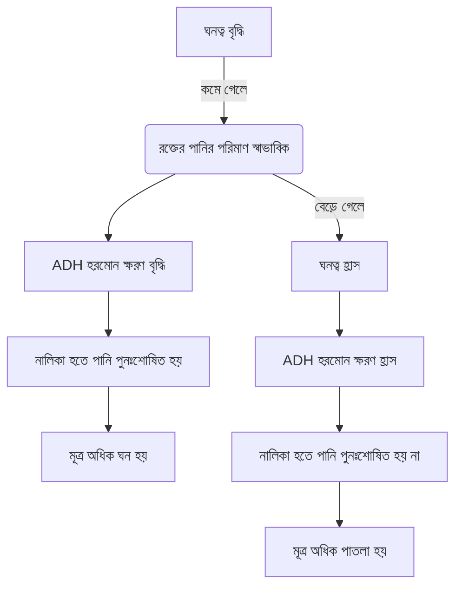

# 05-মানব শারীরতত্ত্ব-শ্বসন ও শ্বাসক্রিয়া


<!-- ========================================== -->
<!-- PDF Page 1 / 11 -->
<!-- ========================================== -->

প্রাণিবিজ্ঞান: অধ্যায়-০৫

প্র্যাকটিস প্রবলেম
প্রথমে নিজে চেষ্টা করো; অতঃপর উত্তরের সাথে মিলিয়ে নাও।

MCQ প্র্যাকটিস প্রবলেম

১. ফুসফুস সংকোচন করে- [আজমল স্যার]
(a) সেরোটোনিন (b) হিস্টামিন
(c) ব্র্যাডিকিনিন (d) সবগুলো

২. শ্বসনতন্ত্রের কোন অংশে এপিগ্লটিস অবস্থিত? [আজমল স্যার]
(a) শ্বাসনালি (b) স্বরযন্ত্র
(c) গলবিল (d) ভেস্টিবিউল

৩. নিচের কোনটি শ্বসন অঞ্চল? [আজমল স্যার]
(a) নাসা গলবিল (b) ট্রাকিয়া
(c) প্রশ্বস ব্রঙ্কিওল (d) শ্বসন ব্রঙ্কিওল

৪. ফুসফুস তরল হচ্ছে- [আজমল স্যার]
(a) প্লুরাল ফ্লুইড (b) কার্ডিয়াল ফ্লুইড
(c) সারফেক্ট্যান্ট (d) ভিট্রিয়াস ফ্লুইড

৫. শ্বসনতন্ত্রের কোন অংশে অলফ্যাক্টরি কোষ থাকে? [আজমল স্যার]
(a) ভেস্টিবিউল (b) নাসাগহ্বর
(c) পশ্চাৎ নাসারন্ধ্র (d) নাসা গলবিল

৬. শ্বসনকেন্দ্র কোথায় অবস্থিত? [আজমল স্যার]
(a) পনস (b) মধ্যমস্তিষ্ক
(c) মজ্জা (d) সেরিবেলাম

৭. হিম ও গ্লোবিন এর অনুপাত কত? [আজমল স্যার]
(a) ১:২৫ (b) ২:২৫ (c) ১:২০ (d) ৩:২০

৮. পূর্ণবয়স্ক মানুষের সমগ্র রক্তে লোহের পরিমাণ থাকে- [আজমল স্যার]
(a) ৩-৫ গ্রাম (b) ৫-৬ গ্রাম
(c) ৪-৬ গ্রাম (d) ৪-৫ গ্রাম

৯. ওটাইটিস মিডিয়া হলে দেহের তাপমাত্রা কত থাকে- [আজমল স্যার]
(a) $১০২.২^\circ F$ (b) $১০০.৪ - ১০২^\circ F$
(c) $৯৭ - ৯৯^\circ F$ (d) $১০২ - ১০৪^\circ F$

১০. সাইনুসাইটিস রোগের প্রধান উপসর্গ কোনটি? [আজমল স্যার]
(a) কাশি (b) বমি (c) জ্বর (d) মাথাব্যথা

১১. কোনটি প্যারানাসাল সাইনাস নয়? [আজমল স্যার]
(a) ফ্রন্টাল সাইনাস (b) ম্যাক্সিলারি সাইনাস
(c) স্ফেনয়েডাল সাইনাস (d) অক্সিপিটাল সাইনাস

১২. দুই ফুসফুসে মোট লোব কয়টি? [আজমল স্যার]
(a) ৩ (b) ৪ (c) ৫ (d) ৬

১৩. শ্বসনতন্ত্র কোন অংশ পর্যন্ত বিস্তৃত? [আজমল স্যার]
(a) স্বরযন্ত্র (b) ট্রাকিয়া
(c) ব্রঙ্কাই (d) অ্যালভিওলাস

১৪. শ্বাসকার্যের রাসায়নিক নিয়ন্ত্রণ এর ক্ষেত্রে কোনটি প্রভাব রাখে না? [আজমল স্যার]
(a) $CO_2$ (b) $O_2$ (c) $H^+$ (d) $H_2O$

১৫. প্রশ্বাসের মাধ্যমে আগত বাতাস ফুসফুসে পৌঁছালে ফুসফুসের অ্যালভিওলাইতে $O_2$ এর চাপ কত থাকে? [আজমল স্যার]
(a) ১০০ mmHg (b) ১০৪ mmHg
(c) ৪০ mmHg (d) কোনোটিই নয়

১৬. একটি হিমোগ্লোবিন অণু কতটি $O_2$ অণু বহন করতে পারে? [আজমল স্যার]
(a) ২ (b) ৩ (c) ৪ (d) ৫

১৭. নিচের কোনটি ঊর্ধ্ব শ্বাসনালির সংক্রমণ? [আজমল স্যার]
(a) ফ্লু (b) ব্রঙ্কাইটিস
(c) নিউমোনিয়া (d) ল্যারিনজাইটিস

১৮. ফ্লুতে কোথায় সংক্রমণ ঘটে? [আজমল স্যার]
(a) শ্বাসনালিতে (b) ফুসফুসে
(c) স্বরযন্ত্রে (d) কোনোটিই নয়

১৯. মানুষের প্যারানাসাল সাইনাস কয়টি? [আজমল স্যার]
(a) ৪ (b) ৮ (c) ৯ (d) ১০

২০. ওটাইটিস মিডিয়া থেকে বাঁচাতে বাচ্চাকে কত ডিগ্রি কোণে কোলে রেখে দুধ পান করাতে হবে? [আজমল স্যার]
(a) $৯০^\circ$ (b) $৪৫^\circ$ (c) $৬০^\circ$ (d) $৩০^\circ$

২১. ডায়াফ্রাম- এর অবস্থান কোথায়? [আজমল স্যার]
(a) বক্ষ ও উদর গহ্বর এর মাঝে (b) মস্তিষ্ক ও বক্ষের মাঝে
(c) বক্ষ গহ্বরের মাঝখানে (d) উদরের নিচের প্রান্তে

২২. ব্রঙ্কিওল ও ব্রঙ্কাই কোন স্নায়ুর সাথে যুক্ত থাকে? [আজমল স্যার]
(a) অপটিক স্নায়ু (b) ফেসিয়াল স্নায়ু
(c) অডিটরি স্নায়ু (d) ভেগাস স্নায়ু

২৩. ২ অণু হিমোগ্লোবিনে কতটি অক্সিজেন সংযুক্ত হতে পারে? [আজমল স্যার]
(a) ২টি (b) ৩টি (c) ৪টি (d) ৮টি

২৪. প্রতি ১০০ মি.লি. রক্তে কত মি.লি. $CO_2$ কার্বামিনো-হিমোগ্লোবিনরূপে বাহিত হয়? [আজমল স্যার]
(a) ২ (b) ৩ (c) ৪ (d) ৫

### MCQ উত্তরমালা

| | | | | | | | |
| :--- | :--- | :--- | :--- | :--- | :--- | :--- | :--- |
| 01. d | 02. b | 03. d | 04. a | 05. b | 06. a | 07. a | 08. d |
| 09. b | 10. d | 11. d | 12. c | 13. d | 14. d | 15. b | 16. c |
| 17. d | 18. a | 19. b | 20. b | 21. a | 22. d | 23. d | 24. a |

২৭৩
ইড্রাম একাডেমিক এন্ড এডমিশন কেয়ার
পরিবর্তনের প্রত্যয়ে নিরন্তর পথচলা...


<!-- ========================================== -->
<!-- PDF Page 2 / 11 -->
<!-- ========================================== -->

ভার্সিটি 'ক' মাস্টার প্রশ্নব্যাংক                                                                   প্রাণিবিজ্ঞান: অধ্যায়-০৪

২৫. প্রতি ১০০ মি.লি. রক্তে কত মি.লি. $CO_2$ কার্বামিনো-প্রোটিনরূপে বাহিত হয়? [আজমল স্যার]
(a) ২ (b) ৩ (c) ৪ (d) ১

২৬. কার্বন ডাই-অক্সাইড $KHCO_3$ রূপে কোনটির মাধ্যমে পরিবাহিত হয়? [আজমল স্যার]
(a) প্লাজমার মাধ্যমে (b) লোহিত কণিকার মাধ্যমে
(c) শ্বেত কণিকার মাধ্যমে (d) অণুচক্রিকার মাধ্যমে

২৭. কার্বন ডাই-অক্সাইড $NaHCO_3$ রূপে কোনটির মাধ্যমে পরিবাহিত হয়? [আজমল স্যার]
(a) প্লাজমার মাধ্যমে (b) লোহিত কণিকার মাধ্যমে
(c) শ্বেত কণিকার মাধ্যমে (d) অণুচক্রিকার মাধ্যমে

২৮. সাইনুসাইটিসের জন্য দায়ী কোনটি? [আজমল স্যার]
(a) Streptococcus pneumoniae (b) Plasmodium vivax
(c) Penicillium notatum (d) Bacillus bacter

২৯. কত বছর বয়সী শিশুদের ওটিটিস মিডিয়া বেশি দেখা দেয়? [আজমল স্যার]
(a) ১ মাস থেকে ১ বছর (b) ৩ মাস থেকে ২ বছর
(c) ৪ মাস থেকে ৪ বছর (d) ১ বছর থেকে ৫ বছর

৩০. পুরুষের Adams apple কোন তরুণাস্থির ফলে সৃষ্টি হয়? [আজমল স্যার]
(a) থাইরয়েড (b) ক্রিকয়েড (c) অ্যারিনয়েড (d) ক্যালকেনিয়াস

৩১. ফুসফুসে নিচের কোনটি সংশ্লেষিত হয়ে দেহ থেকে অপসারণ হয়? [আজমল স্যার]
(a) প্রোটিন (b) লিপিড (c) কার্বোহাইড্রেট (d) প্রোস্টাগ্ল্যান্ডিন

৩২. হিমোগ্লোবিন কি ধর্মী? [আজমল স্যার]
(a) প্রোটিনধর্মী (b) ক্ষারধর্মী (c) অ্যাসিডধর্মী (d) কোনোটিই নয়

৩৩. অ্যালভিওলাসের ক্ষেত্রে কোনটি সঠিক নয়? [আজমল স্যার]
(a) প্রাচীর পাতলা (b) ব্যাস ০.২ মি. মি.
(c) চাপা স্কোয়ামাস এপিথেলিয়াল কোষ (d) কিউবয়ডাল এপিথেলিয়াল কোষ

৩৪. কোন সাইনাসের প্রদাহের ফলে গালে ব্যথা হয়? [আজমল স্যার]
(a) ম্যাক্সিলারি (b) ফ্রন্টাল (c) এথময়েড (d) স্ফেনয়েড

৩৫. ট্রাকিয়ায় মিউকাস জমে প্রদাহের সৃষ্টি হলে সেই রোগকে কী বলা যায়? [আজমল স্যার]
(a) এমফাইসেমা (b) যক্ষ্মা (c) ব্রঙ্কাইটিস (d) প্লুরিসি

৩৬. ব্রঙ্কিওল কোন অঞ্চলের অন্তর্ভুক্ত? [আজমল স্যার]
(a) বায়ু গ্রহণ, ত্যাগ অঞ্চল (b) পরিবহন অঞ্চল (c) শ্বসন অঞ্চল (d) কোনোটিই নয়

৩৭. কত সপ্তাহ পর্যন্ত মানবভ্রুণকে গর্ভপাত করার অনুমতি আছে? [আজমল স্যার]
(a) ২৩ (b) ২৪ (c) ২৫ (d) ২৬

৩৮. বহিঃশ্বসন সম্পর্কে কোনটি সঠিক নয়? [আজমল স্যার]
(a) এনজাইমের ভূমিকা আছে (b) শক্তি উৎপন্ন হয় না
(c) অক্সিজেন গৃহীত হয় (d) ভৌত প্রক্রিয়া

৩৯. অন্তঃশ্বসন সম্পর্কে সঠিক নয় কোনটি? [আজমল স্যার]
(a) এনজাইমের ভূমিকা আছে (b) শক্তি উৎপন্ন হয়
(c) দেহকোষ ও রক্তে সংঘটিত হয় (d) ভৌত প্রক্রিয়া

৪০. কোন স্নায়ুর মাধ্যমে শ্বাসতাড়না নিউমোক্সাটিক কেন্দ্রে পৌঁছায়? [আজমল স্যার]
(a) ভেগাস (b) অডিটরি (c) ট্রাক্লিয়ার (d) কোনোটিই নয়

৪১. গলবিলীয় প্রতিবর্ত ক্রিয়া সৃষ্টি করে [আজমল স্যার]
(a) ভোমার (b) অলফ্যাক্টরি (c) গ্লোসোফ্যারিঞ্জিয়াল (d) অপটিক

৪২. পলিকিটদের শ্বাসরঞ্জক [আজমল স্যার]
(a) হিমোমোবিন (b) হিমোসায়ানিন (c) হেমোরিথ্রিন (d) ক্লোরোক্রিউরিন

৪৩. ওটাইটিস মিডিয়ার ফলে কোন ভ্যাকসিন দেওয়া হয়? [আজমল স্যার]
(a) PCV (b) NPV (c) BCG (d) কোনোটিই নয়

৪৪. শ্বসন অঞ্চল হ্রাস পায় কোন রোগে? [আজমল স্যার]
(a) যক্ষ্মা (b) এমফাইসেমা (c) প্লুরিসি (d) কাশি

৪৫. নিম্নর কোনটি খাদ্য গলাধঃকরণের সময় স্বরযন্ত্রের মুখটি বন্ধ করে? [আজমল স্যার]
(a) আলজিহ্বা (b) এপিগ্লটিস (c) ভোকাল কর্ড (d) কোয়ানা

৪৬. নিম্নর কোনটি বায়ু গ্রহণ ও ত্যাগ অঞ্চলের অংশ নয়? [আজমল স্যার]
(a) শ্বাসনালি (b) নাসিকা (c) নাসাগলবিল (d) স্বরযন্ত্র

৪৭. দেহকোষ থেকে কার্বন ডাই-অক্সাইড কীভাবে ফুসফুস পর্যন্ত পৌঁছায়? [আজমল স্যার]
(a) হিমোগ্লোবিনের সাথে যুক্ত হয়ে কার্বামিনো হিমোগ্লোবিন রূপে
(b) পানির সাথে বিক্রিয়া করে $H_2CO_3$ হিসেবে
(c) বাইকার্বনেট হিসেবে $NaHCO_3, KHCO_3$ রূপে
(d) উপরের সবগুলো

৪৮. নিম্নর কোনটি শ্বসনতন্ত্রের অন্তর্ভুক্ত নয়? [আজমল স্যার]
(a) নাসাগলবিল (b) স্বরযন্ত্র (c) মধ্যচ্ছদা (d) ট্রাকিয়া

৪৯. নিচের কোন প্রবাহ চিত্রটি সঠিক? [আজমল স্যার]
(a) ট্রাকিয়া $\rightarrow$ ব্রঙ্কাই $\rightarrow$ ব্রঙ্কিওল $\rightarrow$ অ্যালভিওলার নালি $\rightarrow$ অ্যালভিওলার থলি $\rightarrow$ অ্যালভিওলাস
(b) ব্রঙ্কাই $\rightarrow$ ট্রাকিয়া $\rightarrow$ ব্রঙ্কিওল $\rightarrow$ অ্যালভিওলার নালি $\rightarrow$ অ্যালভিওলার থলি $\rightarrow$ অ্যালভিওলাস
(c) ট্রাকিয়া $\rightarrow$ ব্রঙ্কিওল $\rightarrow$ ব্রঙ্কাই $\rightarrow$ অ্যালভিওলার নালি $\rightarrow$ অ্যালভিওলার থলি $\rightarrow$ অ্যালভিওলাস
(d) ট্রাকিয়া $\rightarrow$ অ্যালভিওলার থলি $\rightarrow$ ব্রঙ্কাই $\rightarrow$ ব্রঙ্কিওল $\rightarrow$ অ্যালভিওলার নালি $\rightarrow$ অ্যালভিওলাস

| MCQ উত্তরমালা |
|:---:|:---:|:---:|:---:|:---:|:---:|
| 25. d | 26. b | 27. a | 28. a | 29. c | 30. a |
| 31. d | 32. d | 33. d | 34. a | 35. c | 36. b |
| 37. b | 38. a | 39. d | 40. a | 41. c | 42. d |
| 43. a | 44. b | 45. b | 46. a | 47. d | 48. c | 49. a |

উদ্ভাস একাডেমিক এন্ড এডমিশন কেয়ার                                                                  ২৯৪                                  পরিবর্তনের প্রত্যয়ে নিরন্তর পথচলা...


<!-- ========================================== -->
<!-- PDF Page 3 / 11 -->
<!-- ========================================== -->

প্রাণিবিজ্ঞান অধ্যায়-০৪

৫৮. সাইপানকুলিদের কোন ধরনের শ্বাসরঞ্জক থাকে? [আলীম স্যার]
(a) হিমোগ্লোবিন (b) হিমোসায়ানিন
(c) ক্লোরোক্রিউরিন (d) হিমোএরিথ্রিন

৫৯. ঊর্ধ্ব শ্বাসনালির সংক্রমণের প্রধান লক্ষণ কোনটি? [আলীম স্যার]
(a) কাশি (b) হাঁচি
(c) মাথাব্যথা (d) বুকে ব্যথা

৬০. জীবতাত্ত্বিক ঘড়ি বলা হয় কোনটিকে? [আলীম স্যার]
(a) থ্যালামাস (b) হাইপোথ্যালামাস
(c) মেডুলা (d) পনস

| MCQ উত্তরমালা | | | | | |
| :--- | :--- | :--- | :--- | :--- | :--- |
| ৫০. b | ৫১. c | ৫২. c | ৫৩. d | ৫৪. c | ৫৫. d |
| ৫৬. c | ৫৭. a | ৫৮. d | ৫৯. a | ৬০. b | |

(≡) Written প্র্যাকটিস প্রবলেম

০১. বহিঃশ্বসন ও অন্তঃশ্বসনের ৫টি পার্থক্য লিখ। [আজমল স্যার]
০২. ধূমপায়ী ও অধূমপায়ীর এক্স-রে এর মধ্যে ৫টি পার্থক্য লিখ। [আজমল স্যার]
০৩. অক্সিজেন পরিবহণের পদ্ধতি সমূহ কী কী? মানুষের ক্ষেত্রে শ্বাসরঞ্জকের নাম লিখ। [আজমল স্যার]
০৪. সারফ্যাকট্যান্ট কী? এর ৩টি কাজ লিখ। [আজমল স্যার]
০৫. ওটাইটিস মিডিয়া কী? ওটাইটিস মিডিয়ার ৪টি জটিলতা লিখ। [আজমল স্যার]
০৬. ছকের সাহায্যে ব্রঙ্কিয়াল বৃক্ষের গঠন দেখাও।
০৭. শ্বসনের কেন্দ্র কয়টি এবং কোথায় অবস্থিত? শ্বসনের প্রধান উদ্দীপনাসমূহ কী কী?
০৮. শ্বসনের সাথে জড়িত পেশি ও তাদের স্নায়ু সরবরাহ উল্লেখ কর। শ্বাসগ্রহণে পেশিসমূহের ভূমিকা কিরূপ? CO কে কেন নীরব ঘাতক বলা হয়?

---
প্র্যাকটিস প্রবলেমের সমাধান
---

MCQ প্র্যাকটিস প্রবলেমের সমাধান
ব্যাখ্যা: (d); নাসা গলবিল $\rightarrow$ বায়ু গ্রহণ ও ত্যাগ অঞ্চল।
ট্রাকিয়া, ব্রঙ্কিয়াল বৃক্ষ $\rightarrow$ বায়ু পরিবহণ অঞ্চল।
ব্যাখ্যা: (d); ঊর্ধ্ব শ্বাসনালির সংক্রমণ $\rightarrow$ সাধারণ ঠাণ্ডা, সাইনুসাইটিস, ল্যারিনজাইটিস, ওটাইটিস মিডিয়া।
নিম্ন শ্বাসনালির সংক্রমণ $\rightarrow$ ফুসফুস, ব্রঙ্কাইটিস, নিউমোনিয়া, যক্ষ্মা।
ব্যাখ্যা: (d); ১ অণু হিমোগ্লোবিনে চারটি $O_2$ অণু সংযুক্ত হতে পারে।
ব্যাখ্যা: (a); থাইরয়েড তরুণাস্থি পুরুষে গলার সামনে উঁচু হয়ে ওঠে। একে Adam's Apple বলে।
ব্যাখ্যা: (a); ম্যাক্সিলারি $\rightarrow$ গালে, দাঁতে ও মাথায় ব্যথা।

ফ্রন্টাল $\rightarrow$ চোখের উপরে ও মাথায় ব্যথা।
এথময়েড $\rightarrow$ দুচোখের মাঝখানে বা পিছনে এবং মাথায় ব্যথা।
স্ফেনয়েড $\rightarrow$ চোখের পিছনে ও মাথার চূড়ায় ব্যথা।

৪১. ব্যাখ্যা: (c);
প্রতিবর্ত ক্রিয়া $\rightarrow$ জড়িত স্নায়ু
হেইরিং-ব্রোয়ার $\rightarrow$ ভেগাস
হাঁচি $\rightarrow$ ভেগাস
কাশি $\rightarrow$ ভেগাস
গলবিলীয় বা গ্যাপ $\rightarrow$ গ্লসোফ্যারিঞ্জিয়াল

৪৬. ব্যাখ্যা: (a); শ্বাসনালি বায়ু পরিবহণ অঞ্চলের অংশ।
৫০. ব্যাখ্যা: (b); ডায়াফ্রাম পেশি ও ইন্টারকোস্টাল পেশি হলো শ্বাস পেশি। যা সকল স্তন্যপায়ী প্রাণীতে পাওয়া যায়।

উদ্ভাস একাডেমিক এন্ড এডমিশন কেয়ার | ২৭৫ | পরিবর্তনের প্রত্যয়ে নিরন্তর পথচলা...

CS CamScanner


<!-- ========================================== -->
<!-- PDF Page 4 / 11 -->
<!-- ========================================== -->

ভার্সিটি 'ক' মাস্টার প্রশ্নব্যাংক                                                                                                    প্রাণিবিন্যাস. অধ্যায়-০৪

( written) প্র্যাকটিস প্রবলেমের সমাধান

**০১. উত্তর: বহিশ্বসন ও অন্তঃশ্বসন এর মধ্যে ৫টি পার্থক্য নিম্নরূপ—**

| পার্থক্যের বিষয় | বহিশ্বসন | অন্তঃশ্বসন |
| :--- | :--- | :--- |
| (i) প্রকৃতি | এটি ভৌত রাসায়নিক প্রক্রিয়া। | এটি জৈব রাসায়নিক প্রক্রিয়া। |
| (ii) ক্রিয়াস্থল | এটি ফুসফুসের অভ্যন্তরে সম্পন্ন হয়। | এটি সকল কোষ অভ্যন্তরে সাইটোপ্লাজমে, মাইটোকন্ড্রিয়াতে এবং রক্তে সম্পন্ন হয়। |
| (iii) প্রধান উপ-পর্যায় | শ্বাসগ্রহণ ও শ্বাসত্যাগ। | গ্লাইকোলাইসিস, ক্রেবস চক্র ও ইলেকট্রন ট্রান্সপোর্ট চেইন। |
| (iv) শক্তি | শক্তি উৎপন্ন হয় না। | শক্তি উৎপন্ন হয়। |
| (v) এনজাইম | এনজাইমের ভূমিকা নেই। | এনজাইম গুরুত্বপূর্ণ ভূমিকা পালন করে। |

**০২. উত্তর: ধূমপায়ী ও অধূমপায়ীর এক্স-রে এর মধ্যে ৫টি পার্থক্য নিম্নরূপ—**

| অধূমপায়ীর ফুসফুসের এক্স-রে | ধূমপায়ীর ফুসফুসের এক্স-রে |
| :--- | :--- |
| (i) ফুসফুস আকৃতিগতভাবে স্বাভাবিক থাকে। | (i) সার্বিকভাবে ফুসফুসের আকার বৃদ্ধি পায়। |
| (ii) এক্স-রে ফিল্মটি কালো থাকবে, আর ফুসফুসের সকল অঞ্চল স্বচ্ছ ও পরিষ্কার থাকবে। | (ii) এক্স-রে ফিল্মটি সম্পূর্ণ কালো হয় না বরং ফুসফুসের বিভিন্ন অংশের মধ্যে অসংখ্য ছোপের মতো বিচ্ছুরিত ঝাপসা অংশ দেখা যায়। |
| (iii) অ্যালভিওলাইয়ের সংখ্যা স্বাভাবিক থাকে এবং এতে সুষম স্বচ্ছতা দেখা যায়। | (iii) অ্যালভিওলাইয়ের সংখ্যা কমে যায় (নষ্ট হয়ে যাওয়ার কারণে) এবং সুষম স্বচ্ছতা দেখা যায় না। |
| (iv) এমফাইসেমা-র কোন বৈশিষ্ট্য দেখা যায় না। | (iv) এমফাইসেমা হলে তার চিহ্ন দেখা যায়। |
| (v) ফুসফুস ও হৃদপিণ্ডের প্রচ্ছায়া স্বাভাবিক ও সমানুপাতিক হয়। | (v) হৃদপিণ্ডের প্রচ্ছায়া ফুসফুসের তুলনায় ছোট হয়। |

**০৩. উত্তর: মানবদেহে অক্সিজেন পরিবহণে সাধারণত ২টি পদ্ধতিতে হয়ে থাকে। এগুলো হলো:**
(i) ভৌত দ্রবণরূপে: প্রায় ২% $O_2$ রক্তের প্লাজমায় দ্রবীভূত হয়ে ভৌত দ্রবণরূপে পরিবাহিত হয়।
(ii) রাসায়নিক যৌগরূপে: প্রায় ৯৮% $O_2$ রাসায়নিক যৌগরূপে রক্ত দ্বারা পরিবাহিত হয়।
মানুষের ক্ষেত্রে শ্বাসরঞ্জক হিসেবে কাজ করে হিমোগ্লোবিন।

**০৪. উত্তর: সারফ্যাকট্যান্ট: ডিটারজেন্ট এর মতো রাসায়নিক পদার্থ যা অ্যালভিওলাই প্রাচীরের কিছু বিশেষ কোষ থেকে ক্ষরিত হয়।**
**কাজ:**
(i) অ্যালভিওলাস-প্রাচীরের তরল পদার্থের পৃষ্ঠটান কমিয়ে দেয়, ফলে শ্বাস-প্রশ্বাসের সময় ফুসফুস কম পরিশ্রমে সংকুচিত ও প্রসারিত হতে পারে।
(ii) বাতাস ও অ্যালভিওলাস-প্রাচীর সংলগ্ন তরল পদার্থে $O_2$ ও $CO_2$ -এর দ্রুত বিনিময়ে সাহায্য করে।
(iii) অ্যালভিওলাসে আগত জীবাণু ধ্বংস করে।

**০৫. উত্তর: ওটাইটিস মিডিয়া: কানের মধ্যকর্ণে সংক্রমণজনিত প্রদাহকে ওটাইটিস মিডিয়া বলে। গলবিলের সাথে ইউস্টেশিয়ান নালী অধিকাংশ সময়েই বন্ধ থাকে তবে কোনো কারণে জীবাণু এ নালী দিয়ে মধ্যকর্ণে প্রবেশ করলে ওটাইটিস মিডিয়া সৃষ্টি হয়।**
**নিচে ওটাইটিস মিডিয়ার ৪টি জটিলতা উল্লেখ করা হলো:**
(i) কানের পর্দা বা টিম্পেনিক পর্দায় ছিদ্র হয়।
(ii) ছিদ্রপথে মধ্যকর্ণ থেকে গাঢ় তরল পদার্থ গড়িয়ে পড়ে।
(iii) কানে কম শোনে।
(iv) কানে কম শোনার কারণে শিশুরা সহজে কথা বলা শিখতে পারে না।

উদ্ভাস একাডেমিক এন্ড এডমিশন কেয়ার                                           ২৫৬                                          পরিবর্তনের প্রত্যয়ে সর্বদা


<!-- ========================================== -->
<!-- PDF Page 5 / 11 -->
<!-- ========================================== -->

জমিটি 'ক' ল্যাবেট মডিউল

প্রাণিবিজ্ঞান: অধ্যায়-০৬

# অধ্যায় ০৬
# মানব শারীরতত্ত্ব: বর্জ্য ও নিষ্কাশন

### টপিক অ্যানালাইসিস

*অ্যাডমিট ভর্তি পরীক্ষার জন্য এই অধ্যায়ের গুরুত্বপূর্ণ টপিকসমূহ:*

| গুরুত্ব | টপিক | বিগত বছরে MCQ | বিগত ভর্তি পরীক্ষায় প্রশ্ন এসেছে (MCQ) |
| :--- | :--- | :--- | :--- |
| 000 | T-01: বৃক্কের গঠন | 34 | DU'14-15, 13-14; JnU'25-26, 19-20; RU'20-21, 19-20, 16-17, 12-13, 09-10, 07-08; CU'22-23, 20-21, 18-19, 17-18; KU'19-20, 16-17; SUST'25-26; Agt'25-26, 24-25; BAU'14-15 |
| 00 | T-02: নেফ্রনের শারীরতত্ত্ব | 14 | DU'15-16, 13-14; JnU'16-17; RU'23-24, 22-23, 18-19; CU'25-26, 21-22; KU'25-26, 19-20, 18-19; SUST'25-26; Agt'24-25; BUP'23-24 |
| 00 | T-03: বৃক্ক বিকল, ডায়ালাইসিস, হরমোনাল ক্রিয়া | 07 | JnU'25-26; RU'17-18; CU'20-21; KU'18-18; SUST'24-25; Agt'24-25; CoU'25-26 |

---

### T-01: বৃক্কের গঠন

**(p) কনসেপ্ট রিভিউ**

**বৃক্ক**

* বাহ্যিক গঠন:

| বাহ্যিক গঠন | বর্ণনা |
| :--- | :--- |
| আকৃতি | শিম বীজের মতো, পার্শ্বদেশ উত্তল, ভিতরের দিক অবতল, নিরেট চাপা। |
| আবরণ | রেনাল ক্যাপসুল বা টিউনিকা ফাইব্রোসা নামক যোজক টিস্যু। |
| সংযুক্ত গ্রন্থি | অ্যাডরেনাল বা সুপ্রারেনাল গ্রন্থি যা বৃক্কের অগ্রপ্রান্তে মাথার উপর টুপির ন্যায় অবস্থান করে। |
| হাইলাম | > ভিতরের দিকে অবতল অংশের ভাজকে/কুঞ্চিত অংশকে হাইলাম (বহুবচনে হাইলাস) বলে। <br> > প্রবেশ: রেনাল ধমনি ও স্নায়ু। <br> > নির্গমন: রেনাল শিরা ও ইউরেটার। |

**অন্তর্গঠন**

* অন্তর্গঠন: ৩টি অংশ—

| কর্টেক্স | > বৃক্কের বাহিরের দিকে রেনাল ক্যাপসুল সংলগ্ন গাঢ় অংশটি হলো কর্টেক্স। <br> > ২ টি অঞ্চলে বিভক্ত। যথা: বহিঃস্থ কর্টিক্যাল বা সুপারফিশিয়াল ও অন্তঃস্থ জাস্টামেডুলারি অঞ্চল। <br> > এই অংশে থাকে নেফ্রনের রেনাল করপাসল, নিকটবর্তী প্যাঁচানো নালিকা, দূরবর্তী প্যাঁচানো নালিকা। <br> > মেডুলার রেনাল পিরামিডের ফাকে ফাকে কর্টেক্সের যে অংশ বিস্তৃত থাকে তাকে রেনাল কলাম বলে। |

---
**উদ্ভাস অ্যাকাডেমিক এন্ড এডমিশন কেয়ার** | ২৭৮ | পরিবর্তনের প্রত্যয়ে নিরন্তর পথচলা
---
CS CamScanner


<!-- ========================================== -->
<!-- PDF Page 6 / 11 -->
<!-- ========================================== -->

‘ক’ মাস্টার ল্যাবরেটরি

➢ বৃক্কের ভিতরের দিকে হালকা লাল বর্ণের কেন্দ্রীয় অংশটি হলো মেডুলা।
• মেডুলা অংশে থাকে নেফ্রনের হেনলির লুপ, সংগ্রাহক নালিকা ও রক্তনালিকা।
• এই অংশটি ৮-১৮টি পিরামিড আকৃতির অংশ নিয়ে গঠিত, যাদের রেনাল পিরামিড বলে।
• রেনাল পিরামিডের শীর্ষকে বলা হয় রেনাল প্যাপিলা। এই রেনাল প্যাপিলা ১০-২০টি ছিদ্র যুক্ত এক মাধ্যমের দ্বারা মাইনর ক্যালিক্সের উপরিভাগে উন্মুক্ত হয়।
• ২-৩টি রেনাল প্যাপিলা হতে নির্গত মাইনর ক্যালিক্স মিলিত হয়ে একটি মেজর ক্যালিক্স গঠন করে। এরপর ২-৩টি মেজর ক্যালিক্স উন্মুক্ত হয় বৃক্কের রেনাল পেলভিসে।
➢ রেনাল পেলভিস হলো ইউরেটার বা রেচননালির উপরের দিকের ফানেল আকৃতির প্রশস্ত অংশ যেখানে মেজর ক্যালিক্সগুলো উন্মুক্ত হয়।

নেফ্রন: বৃক্কের গাঠনিক ও কার্যকরী একক।
সংখ্যা: প্রতি বৃক্কে ১০-১২ লক্ষ।

নেফ্রনের গঠন:
নেফ্রন $\rightarrow$ রেনাল বা ম্যালপিজিয়ান করপাসল $\rightarrow$ রেনাল টিউবিউলস
রেনাল বা ম্যালপিজিয়ান করপাসল (রক্তের আল্ট্রাফিল্ট্রেশন ঘটে) $\rightarrow$ রেনাল ক্যাপসুল (দ্বিস্তরের এপিথেলিয়াল কোষনির্মিত, ভিসেরাল ও প্যারাইটাল স্তর মধ্যখানে সংকীর্ণ গহ্বর ক্যাপসুলার স্পেস) | গ্লোমেরুলাস (অ্যাফারেন্ট আর্টারিওল থেকে সৃষ্ট ৪০-৫০টি কৈশিকজালিকা দিয়ে গঠিত হয়)
রেনাল টিউবিউলস $\rightarrow$ প্রক্সিমাল বা নিকটবর্তী প্যাঁচানো নালিকা (নির্বাচনমূলক পুনঃশোষণ) | হেনলির লুপ (পলি পুনঃশোষণ) (অবরোহণ বাহু | আরোহণ বাহু) | ডিস্টাল বা দূরবর্তী প্যাঁচানো নালিকা (পানি ও অন্যান্য লবণ পুনঃশোষণ)

---
**বিগত ভর্তি পরীক্ষার MCQ প্রশ্ন-সলভ**

১. কোনটি নেফ্রনের অংশ নয়? [JNU'25-26; DU'13-14]
(a) Renal pelvis
(b) Glomerulus
(c) Loop of Henle
(d) Collecting duct
(a)

২. রেনাল ক্যাপসুলের ভিসেরাল স্তর ও প্যারাইটাল স্তরের মধ্যবর্তী সংকীর্ণ গহ্বরকে কী বলে? [SUST'25-26]
(a) ক্যাপসুলার স্পেস
(b) পোডোসাইট
(c) কর্টেক্স
(d) মেডুলা
(a)

৩. লুপ অফ হেনলি শরীরের কোন অঙ্গের অংশ? [Agri'25-26; CU'20-21]
(a) যকৃৎ (b) বৃক্ক (c) প্লীহা (d) হৃদপিণ্ড
(b)

৪. কোন অঙ্গটি দেহ থেকে ক্ষতিকর পদার্থ নিষ্কাশনে ভূমিকা রাখে না? [Agri'24-25]
(a) ফুসফুস (b) অন্ত্র (c) হৃদপিণ্ড (d) ত্বক
(c)
ব্যাখ্যা: হৃদপিণ্ড রক্ত পরিবহণে ও রক্তচাপ বজায় রাখতে সাহায্য করে।

৫. মানবদেহের একটি বৃক্কে কত লক্ষ নেফ্রন আছে? [CU'22-23; RU'12-13]
(a) 8-10 (b) 10-12 (c) 12-14 (d) 14-16
(b)

৬. হেনলির লুপ নেফ্রনের কোনটির অংশ? [RU'20-21]
(a) রেনাল করপাসল (b) রেনাল টিউবিউলস
(c) গ্লোমেরুলাস (d) রেনাল ক্যাপসুল
(b)

৭. বৃক্কের অবতল অংশের ভাজকে কী বলে? [JU'19-20; BAU'14-15; RU'09-10]
(a) ক্যাপসুল (b) হাইলাম
(c) পেলভিস (d) মেডুলা
(b)
ব্যাখ্যা: ক্যাপসুল $\rightarrow$ বৃক্কের যোজক টিস্যুর আবরণ বেষ্টিত।
পেলভিস $\rightarrow$ বৃক্কের অভ্যন্তরে বৃহৎ সংগ্রাহক স্থান।
মেডুলা $\rightarrow$ বৃক্কের লম্বচ্ছেদের মধ্যভাগে হালকা লাল রঙের অংশটিই মেডুলা। এটি ৮-১৮ টি রেনাল পিরামিড নিয়ে গঠিত।

---
উদ্ভাস একাডেমিক এন্ড এডমিশন কেয়ার
২৭৪
পরিবর্তনের প্রত্যয়ে নিরন্তর পথচলা...


<!-- ========================================== -->
<!-- PDF Page 7 / 11 -->
<!-- ========================================== -->

প্রাণিবিজ্ঞান অধ্যায় - ৩

০৮. নিকটবর্তী প্যাঁচানো নালিকা বৃক্কের কোথায় অবস্থিত? [RU '১৪-১৫]
(a) মেডুলা (b) মাইনর ক্যালিক্স
(c) কর্টেক্স (d) পেলভিস

০৯. বৃক্কীয় নালিকার অংশ নয় কোনটি? [RU '১৪-১৫]
(a) হেনলির লুপ (b) গ্লোমেরুলাস
(c) কালেক্টিং নালী (d) ডিসটাল প্যাঁচানো নালিকা

১০. বৃক্কের সূক্ষ্ম গঠনের সঠিক বর্ণনা প্রথম কে দিয়েছিলেন? [RU '১৪-১৫]
(a) হার্ভে উইলিয়াম (b) চার্লস ডারউইন
(c) উইলিয়ামসন (d) স্যার উইলিয়াম বোম্যান

১১. রেনাল মেডুলার (Renal medulla) শঙ্কু আকৃতির (Cone Shape) অংশকে কী বলে? [RU '১৪-১৫]
(a) এডিফোস ক্যাপসুল (b) রেনাল কর্টেক্স
(c) রেনাল পেলভিস (d) রেনাল পিরামিড

১২. একজন পূর্ণবয়স্ক পুরুষের একটি বৃক্কের ওজন কত? [RU '১৩-১৪]
(a) ১৫০-১৭০ গ্রাম (b) ১২০-১৭০ গ্রাম
(c) ১৩০-১৪০ গ্রাম (d) ১৪০-১৭০ গ্রাম

১৩. বৃক্কের গাঠনিক ও কার্যকর একক কোনটি? [CU '১৭-১৮; RU '১৬-১৭, ০৭-০৮; KU '০৮-০৯]
(a) কর্টেক্স (b) মেডুলা
(c) নেফ্রন (d) প্যাপিলা

১৪. কোনটি মানব বৃক্কের মালপিজিয়ান কণিকার অংশ? [DU '১৫-১৬]
(a) Bowman's Capsule (b) Henle's Loop
(c) Collecting tubule (d) Renal tubule

১৫. মানববৃক্কের অবতল পৃষ্ঠের কুঞ্চিত অংশকে কী বলে? [BAU '১৪-১৫, RU '০৯-১০]
(a) নেফ্রন (b) হাইলাম (c) মেডুলা (d) কর্টেক্স

T-০২: রেচনের শারীরতত্ত্ব

* ইউরিয়া ($NH_2 - CO - NH_2$)
    * ইউরিয়া তৈরির প্রক্রিয়া: অরনিথিন চক্র বা ইউরিয়া চক্র, যা লিভারে সংঘটিত হয়।
    * বিক্রিয়া:
        (i) আমিষ খাদ্য $\xrightarrow{এনজাইম}$ অ্যামিনো অ্যাসিড
        (ii) অ্যামিনো অ্যাসিড $\xrightarrow{Deamination}$ কিটো অ্যাসিড + $NH_3$
        (iii) $NH_3 + H^+ \rightarrow NH_4$ (অ্যামোনিয়া)
        (iv) $2NH_3 + CO_2 \xrightarrow{অরনিথিন চক্র}$ $NH_2 - CO - NH_2$ (ইউরিয়া) + $H_2O$
* ইউরিক অ্যাসিড: DNA, RNA এর পিউরিন বেস এর বিপাকের ফলে তৈরি হয় ইউরিক অ্যাসিড।
* ক্রিয়েটিনিন:
    * রক্তে ক্রিয়েটিনিন এর মাত্রাকে বৃক্কের রোগ নির্ণয়ের নির্দেশক বলা হয়।
    * রক্তে ক্রিয়েটিনিন এর স্বাভাবিক মাত্রাঃ পুরুষ- $০.৬-১.২$ mg/dl,
      মহিলা- $০.৫-১.১$ mg/dl.

| মূত্র | |
| :--- | :--- |
| বর্ণ | মূত্রে ইউরোক্রোম নামক রঞ্জক থাকায় এটি ইষৎ (হালকা হলুদ) বর্ণের হয়। |
| পরিমাণ | • বৃক্ক দৈনিক ৬০০-২৫০০ মিলিলিটার মূত্র উৎপাদন করে। |
| | • একজন সুস্থ মানুষ প্রতিদিন গড়ে ১৫০০ মি.লি মূত্র ত্যাগ করে। |
| গন্ধ | • স্বাভাবিক মূত্র ফেলে রাখলে অ্যামোনিয়ার গন্ধ হয়। মূত্রের ইউরিয়া জীবাণুর সংস্পর্শে এসে অ্যামোনিয়ায় রূপান্তরিত হয়। |
| | • দুর্গন্ধযুক্ত ইউরিনয়েড ($C_8H_8O$) এর উপস্থিতির জন্য মূত্রে গন্ধ হয়। |
| আপেক্ষিক গুরুত্ব | ১.০০৮-১.০৩০ |
| রাসায়নিক ধর্ম/বিক্রিয়া | মূত্র সামান্য অম্লীয়, এর গড় pH মান ৬.০ (মাত্রা ৪.৫-৮.০)। |

|| উদ্ভাস একাডেমি এন্ড এডমিশন কেয়ার | ২৬১ | পরিবর্তনের মাধ্যমে শিক্ষার পথে ||


<!-- ========================================== -->
<!-- PDF Page 8 / 11 -->
<!-- ========================================== -->

ভার্সিটি 'ক' মাস্টার প্রশ্নব্যাংক                                                                  প্রাণিবিজ্ঞান অধ্যায়-০৬  

**অসমোরেগুলেশন**
দেহকোষের কোষরসে বিদ্যমান পানি ও বিভিন্ন লবণের ভারসাম্য রক্ষার কৌশলকে অসমোরেগুলেশন বা Osmoregulation বলা হয়।

**অসমোরেগুলেশনে বৃক্কের ভূমিকা:**

```mermaid
graph TD
    A[দেহে পানির পরিমাণ বেড়ে গেলে] --> B[রক্তের আয়তন ও রক্তচাপ বৃদ্ধি পায় এবং রক্তের অস্মোটিক চাপ হ্রাস পায়]
    B --> C[অতি পরিশ্রাবণ হার বৃদ্ধি (Ultrafiltration)]
    B --> D[পশ্চাৎ পিটুইটারি গ্রন্থি হতে ADH নিঃসরণ হ্রাস পায়]
    C --> E[অধিক গ্লোমেরুলার ফিলট্রেট উৎপাদন]
    D --> F[দূরবর্তী প্যাঁচানো নালিকা ও সংগ্রাহী নালিকায় পানি পুনঃশোষণ হ্রাস পায় (Reabsorption)]
    E --> G[বৃক্ক কম ঘনত্বের অধিক 16 ml/min তৈরি করার মাধ্যমে দেহের অতিরিক্ত পানি বের করে দেয়]
    F --> G
    G --> H[দেহের আয়তন স্বাভাবিক হয়ে আসে]
```

---

### বিগত ভর্তি পরীক্ষার MCQ প্রশ্ন-সলভ

**01. নিম্নোক্ত কোন চক্রে (Cycle) ইউরিয়া উৎপন্ন হয়? [CU '25-26]**
(a) ফ্যাটি অ্যাসিড চক্র 
(b) অরনিথিন চক্র
(c) ক্রেবস চক্র 
(d) নাইট্রোজেন চক্র
**(b)**

**02. মানবদেহে কোন অঙ্গে ইউরিয়া তৈরি হয়? [KU '25-26]**
(a) পাকস্থলীতে 
(b) যকৃতে
(c) বৃক্কে 
(d) ক্ষুদ্রান্ত্রে
**(b)**

**03. কোনটির বিপাকে Hyperuricosuria তৈরি হয়? [SUST '25-26]**
(a) Arginine 
(b) Guanine
(c) Cytosine 
(d) Uracil
**(b)**
**ব্যাখ্যা:** Guanine ভেঙে Uric acid তৈরি হয় যা মানুষের শরীর আর ভাঙতে পারে না। Urine-এ ইউরিক অ্যাসিডের পরিমাণ অতিরিক্ত বেড়ে গেলে তাকে hyperuricosuria বলে।

**04. 750 mL রক্ত পরিশোধন করতে মানুষের উভয় কিডনির কত সময় লাগবে? [Agri '24-25]**
(a) 60 সেকেন্ড 
(b) 120 সেকেন্ড
(c) 240 সেকেন্ড 
(d) 360 সেকেন্ড
**ব্যাখ্যা:** প্রকৃতপক্ষে দুটি কিডনির মাধ্যমে ৬০ সেকেন্ড বা প্রতি মিনিটে ১২০০ml রক্ত প্রবাহিত হয়। সেই অর্থে ৭৫০ ml রক্ত পরিশোধন করতে ৩৭.৫ সেকেন্ড সময় প্রয়োজন। প্রতি মিনিটে ১২৫ml গ্লোমেরুলার ফিলট্রেট বা পরিশ্রুত তরল তৈরি হয়। সেক্ষেত্রে ৭৫০ml গ্লোমেরুলার ফিলট্রেট তৈরি করতে ৩৬০ সেকেন্ড সময় প্রয়োজন।
[প্রশ্নটি ত্রুটিপূর্ণ তবে অপশনগুলোর সাপেক্ষে (d) অপশনটি অধিক গ্রহণযোগ্য।]

**05. ইউরিয়া চক্রের সঠিক নির্দেশিত পথ কোনটি? [RU '23-24]**
(a) সাইট্রুলিন $\to$ আর্জিনোসাকসিনেট $\to$ আর্জিনিন $\to$ অরনিথিন
(b) অরনিথিন $\to$ আর্জিনিন $\to$ আর্জিনোসাকসিনেট $\to$ সাইট্রুলিন
(c) আর্জিনোসাকসিনেট $\to$ সাইট্রুলিন $\to$ আর্জিনিন $\to$ অরনিথিন
(d) কোনটিই নয়
**(a)**

**06. মুত্রে ইউরিক অ্যাসিডের পরিমাণ কত? [BUP '23-24]**
(a) 0.5% 
(b) 0.05%
(c) 0.01% 
(d) 0.1%
**(b)**

**07. পুরুষ মানুষের রক্তে ক্রিয়েটিনিনের স্বাভাবিক মাত্রা কত mg/dl? [RU '22-23]**
(a) 0.06 – 0.15 
(b) 0.6 – 1.2
(c) 3.0 – 4.0 
(d) 5.0 – 6.0
**(b)**

---
৬ উদ্ভাস একাডেমিক এন্ড এডমিশন কেয়ার                                       ২৯১                                     পরিবর্তনের প্রত্যয়ে নিরন্তর পথচলা...


<!-- ========================================== -->
<!-- PDF Page 9 / 11 -->
<!-- ========================================== -->

ভার্সিটি 'ক' মাস্টার প্রশ্নব্যাংক                                                     প্রাণিবিজ্ঞান: অধ্যায়-০৬

০৮. নিচের কোনটি বিপাকের কারণে ইউরিক অ্যাসিড তৈরি হয়?
                                       [CU' 21-22]
    (a) অ্যামাইনো অ্যাসিড   (b) পিউরিন
    (c) টিস্যু প্রোটিন       (d) সবগুলা 
                                       (b)

০৯. নাইট্রোজেনজাত বর্জ্য থেকে ইউরিয়া সৃষ্টিতে কোন 
    এনজাইমটি প্রয়োজন?                [KU' 19-20]
    (a) আইসোমারেজ         (b) ডি-অ্যামাইনেজ
    (c) ইউরিয়েজ           (d) ট্রান্সঅ্যামাইনেজ 
                                       (b)

১০. রক্তে কিসের মাত্রাকে কিডনি রোগ নির্ণয়ের নির্দেশক বলা 
    হয়?                               [RU' 18-19]
    (a) কাইমোট্রিপসিন      (b) ক্রিয়েটিনিন
    (c) অরনিথিন           (d) L-আরজিনেজ
                                       (b)

১১. মানব দেহের কোন অঙ্গটি রক্তের pH নিয়ন্ত্রণ করে?
                                       [KU' 18-19]
    (a) বৃক্ক               (b) যকৃৎ
    (c) ফুসফুস            (d) হৃৎপিণ্ড 
                                       (a)

১২. মানুষের প্রধান নাইট্রোজেনঘটিত রেচন বর্জ্য নয় কোনটি?
                                       [JnU' 16-17]
    (a) অ্যামোনিয়া          (b) হিপনোটক্সিন
    (c) ক্রিয়েটিনিন         (d) ইউরিয়া
                                       (b)
    ব্যাখ্যা: মানুষের প্রধান নাইট্রোজেনঘটিত রেচন বর্জ্য:
    ইউরিয়া, ইউরিক অ্যাসিড, অ্যামোনিয়া, ক্রিয়েটিনিন ইত্যাদি।
    হিপনোটক্সিন হলো আমিষ ও ফেনল দ্বারা গঠিত বিষাক্ত
    তরল যা হাইড্রার নিডোসাইটে থাকে।

১৩. অসমোরেগুলেশন মানব দেহের কোন অঙ্গের মাধ্যমে হয়ে
    থাকে?                             [DU' 15-16]
    (a) যকৃৎ              (b) অগ্ন্যাশয়
    (c) বৃক্ক              (d) ফুসফুস
                                       (c)

১৪. বৃক্কের কোন অংশে Filtration হয়?      [DU' 13-14]
    (a) হেনলির লুপে        (b) গ্লোমেরুলাসে
    (c) গোড়াদেশীয় প্যাঁচানো নালিতে
    (d) মূত্রনলিতে
                                       (b)

-----------------------------------------------------------
T-03: বৃক্ক বিকল, ডায়ালাইসিস, হরমোনাল ক্রিয়া
-----------------------------------------------------------

কনসেপ্ট রিভিঊ

বৃক্কের বিকল
* বৃক্ক বিকল দুই ধরনের, তাৎক্ষণিক (Acute renal failure) (৪৮ ঘণ্টার মধ্যে) এবং দীর্ঘক্ষণিক (Chronic renal failure) (৩ মাস বা 
  তার অধিক সময় যাবৎ)

* তাৎক্ষণিক বৃক্ক বিকলের লক্ষণ:
  (i) অতি অল্প, ঘন ও গাঢ় মূত্র ত্যাগ বা মূত্র একেবারেই না হওয়া।
  (ii) রক্তে নাইট্রোজেনজাত বর্জ্যপদার্থ সঞ্চিত হওয়া।
  (iii) রক্তে তরলের পরিমাণ বেড়ে যাওয়ায় হাত ও পায়ের পাতা, পা, গোড়ালি, মুখমণ্ডল ইত্যাদি ফুলে যায়, ফুসফুসে পানি জমার কারণে 
        ঘনঘন শ্বাস নিতে হয়।
  (iv) পাঁজরের ও কোমরের মাঝামাঝি দুপাশে ব্যথা (flank pain)।

ডায়ালাইসিস
* ডায়ালাইসিস: বৃক্ক সম্পূর্ণভাবে অকেজো হওয়ার পর শরীরে জমে থাকা বর্জ্য (ইউরিয়া, ক্রিয়েটিনিন, পটাশিয়াম) পরিশোধিত করার 
  প্রক্রিয়াকে ডায়ালাইসিস বলে।
* বৃক্কের তাৎক্ষণিক বিকলের চিকিৎসায় দুই ধরনের ডায়ালাইসিস করা হয়: হিমোডায়ালাইসিস এবং পেরিটোনিয়াল ডায়ালাইসিস।

-----------------------------------------------------------
উদ্ভাস একাডেমিক এন্ড এডমিশন কেয়ার         ২৮২        পরিবর্তনের প্রত্যয়ে নিরন্তর পথচলা...
-----------------------------------------------------------


<!-- ========================================== -->
<!-- PDF Page 10 / 11 -->
<!-- ========================================== -->

'সিটি' 'ক' মাস্টার প্রশ্নব্যাংক                                                                                    প্রাণিবিজ্ঞান: অধ্যায়-০৬

**বৃক্ক প্রতিস্থাপন**
* বৃক্ক বিকলর দীর্ঘকালীন সমাধানে রোগীর দেহে অন্য ব্যক্তির সঠিক ও সুস্থ বৃক্ক স্থাপনকে বৃক্ক প্রতিস্থাপন বলে।
* বৃক্ক প্রতিস্থাপনের পূর্বে যে সমস্ত বিষয়ে সতর্ক থাকতে হবে-
(i) দাতার দেহ থেকে সংগ্রহের পর ৪৮ ঘণ্টার মধ্যে গ্রহীতার দেহে স্থাপন করতে হবে।
(ii) এ সময়ের মধ্যে যতখানি সময় বৃক্কটি বাইরে থাকে ততক্ষণ বৃক্কের উপর দিয়ে যন্ত্রের সাহায্যে ঠান্ডা স্যালাইন দ্রবণ প্রবাহিত করা হয়।
(iii) সংগৃহীত বৃক্কটি নীরোগ হতে হবে (HIV বা অন্যান্য সংক্রমণমুক্ত হতে হবে)।
(iv) দাতা ও গ্রহীতার ব্লাড গ্রুপ এবং টিস্যুর ধরন অবশ্যই একই হতে হবে।

**হরমোনাল ক্রিয়া**
* **ADH হরমোনের মাধ্যমে মূত্রের ঘনত্ব নিয়ন্ত্রণ:**



* **রক্তে সোডিয়াম মাত্রা নিয়ন্ত্রণকারী হরমোন:**

| হরমোন | উৎস | প্রভাব | ফলাফল |
| :--- | :--- | :--- | :--- |
| Aldosterone | অ্যাড্রিনাল গ্রন্থি | • বৃক্কের সোডিয়াম সংরক্ষণ করা। <br> • পানি ধরে রাখা। <br> • রক্তচাপ বৃদ্ধি করা। | মূত্রের পরিমাণ হ্রাস |
| Angiotensin II | যকৃৎ | • অ্যালডোস্টেরন হরমোন সংশ্লেষ ও ক্ষরণ বৃদ্ধি করা। <br> • রক্তনালির সংকোচনের মাধ্যমে রক্তচাপ বৃদ্ধি করা। <br> • নেফ্রনের নিকটবর্তী প্যাঁচানো নালিকা কর্তৃক সোডিয়াম পুনঃশোষণ উদ্দীপ্ত করা। <br> • পিটুইটারি গ্রন্থিকে ADH ক্ষরণে উদ্দীপ্ত করা। | মূত্রের পরিমাণ হ্রাস |

---
**(বিগত ভর্তি পরীক্ষার MCQ প্রশ্ন-সলভ**

01. কোন হরমোন রক্তে সোডিয়ামের মাত্রা নিয়ন্ত্রণ করে? [JnU’25-26; CU’20-21; KU’17-18]
(a) Renin
(b) Insulin
(c) Aldosteron
(d) Angiotensin
**(c)**
ব্যাখ্যা: রক্তের প্লাজমার সোডিয়ামের মাত্রা স্থির রাখতে যে হরমোন ভূমিকা রাখে→ Aldosteron.

02. মানবদেহে পানি ও লবণের মাত্রা নিয়ন্ত্রণ করে কোন হরমোন? [CU’25-26]
(a) ইনসুলিন
(b) অ্যালডোস্টেরন
(c) প্যারাথরমোন
(d) এপিনেফ্রিন
**(b)**

03. রক্তে রেচন বর্জ্যের বৃদ্ধি পাওয়াকে কী বলে? [SUST’24-25]
(a) Uremia
(b) Pneumonia
(c) Anemia
(d) Azotimia
**(d)**

04. যে হরমোন কিডনিকে শরীরে পানি এবং লবণের পরিমাণ নিয়ন্ত্রণ করতে সাহায্য করে সেটি- [Agri’24-25]
(a) অ্যালডোস্টেরন
(b) অ্যাঞ্জিওটেনসিন
(c) রেনিন
(d) অ্যান্টিডিউরেটিক হরমোন
**(a)**

05. দেহের পানি সমতা রক্ষাকারী হরমোন কোনটি? [RU’17-18]
(a) FSH
(b) ADH
(c) TSH
(d) LH
**(b)**

উদ্ভাস একাডেমিক এন্ড এডমিশন কেয়ার                                           ২৮৩                                      পরিবর্তনের প্রত্যয়ে নিরন্তর পথচলা...


<!-- ========================================== -->
<!-- PDF Page 11 / 11 -->
<!-- ========================================== -->

ভিসিটি 'ক' মাস্টার প্রশ্নব্যাংক                                                                                    প্রাণিবিজ্ঞান: অধ্যায়-০৬

---------------------------------------------------------------------------------------------------------------------------------------------------
                                                                 **প্র্যাকটিস প্রবলেম**
                                                 **প্রথমে নিজে চেষ্টা করো অতঃপর উত্তরের সাথে মিলিয়ে নাও।**
---------------------------------------------------------------------------------------------------------------------------------------------------

**MCQ প্র্যাকটিস প্রবলেম**

০১. মানুষ কোন ধরনের প্রাণী? [আজমল স্যার]
(a) ইউরিকোটেলিক
(b) অ্যামোনোটেলিক
(c) ইউরিওটেলিক
(d) অ্যানিমোটেলিক

০২. বৃক্ক থেকে মূত্রকে পরিবহন করে মূত্রথলিতে প্রেরণ করে কোনটি? [আজমল স্যার]
(a) সংগ্রহী নালী
(b) রেচননালি
(c) ইউরেথ্রা
(d) রেনাল টিউবিউল

০৩. মূত্রথলি কোন পেশি দ্বারা গঠিত? [আজমল স্যার]
(a) ডেটরেয়ড
(b) ডেট্রুসর
(c) ম্যাসেটার
(d) পাইরিফরমিস

০৪. দেহের সবচেয়ে বড় শিরা কোনটি? [আজমল স্যার]
(a) পালমোনারি শিরা
(b) ঊর্ধ্ব মহাশিরা
(c) নিম্ন মহাশিরা
(d) রেনাল শিরা

০৫. প্রতিটি রেনাল পিরামিডের চূড়াকে কি বলা হয়? [আজমল স্যার]
(a) প্যাপিলা
(b) পেলভিস
(c) হাইলাস
(d) মেজর ক্যালিক্স

০৬. রেচনের সাথে সংশ্লিষ্ট নয় কোনটি? [আজমল স্যার]
(a) ইউরেটার
(b) ইউরেথ্রা
(c) ইউটেরাস
(d) মূত্রথলি

০৭. বৃক্ক কোন হরমোন নিঃসরণ করে? [আজমল স্যার]
(a) এরিথ্রোপোয়েটিন
(b) রেনিন
(c) অ্যালডোস্টেরন
(d) অ্যাড্রেনালিন

০৮. নারীদেহে একটি বৃক্কের ওজন কত? [আজমল স্যার]
(a) ১৩০ - ১৫০ গ্রাম
(b) ১৫০ - ১৭০ গ্রাম
(c) ১১০ - ১৩০ গ্রাম
(d) ১৫০ - ২৫০ গ্রাম

০৯. দেহে অম্ল ও ক্ষারের ভারসাম্য রক্ষা করে কোন অঙ্গ? [আজমল স্যার]
(a) অন্ত্র
(b) বৃক্ক
(c) হৃদপিণ্ড
(d) যকৃৎ

১০. রেনিন এনজাইম কোথায় তৈরি হয়? [আজমল স্যার]
(a) যকৃতে
(b) পাকস্থলিতে
(c) অ্যাড্রিনাল গ্রন্থিতে
(d) বৃক্কে

১১. রক্তচাপ নিয়ন্ত্রণ করে কোন অঙ্গটি? [আজমল স্যার]
(a) হৃদপিণ্ড
(b) বৃক্ক
(c) যকৃৎ
(d) ফুসফুস

১২. বৃক্কের হাইলামের ভেতর দিয়ে কোনটি বহির্গত হয়? [আজমল স্যার]
(a) ইউরেটার
(b) ইউটেরাস
(c) রেনার ধমনী
(d) রেনাল স্নায়ু

১৩. প্রতিটি বৃক্কে রেনাল পিরামিডের সংখ্যা কত? [আজমল স্যার]
(a) ২-৩ টি
(b) ৮-১৪ টি
(c) ৮-১৮ টি
(d) ১০-১২ টি

১৪. মেজর ক্যালিক্স বিভক্ত হয়ে মোট কতটি মাইনর ক্যালিক্স সৃষ্টি করে? [আজমল স্যার]
(a) ২-৩ টি
(b) ৮-১৪ টি
(c) ৮-১৮ টি
(d) ১০-১২ টি

১৫. কোনটি মানব বৃক্কের ম্যালপিজিয়ান কণিকার অংশ? [আজমল স্যার]
(a) Bowman's Capsule
(b) Henle's Loop
(c) Collecting tubule
(d) Renal tubule

১৬. প্রতিটি বৃক্কে নেফ্রন (Nephron) এর সংখ্যা কত? [আজমল স্যার]
(a) ৩ - ৪ lacs
(b) ১০ - ১২ lacs
(c) ৫ - ৬ lacs
(d) ২০ - ২২ lacs

১৭. ‘লুপ অব হেনলি’ কোথায় দেখা যায়? [আজমল স্যার]
(a) যকৃতে
(b) নেফ্রনে
(c) নিউরনে
(d) রেক্টামে

১৮. গ্লোমেরুলাস কৈশিকনালি পাওয়া যায়- [আজমল স্যার]
(a) ফুসফুসে
(b) বৃক্কে
(c) অগ্ন্যাশয়ে
(d) যকৃতে

১৯. বোম্যানস ক্যাপসুলের ভিসেরাল স্তর ও প্যারাইটাল স্তর মাঝখানে সংকীর্ণ গহ্বরকে কি বলে? [আজমল স্যার]
(a) পোডোসাইট স্পেস
(b) ক্যাপসুলার স্পেস
(c) ফ্ল্যাজেলা স্পেস
(d) করপাসল স্পেস

২০. বোম্যানস ক্যাপসুলের প্যারাইটাল স্তর কি নিয়ে গঠিত? [আজমল স্যার]
(a) ফ্ল্যাজেলাযুক্ত কোষ
(b) পোডোসাইটযুক্ত কোষ
(c) যোজক কোষ
(d) আইঁশাকার এপিথেলিয়াল কোষ

২১. অ্যাফারেন্ট ধমনি কতটি কৈশিক জালিকার বিভক্ত হয়ে গ্লোমেরুলাস তৈরি করে? [আজমল স্যার]
(a) ৩০-৪০টি
(b) ৪০-৫০টি
(c) ৫০-৬০টি
(d) ৬০-৭০টি

২২. হেনলির লুপের আকৃতি কেমন? [আজমল স্যার]
(a) L আকৃতি
(b) U আকৃতির
(c) V আকৃতি
(d) S আকৃতির

২৩. প্রতিটি নেফ্রন কতটুকু লম্বা? [আজমল স্যার]
(a) ৩-৫ মি.মি.
(b) ৩-৫ সেমি.
(c) ৩-৫ মি.
(d) ০.৩-০.৫ সেমি.

২৪. মানুষের প্রধান নাইট্রোজেনঘটিত রেচন বর্জ্য নয় কোনটি? [আজমল স্যার]
(a) অ্যামোনিয়া
(b) ইউরোক্রোম
(c) ক্রিয়েটিনিন
(d) ইউরিয়া

---------------------------------------------------------------------------------------------------------------------------------------------------
**MCQ উত্তরমালা**
---------------------------------------------------------------------------------------------------------------------------------------------------

| ০১. c | ০২. b | ০৩. b | ০৪. d | ০৫. a | ০৬. c |
|---|---|---|---|---|---|
| ০৭. a | ০৮. a | ০৯. b | ১০. d | ১১. b | ১২. a |
| ১৩. c | ১৪. b | ১৫. a | ১৬. b | ১৭. b | ১৮. b |
| ১৯. b | ২০. d | ২১. c | ২২. b | ২৩. b | ২৪. b |

---------------------------------------------------------------------------------------------------------------------------------------------------
উদ্দাস একাডেমিক এন্ড এডমিশন কেয়ার                                           ২৮৪                                             পরিবর্তনের প্রত্যয়ে নিরন্তর পথচলা
---------------------------------------------------------------------------------------------------------------------------------------------------
CS CamScanner
